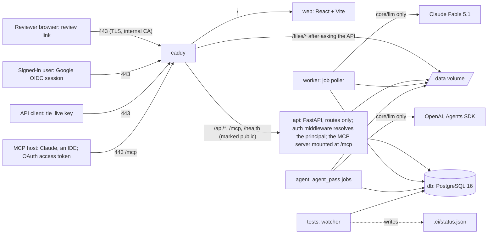
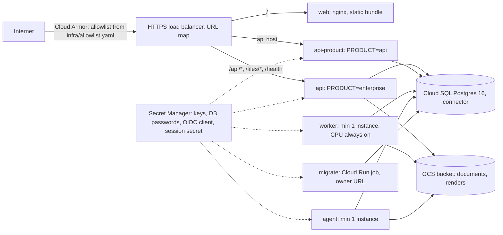

# Architecture

Kept current in the same commit as the code that changes it. Sources of authority: the invariants and locked decisions in `CLAUDE.md`, the inheritance choices in `docs/INHERITANCE.md`, dated decisions in `docs/DECISIONS.md`.

## Components



| Service | Image | Command | Notes |
| --- | --- | --- | --- |
| `db` | `postgres:16` | default | databases `tender` (app) and `tender_ci` (watcher and pytest) |
| `api` | `infra/docker/Dockerfile.python` (target `app`) | `uvicorn api.main:create_app --factory` | routes only; no business logic, no LLM calls |
| `worker` | same image | `python -m worker.main` | one process; polls `job` every 2 s and runs the parse → section map → extract → validate chain; claims only the job kinds it has handlers for |
| `agent` | same image | `python -m agent.main` | the independent agent pass (Stage 5A): one process that claims only `agent_pass` jobs and runs the OpenAI Agents SDK loop, every model call logged through `core/llm/agent_calls.py` |
| `web` | `infra/docker/Dockerfile.web` | Vite dev server | the reviewer screen; calls `/api/v1/*` through `web/src/api/` only |
| `caddy` | `caddy:2` | `infra/Caddyfile` (routes in `infra/Caddyfile.routes`) | TLS with Caddy's internal CA on the static IP; marks API requests as public; serves stored files from `/data` (read-only mount) after `forward_auth` to the API |
| `api-e2e`, `caddy-e2e`, `playwright` | tests image, `caddy:2`, `mcr.microsoft.com/playwright` | compose profile `e2e`, started only by `make test-ui` | the browser tests: an API on database `tender_e2e` seeded by `tests/e2e/seed_review.py` with a scripted model, the same proxy routes over HTTP, and Playwright |
| `tests` | `infra/docker/Dockerfile.python` (target `tests`: dev dependencies plus Node) | `python infra/ci/run_checks.py --watch` | the continuous test pipeline |

## Repository layout

The layout in `CLAUDE.md` is authoritative. Additions made under operating rule 9 (folder added here first, then the code):

| Folder | Purpose | Added |
| --- | --- | --- |
| `infra/docker/` | `Dockerfile.python` (targets `app` and `tests`) and `Dockerfile.web` | Stage 0B |
| `infra/ci/` | `run_checks.py`, the watcher that writes `.ci/status.json` | Stage 0B |
| `infra/hooks/` | git hooks; `pre-commit` blocks a commit over a red or missing status | Stage 0B |
| `infra/db/` | Postgres init script that creates the `tender_ci` database | Stage 0B |
| `core/config.py`, `core/db.py` | settings and engine/session factories shared by api, worker and scripts | Stage 0B |
| `api/v1/schemas/` | Pydantic I/O models for the routers (named in the layout comment for `api/v1/`) | Stage 0B |
| `core/schemas/` | the extraction schema model (`FieldDef`, `FieldGroup`, `ExtractionSchema`), value types and the `SchemaRegistry`; a schema is data handed to core, which knows nothing about tenders | Stage 1 |
| `tender/domain_packs/<pack>/released/` | one file per released schema version (`v1.yaml`, `v2.yaml`): per tender type, every field with its type, unit, allowed values and record keys; written by `scripts/release_schema.py`, never by hand; the pack loader compares versions against them | Stage 3 |
| `web/src/api/openapi.json`, `schema.d.ts` | generated by `make client` from the API; the watcher's `openapi_drift` check fails when they are stale | Stage 0B |
| `migrations/` | Alembic environment and versions (one migration history for core and tender) | Stage 0B |
| `tender/domain_packs/<pack>/` | a domain pack: YAML schemas, prompts under `prompts/<name>/vN.md`, validators (`validation.py` in the core pack, `validation/` in a sector pack) and, for a sector pack, its own `tests/` (collected by pytest through `testpaths`) | Stage 2 |
| `tender/domain_packs/core/value_types.py` | value types the tender schemas add to core's (`money_inr`, `percent`, `duration_months`, `mw`, `mwh`, `kv`, `km`, `record_list`) | Stage 2 |
| `tender/domain_packs/<pack>/derivations/` | the pack's derivation rules: deterministic code that writes the fields of a `derived: true` section from the tender's decided fields (producer `DERIVED`); one module per derived field with a `VERSION`, registered in `__init__.py` (`rules()`, `rule_for(path)`). Never reads a page, never calls a model | 2026-10-08 |
| `tender/services/` | `packs.py` (YAML → compiled types, registered with core), `tenders.py`, `versioning.py`, `current_view.py`, `field_defs.py`, `extraction_summary.py` | Stage 2 |
| `api/v1/tenders/` | the tender router | Stage 2 |
| `core/evidence/` | the quote resolver (`resolver.py`) and its corpus loader (`corpus.py`); imports nothing from the rest of core | Stage 2 |
| `tests/core/evidence_corpus/` | real and deliberate cases for the resolver, with page text and character boxes | Stage 2 |
| `tests/scripts/` | tests of the management commands in `scripts/` | Stage 2 |
| `core/services/extract_plan.py`, `core/llm/pricing.py` | which field groups share a page window; what a call costs | Stage 3 |
| `tender/models/review.py`, `tender/services/tokens.py`, `tender/services/review.py` | review tokens and snapshots; the reviewer's view of a tender and completing a review; from 2026-10-15 the review round a token opens (`round_no`, `from_version`; `tender_review`'s scope and counts over it) | Stage 3 |
| `tender/services/rounds.py` | `RoundOpener.after_validation`: a reviewed tender that a later version's validated run reaches gets a round for its reviewer, scoped to that version, when nothing else of it is under way and no link is live; audited as `open_round` | 2026-10-15 |
| `api/middleware/review_token.py`, `api/middleware/audit.py` | named in the layout; built in Stage 3 | Stage 3 |
| `api/v1/tenders/review.py` | the review router (tokens, session, tender review, completion, snapshot, file authorisation) | Stage 3 |
| `web/src/review/` | `ReviewApp` (the link), `ReviewScreen` (the two panes, keys, saving), `SectionList`, `FieldCard`, `EditForm`, `EvidenceChip`, `PdfPane` with `pdfText` (pdf.js), `SummaryPage`, `MessagePage`, `model.ts`; `AmendmentsPage` and `AmendmentCard` (2026-10-12, the amendments side by side with the document), `DecisionNote` (a remark with an approval) | Stage 3 |
| `tender/services/amendments.py` | the amendments of a tender as the reviewer checks them: per later version, the fields it states against what stood before (a projection of the review, nothing written) | 2026-10-12 |
| `core/services/spreadsheet.py` | a workbook (.xlsx) rendered once, deterministically, to a text PDF for the parser (one block per row, one line per cell, sheet by sheet); `IngestService.upload` stores the rendering under the workbook's own sha256 and filename | 2026-10-13 |
| `tender/services/freshness.py`, `api/v1/admin/freshness.py` | the corpus freshness check: each tender's source page (from its manifest) read again, every document it lists hashed and compared with the documents held, new and changed files reported in the audit log (`source_freshness`), the weekly job that queues itself, `GET`/`POST /api/v1/admin/freshness`; nothing ingested | 2026-10-13 |
| `web/src/lib/` | `format.ts` (values by type), `keyboard.ts` (the reviewer's keys) | Stage 3 |
| `web/e2e/`, `web/playwright.config.ts` | the Playwright suite, run by `make test-ui` | Stage 3 |
| `tests/e2e/seed_review.py` | seeds the browser-test database | Stage 3 |
| `infra/Caddyfile.routes`, `infra/Caddyfile.e2e` | the proxy routes shared by the deployed site and the browser-test stack: `/api/*`, `/files/*`, `/health` and, since Stage 5D, `/mcp`, `/authorize`, `/token`, `/register`, `/.well-known/*` go to the API with the public mark; everything else to the web app | Stage 3, 5D |
| `scripts/review_token.py`, `scripts/gen_field_trace.py` | review links; `docs/FIELD-TRACE.md` | Stage 3 |
| `evals/` | `gold.py` (a completed review as a YAML record under `evals/gold/<type>/<slug>.yaml`), `runner.py` (scores candidates against gold records; `evals/results/`), `feedback_report.py`, `report.py` (`RELIABILITY-REPORT.md`, `REVIEW-LOG.md`), `reliability.py` (the composite figures and the two accuracy sentences from the result files, Block 7 b; also behind the MCP tool `reliability_report`); imports core and tender, is imported only by the admin router and the scripts | Stage 4 |
| `scripts/make_gold.py` | `make gold TENDER=<slug>`: the gold record of a completed review, then the report | Stage 4 |
| `api/v1/admin/` | the reliability router, behind the admin token (`api/middleware/review_token.py`) | Stage 4 |
| `web/src/admin/` | `ReliabilityPage` at `/admin/reliability` | Stage 4 |
| `tests/evals/` | the runner's match rules, a gold record from a completed test review, the feedback report, the report on two fixture records | Stage 4 |
| `evals/threeway.py` | the three-way comparison: per gold field the reviewer's value, the engine's reading in review and the agent's standing finding, one of six agreement classes each; `docs/reports/THREEWAY-REPORT.md`, `evals/results/<stamp>-threeway-<tenant>.json`, `evals/results/review-emphasis-<tenant>.json` (the production confidence rule) | Stage 5B |
| `scripts/agent_pass.py` | `make agent-pass`: queue the agent pass over every gold tender at its reviewed version (`--gold`), or one tender (`--tender`, `--version`); a tender with a pass at that version is skipped unless `--again` | Stage 5B |
| `tests/evals/test_threeway.py` | the six classes on fixture readings, the emphasis rule at and below its thresholds, the report on fixture rows, tenders without a pass left out | Stage 5B |
| `agent/` | named in the layout, built in Stage 5A: `models.py` (`agent_run`, `agent_finding`), `inputs.py` (what the agent is given: documents with the pages the section map names, the fields), `harness.py` (the three tools, the judge of a finding, the SDK driver), `service.py` (start, run, read back), `main.py` (the container's poll loop) | 5A |
| `core/llm/agent_calls.py`, `core/llm/prompts/agent_pass/` | the OpenAI model behind the agent, wrapped so every turn writes an `llm_call_log` row; the agent's instructions as a registered prompt version | 5A |
| `tests/agent/` | the harness, the inputs, the service and the container's poll loop, driven by a scripted driver instead of a model | 5A |
| `core/models/identity.py` | `app_user`, `login_session`, `api_key`, `usage_record` (Stage 5C); `tenant.plan` in `core/models/tenant.py` | 5C |
| `core/services/identity.py`, `core/services/oidc.py` | the principal (a user or an API key, its tenant, the tenants it may read, its role and scopes) and `IdentityService`: sign-in from verified Google OIDC claims, sessions, API keys, the rate limit and daily cap counted from `usage_record`, usage metered to the calling tenant | 5C |
| `api/middleware/auth.py` | installed in place of `review_token.install`: resolves the request's principal — review token, then the `tie_session` cookie, then a Bearer `tie_live_` key, then `X-Admin-Token` — scopes the request session to its tenant, applies the role matrix, counts the rate limit and writes the usage record; `review_token.py` keeps `_admit` and `ALLOWED` for the review-link case | 5C |
| `api/v1/core/auth.py`, `api/v1/admin/identity.py` | `/auth/login`, `/auth/callback`, `/auth/logout`, `/auth/me`; `/admin/users`, `/admin/api-keys`, `/admin/review-tokens`, `/admin/usage` | 5C |
| `tender/services/publication.py`, `published.py`, `changelog.py`, `compare.py`, `published_pdf.py` | the publication state of a tender; the published view (canonical facts only); the changelog across versions; the comparison of tenders; the PDF export with its page-reference appendix | 5C |
| `api/v1/tenders/published.py` | `GET /tenders/{id}/published`, `/published.pdf`, `/changes`, `GET /tenders/compare` | 5C |
| `core/storage/gcs.py`, `api/v1/core/files.py` | the GCS backend behind the one storage interface (`STORAGE_BACKEND=gcs`, `GCS_BUCKET`); stored files streamed by the API at `GET /files/{path}` after the same authorisation as `files-auth`, for the Cloud Run deployment where no proxy serves `/data` | 5C |
| `infra/cloudrun/` | the Cloud Run deployment: README runbook of the gcloud commands the owner runs, one service YAML per process (`api`, `api-product`, `worker`, `agent`, `web`), the migrate job, `deploy.sh`, the Cloud Armor policy made from `infra/allowlist.yaml` | 5C |
| `infra/docker/Dockerfile.python` (target `prod`), `infra/docker/Dockerfile.web.prod` | production images: no reload, no mounts; the web bundle built once and served by nginx (`make build-prod`) | 5C |
| `web/src/app/`, `web/src/library/`, `web/src/admin/AdminPage.tsx`, `web/src/api/types5c.ts`, `client.ts` | the enterprise front end (Product A): `Shell` (the signed-in header and navigation) and `LoginPage` (Google sign-in) under `app/`; `LibraryPage` (the tenders at `/` and `/tenders`), `PublishedPage` (`/tenders/:id`, with its changes tab at `/tenders/:id/changes`) and `format.ts` under `library/`; `AdminPage` at `/admin` (users, keys, review links, usage); `appApi` in `client.ts` and the 5C types; the review link screens and `/admin/reliability` unchanged | 5C |
| `tests/core/test_rls.py` | row-level security: a cross-tenant read returns zero rows with no tenant filter at all; a write into another tenant or `public` is refused by the database; `public` readable, not writable; a session without a tenant sees nothing | 5C |
| `mcpserver/` | the MCP server of the public library tier (Stage 5D), named so as not to shadow the `mcp` SDK: `server.py` (`build_server`, `asgi_app`; the `MCPServer` of the `mcp` 2.3 SDK mounted at `/mcp` on the api service, stateless streamable HTTP; `UiExtension` advertises `io.modelcontextprotocol/ui` and serves the widgets as `ui://widgets/<name>.html` resources with mime `text/html;profile=mcp-app`), `tools.py` (`ToolContext`, `ToolResult(structured, text)`, `run_tool` — the tier guard, the free limits, usage recorded as `mcp:<tool>` to the calling tenant — and the eleven tools, each calling the library services of `tender/services/`), `auth.py` (`LibraryTokenVerifier`: a bearer token is an `api_key` row; `LibraryOAuthProvider`: dynamic registration of public clients under tenant `public`, PKCE S256, single-use codes of ten minutes, access tokens as `api_key` rows named `mcp:<client_id>` scoped `public:read`, plus `own:read` for an enterprise plan, no refresh tokens) | 5D |
| `mcp/widgets/` | the four self-contained widgets (`tender_card.html`, `financial_model.html`, `changes_view.html`, `comparison_table.html`) and their fixtures under `fixtures/`; a plain folder of files the server reads, no package and no build step | 5D |
| `tender/models/library.py` | `model_assumption`, `watchlist_entry`, `correction_case`, `publication_hold`, `oauth_client`, `oauth_code` (migration 0019, each under the row-level policies of 0018) | 5D |
| `tender/services/finance.py` | the one deterministic financial engine, `power_project_finance` (`FixedInputs`, `Assumptions`, `Outputs`, `irr` by bisection): serves the widget, the front end and the API alike | 5D |
| `tender/services/model_inputs.py` | `fixed_inputs(view)` and `PATHS`: the engine's `FixedInputs` read from the published view, each parameter with the page it came from; never a candidate | 5D |
| `tender/services/library.py`, `tender/services/corrections.py` | the library: `normalise`, `search_tenders`, `score_match` and `find_matching_tender` (`match_threshold`, 0.75), `signup` (a tenant `free-<12 hex>` of plan `free` with a `reviewer`-role user), `watchlist_*`, `upsert_assumptions`, `saved_assumptions`, `model_tender`, `fixed_parameters`; corrections: `open_case` (a case never changes a value: it opens a review round scoped to the version that set the field), `resolve_case`, `cases`, `place_hold`/`lift_hold` (a takedown or a correction hold suspends publication whatever the review state; `publication.standing_hold` answers `publication_suspended` with `suspended_by=["hold:<kind>"]`), `append_takedown_row` (the "Takedowns" table of KNOWN-GAPS, written on first use) | 5D |
| `api/v1/tenders/library.py`, `api/v1/admin/library.py`, `api/v1/core/oauth.py` | the library routes (search, match, model, assumptions, watchlist, corrections, sign-up), the admin routes (corrections, holds) and the OAuth consent page | 5D |
| `tender/domain_packs/result/` | the result pack (Stage 6): `pack.yaml` (`object_type: award`, `namespace: result`), `award.yaml` (the fields of one result publication: procurer, reference, kind, date, the winners table), `validation/` (five deterministic cross-field rules over the winners table and the run rule `award_rows_located`); no prompts, nothing in it is read by a model | 6 |
| `tender/models/award.py` | `award`: one row per imported result publication, its provenance (dataset and commit, source id, URL, sha256, verification tier) and its optional link to a tender (migration 0020) | 6 |
| `tender/services/results_import.py`, `tender/services/source_domains.py`, `tender/services/awards.py` | the importer (`Dataset`, `ResultsImporter.run`: allowlist check, hash check, ingest and parse, one `import` run per publication, candidates with their quotes resolved, validation, the tender link, a report), the source allowlist (`SourceAllowlist.load` of `infra/source-domains.yaml`, `admissible`, `hosts`), and the award's view, completion and canonical results (`AwardService`) | 6 |
| `api/v1/awards/awards.py`, `api/v1/schemas/awards.py` | the award routes: list, one award, its review, its review state, its approved results, completion, and a tender's linked awards | 6 |
| `scripts/import_results.py` | the management command that runs the importer once per dataset commit (`--root`, `--only`, `--report-json`) | 6 |
| `infra/source-domains.yaml` | the committed source allowlist: the agencies' and the regulator's own domains; a subdomain qualifies, nothing else does | 6 |
| `tests/fixtures/results/` | one real one-page SECI result sheet from the dataset with its data.json slice and SECI research record, for the end-to-end test of the import | 6 |
| `core/retrieval/` | retrieval (Stage 7, Block 5): `chunks.py` (clause-aware chunking, pure), `store.py` (Haystack's pgvector store over `retrieval_chunk`, one per tenant, the tenant scope set on its connection), `embeddings.py` (the `local` fastembed model or `none`, every run logged), `indexer.py` (`ChunkIndexer`, the `index_document` and `embed_pending` jobs), `query.py` (`Retriever`: keyword and embedding legs joined by reciprocal rank fusion, keyword alone when the embedding leg is off or fails); the keyword leg asks for every word of the question, then for any word with at least two of them in the chunk (`KEYWORD_ANY_QUERY`, `MIN_TERMS`) | 7.5 |
| `core/models/retrieval.py` | `retrieval_chunk` (migrations 0023 and 0024): Haystack's columns plus `tenant_id` under the row-level policies and the audit columns, with the indexes the store looks for declared on the model | 7.5 |
| `tender/services/ask.py`, `ask_fields.py`, `ask_across.py`, `retrieval_meta.py` | `AskService` (field route from the record, retrieval route from passages, every quote resolved, amendment note, never a fact); the question-to-field mapping; the cross-tender structured search over approved facts; what the tender layer puts on a chunk | 7.5 |
| `api/v1/tenders/ask.py` | `POST /tenders/{id}/ask`, `POST /tenders/ask`, `POST /tenders/{id}/index` | 7.5 |
| `core/llm/prompts/independent_review/` | the rule-15 checklist as a registered prompt (`scripts/independent_review.py` runs it on `REVIEW_MODEL`) | 7.5 |
| `evals/questions/`, `evals/ask_eval.py` | the fifty-question set over the gold tenders and its runner (`make ask-eval`): answer accuracy and citation-resolution rate | 7.5 |
| `scripts/blind_check.py` | Block 4 as an unreviewed check (the owner's decision of 2026-10-27): evidence location, confidence bands, rule pass rate, type classification against the manifest, amendment linking against the manifest, change classes, per blind tender; writes `docs/reports/stage-7-artifacts/block-4-check.{md,json}` | 7.4 |
| `tests/mcpserver/`, `tests/mcp/` | `tests/mcpserver/`: the tools (6), the server (6), the OAuth flow (2); `tests/mcp/`: the widget rules (8) and the widget-against-engine agreement (1, 32 cases, run with node) | 5D |
| `web/src/widgets/` | `widgets.test.ts`: the four widgets rendered under jsdom from their fixtures (6) | 5D |
| `tender/services/submit.py` | submission for any caller (Stage 7, Block 6 a): `SubmitService.submit_tender` (a file or an official URL; the same file again is the same tender, `created: false`), `submit_amendment` (the link check of Block 3 first: a document naming another tender is refused with the candidates unless `force`), `Fetcher` (official domains only, `infra/source-domains.yaml`), the `tender_extract` job (waits until the version's documents are parsed and, with no type named, until the classifier answered, then starts the reading; `submit_run_mode` batch or sync, `priority` for sync) | 7.6 |
| `tender/services/status.py`, `tender/services/snapshot.py` | `tender_status` (per version its documents, runs and pending jobs; `stage_of` one of submitted, parsing, mapping, extracting, validated, failed; `extraction_done`; review and publication state) and `tender_snapshot` (contract v1: every field with value, unit, state `value`/`withdrawn`/`not_stated`, source `approved`/`machine`/`none`, confidence, version, evidence located on its page); both read only | 7.6 |
| `core/services/webhooks.py`, `core/models/webhook.py` | webhooks (Block 6 b): `register`, `deactivate`, `emit` (one pending delivery per subscribed active endpoint, queued as `webhook_deliver`), `Deliverer` (signed POST, `X-Tender-Signature: t=…,v1=<HMAC-SHA256>`, six attempts with backoff), `sign`/`verify`; `webhook_endpoint`, `webhook_delivery` (migration 0025) | 7.6 |
| `api/v1/tenders/contract.py` | the REST v1 router for callers: submit, submit-amendment, status, fields, review-link, webhooks | 7.6 |
| `scripts/export_contract.py`, `docs/contracts/` | the published contract: `snapshot.v1.schema.json` (additive only), `openapi.v1.json` (OpenAPI 3.1 of the caller's routes), `functions.v1.json` (the same as function definitions for a model); `--check` is the `contract_drift` CI check | 7.6 |
| `client/` | `tender_engine_client.py`: the thin Python client for a product (standard library only; `TenderEngine`, `wait_until_done`, `verify_webhook`); a folder added to the layout for Block 6 d | 7.6 |
| `docs/CONNECTOR.md` | how to connect from Claude Code, Claude.ai, ChatGPT, the OpenAI Responses API and a Python product | 7.6 |

## Data model

| Table | Purpose | Who writes it | Stage |
| --- | --- | --- | --- |
| `tenant` | one row per tenant; `ergplan` seeded by migration 0001; `plan` (migration 0017: `enterprise`, `free`, `public`) and the reserved `public` library tenant seeded for Stage 5D. No `tenant_id` of its own, so no row-level policy | migration only; from Stage 5D, sign-up | 0B, 5C |
| `llm_call_log` | one row per LLM call: prompt name and version, model, input hash, output, tokens (`tokens_in` is the uncached input; `cache_write_tokens` and `cache_read_tokens` are the rest of it), `mode` (`sync` or `batch`), `batch_id`, `cost_usd` with the cache and batch factors applied, latency, status, request id, `extraction_run_id`; `agent_run_id` (migration 0016) for a turn of the agent pass | `core.llm.client.LLMClient` only (`call`, and `collect_batch` for calls read from a batch); `core.llm.agent_calls.LoggedModel` for the agent's turns | 0B, 1, 3, 5A |
| `llm_batch` | a batch handed to the provider's batch API: provider batch id, run, wave (1 writes shared windows to the cache, 2 reads them), status `submitted/collected`, the custom id and input hash of each call | `LLMClient.submit_batch`; status by `collect_batch` | 3 |
| `document` | an uploaded PDF: sha256 (unique per tenant), filename, mime, page_count, storage_path, status `uploaded/parsed/failed`, error; provenance `source_url` and `retrieved_on` (migration 0013, nullable; a later upload of the same file fills them where blank, never overwrites) | `IngestService.upload`; status and page_count by `ParseService.parse` | 1 |
| `page` | per page: text, width and height in PDF points, `render_path` (PNG at 150 dpi), `char_boxes` (one `[x0, top, x1, bottom]` per character of `text`, null for layout whitespace), `has_text_layer` | `ParseService.parse` | 1 |
| `section` | contiguous page range with heading, free-text `kind`, confidence, prompt version | `SectionMapper.map` | 1 |
| `extraction_run` | one extraction of one document with one schema and prompt version, for one object (`object_type`, `object_id`, `object_version`); status `queued/running/extracted/validated/failed`, `mode` (`sync`, `batch`, or `record` for a run whose candidate was written from the object's record and read no page), tokens (`token_in` is the whole input, `token_cached` the part read from the prompt cache), cost | `ExtractService.start_run` and `.extract`; `ValidationService.validate` sets `validated` | 1 |
| `candidate` | model output for one field: value (jsonb), value_type, confidence, rationale, status `raw/validated/needs_review/superseded/not_found/rejected`, prompt name and version, the call log row, the page window, `withdrawn` (migration 0014: the document removes the provision — value null, the evidence the removing words; distinct from `not_found`, which has no evidence, and from a plain null) | inserted by `ExtractService` only (`extract`, and `record_candidate` for a candidate written from the record); **immutable** except `status` (trigger `candidate_immutable`) | 1, 3 |
| `evidence_span` | where the value is written: document, page, bbox, char range, quote, how it was located (`stated_page/adjacent_page/window_page/unresolved`), match score | inserted by `ExtractService` only; **append-only** (trigger) | 1 |
| `validation_result` | one row per rule per candidate: rule name, passed, message | `ValidationService.validate` | 1 |
| `approval` | a reviewer's decision `approved/edited/not_in_document/rejected/flagged` with final value, reviewer, note; `active` or `superseded`. A flag ("unsure, come back") keeps the note, withdraws an earlier decision and decides nothing | `ApprovalService.approve` only | 1, 3 |
| `canonical_fact` | truth: object, version, field, value, value_type, approval, evidence copied from the candidate (plus the reviewer's decision when it was not a plain approval), `is_current`, `withdrawn` (migration 0014: the fact is that this version withdrew the provision; value null) | **`ApprovalService.approve` only**. Trigger `canonical_fact_guard` (migration 0004): a row is accepted only under a live approval (active, and one of approved, edited, not_in_document since migration 0008) of the same tenant, object, version and field; afterwards it can be retired (`is_current`, `superseded_at`) once its approval is superseded, and never changed or deleted | 1 |
| `feedback` | candidate value, final value, `delta_kind` (`format/wrong_value/missing/extra`), reviewer, prompt version | `ApprovalService.approve` only; nothing reads it at runtime | 1 |
| `audit_log` | actor, action, table, row id, before, after, at | `core.services.audit.record`, called by extract, validate and approve; **append-only** (trigger) | 1 |
| `job` | kind, payload, status `queued/running/done/failed`, attempts, max_attempts, last_error, run_after | `core.services.jobs` | 1 |
| `tender` | tender_type, issuing_agency, external_ref, title, slug (folder name for tenders ingested by the command), status `ingested/extracted/in_review/reviewed/published/superseded` (superseded: built again as a new tender, 2026-10-15), current_version_id | `tender.services.tenders.TenderService` | 2 |
| `tender_version` | tender_id, version_no, kind `original/corrigendum/amendment/clarification`, issued_on, summary_of_change, supersedes_version_id. Never edited: a change to a tender is a new row | `TenderService.add_version`; audited | 2 |
| `tender_version_document` | tender_version_id, document_id, role (`rfs`, `amendment`, `clarification`, `ppa`, `psa`, `cfda`, `technical`, `contractual`, `nit`) | `TenderService.add_version` and `attach_document`; audited on the version | 2 |
| `review_token` | the link a reviewer opens: token (32 random url-safe characters, unique), `object_type` and `object_id` (a tender, or since Stage 6 an award; migration 0020, `tender_id` kept for a tender's token), reviewer_name, expires_at (30 days), completed_at, revoked_at; `round_no` (1 = the whole tender) and `from_version` (the version that opened a later round; migration 0015, 2026-10-15). One live token per object | `tender.services.tokens.TokenService.create` (`create_for` for an award) (revokes the earlier one; audited) and `open_round` (a round for the reviewer of the last completed review, called by `tender.services.rounds.RoundOpener` when a later version's run is validated); `completed_at` by `tender.services.review.complete_review` | 3 |
| `tender_review_snapshot` | the current view of a tender when its review was completed (jsonb: every field's final value, version and evidence, the reviewer, the flagged fields), for the gold set | `tender.services.review.complete_review`; audited on the tender | 3 |
| `tender_field_def` | the compiled schemas, one row per tender type and field: path, namespace (`core` or `sector`), domain, subdomain, section, label, value_type, required, help_text, review_order | `tender.services.field_defs.sync_field_defs` when the API starts; replaced only when the packs changed | 2 |
| `agent_run` | one pass of the independent agent over one object version (`object_type`, `object_id`, `object_version`), its schema and prompt version, the OpenAI model, status `queued/running/done/stopped/failed`, turns, tokens (`tokens_in` the whole input, `tokens_cached` the part served from the provider's cache), `cost_usd`, error, `documents` (the pass's documents by number), `pages_offered` and `pages_read` per document | `agent.service.AgentPassService.start` (queued) and `.run`; closed by `agent.harness.Harness.finish`; audited | 5A |
| `agent_finding` | what the agent submitted for one field, as the harness judged it: `ordinal` (the attempt's place in the run), value (jsonb), value_type, confidence, rationale, status `accepted/not_found/withdrawn/rejected/superseded`, `reason` for a rejection, `evidence` (each quote as cited and as located on the cited page: document, page, char range, bbox, score, method). Never a candidate, never a canonical fact | `agent.harness.Harness` only (`submit_finding`); status to `superseded` when a later finding for the field stands; audited | 5A |
| `app_user` | a person who signs in: email (unique per tenant), display name, role `reviewer/approver/admin/api_client`, status `active/disabled`, `oidc_subject` (Google's stable subject), `last_login_at` | `core.services.identity.IdentityService` on the first verified sign-in (the default role, or `admin` for a bootstrap address) and from `/admin/users`; audited | 5C |
| `login_session` | a signed-in browser: the hash of the random cookie token, user, `expires_at` (`SESSION_HOURS`), `revoked_at`, `last_seen_at` | `IdentityService` at sign-in and sign-out | 5C |
| `api_key` | a key of the intelligence API: name, owner user, `prefix` (the first characters, shown), `key_hash` (sha256 of the key shown once), `scopes` (`read`, `model`), `rate_limit_per_min`, `daily_cap`, `expires_at`, `revoked_at`, `last_used_at` | `IdentityService` from `/admin/api-keys`; audited | 5C |
| `usage_record` | one row per metered call: `tenant_id` is the **calling** tenant, `resource_tenant_id` whose data was read, user or API key, `tool` (route or MCP tool), `tier` (`internal/enterprise/free/api`), units, tokens, status. The rate limit and the daily cap are counts over it | the auth middleware after each metered request; the MCP tools for their calls (5D) | 5C |
| `model_assumption` | a user's assumptions for one financial model of one tender (`model_type`, `assumptions` jsonb; `tender_tenant_id` says whose tender): never a canonical fact, never in the published view, `get_tender` or `compare_tenders` | `tender.services.library.upsert_assumptions` (`save_model_assumptions`, `PUT /tenders/{id}/assumptions`), in the caller's tenant | 5D |
| `watchlist_entry` | a tender a user follows (`tender_id`, `tender_tenant_id`) | `tender.services.library.watchlist_*` (`my_watchlist`, `/me/watchlist`), in the caller's tenant | 5D |
| `correction_case` | a claim that a published field is wrong: tender, field, the claimed error and reasoning, the claimant (tenant, user, address), status `open/accepted/rejected`, resolution. Changes no value: it opens a review round for the field | `tender.services.corrections.open_case` in the system scope, in the tender's tenant (`public` for a library tender), on the claimant's behalf (a signed-in principal or a `claimant_email` from the public form); `resolve_case`; audited | 5D |
| `publication_hold` | a takedown or a correction hold on a tender: kind, reason, who asked, `lifted_at`/`lifted_by`. While one stands the tender's publication is suspended whatever its review state | `tender.services.corrections.place_hold` and `lift_hold`, in the system scope, in the tender's tenant, by an admin; audited | 5D |
| `oauth_client` | an MCP client registered with the library's authorization server (RFC 7591 dynamic registration): `client_id`, name, redirect URIs, scopes; public clients with PKCE, no secret | `mcpserver.auth.LibraryOAuthProvider` at dynamic registration, tenant `public` | 5D |
| `oauth_code` | an authorization code issued to a signed-in user for a client: hash, client, user, redirect URI, scopes, PKCE challenge, expiry, `used_at` (exchanged once) | `LibraryOAuthProvider` at consent (`POST /api/v1/oauth/consent`); `used_at` at the token exchange; a code lives ten minutes | 5D |
| `award` | one result publication imported from the RE-tender-results dataset (Stage 6): `document_id` (its PDF, ingested like any document), `source_id`, `source_sha256` (unique per tenant; equal to the document's and to the dataset's), `source_url`, `source_name`, `dataset` (`RE-tender-results@<commit>`), `procurer`, `reference` (RfS or petition number), `result_kind`, `verification` (the dataset's tier), `row_count`, `tender_id` with `tender_link_basis` (`rfs_number`: exact match on `tender.external_ref`; `page_text`: the tender number found verbatim in the order, with `tender_link_page`), `status` `imported/reviewed`. The row is identity and provenance; what the publication says is in the candidates of its `import` run and, once approved, in `canonical_fact` | `ResultsImporter.run` (insert, link), `AwardService.complete_review` (status) | 6 |
| `webhook_endpoint` | a caller's URL with `events` (jsonb), `secret`, `description`, `active` | `core.services.webhooks.register` / `deactivate` from `/webhooks`; audited | 7.6 |
| `webhook_delivery` | one event sent to one endpoint: `event`, `payload` (jsonb), status `pending/delivered/failed/cancelled`, `attempts`, `last_status`, `last_error`, `last_attempt_at`, `delivered_at` | `webhooks.emit` writes it, `Deliverer` updates it from the `webhook_deliver` job; audited | 7.6 |

Every table carries `tenant_id`, `created_at`, `created_by` through `core.models.base.TenantAuditMixin`; a test fails if a table is added without them.

**Row-level security (Stage 5C, migration 0018).** Every table with a `tenant_id` has `ENABLE` and `FORCE ROW LEVEL SECURITY` and its policies (four; the tenant registry two): a row is read when `tenant_id` equals the session setting `app.tenant_id` or is in the comma list `app.read_tenants`, and inserted, updated or deleted only when it equals `app.tenant_id`; the scope `*` (`core.db.SYSTEM_TENANT`) passes every policy and is set only by the identity steps that must look across tenants before a tenant is known (a login, a review link, an API key). `core.db` sets both settings with `set_config(…, true)` at the start of every transaction from `session.info` (`make_session_factory(engine, tenant_id, read_tenants=…)`; `set_tenant` for a session already made); a session with no tenant sees nothing. A superuser bypasses row-level security whatever `FORCE` says, and the compose database's owner `tender` is one, so the app connects as `tender_app`, a role created by the migration with no ownership (`DATABASE_URL`); migrations and the test clean-up run as the owner (`MIGRATION_DATABASE_URL`, `TEST_DATABASE_URL` against `TEST_APP_DATABASE_URL`). `tests/core/test_rls.py` reads across with no tenant filter and gets zero rows, and sees the database refuse a write into another tenant and into `public`.

Invariants the database itself enforces (migration 0002): a `candidate` row can be neither deleted nor updated in any column but `status`; `evidence_span` and `audit_log` rows can be neither updated nor deleted. Tests in `tests/core/test_invariants.py` try each and expect the refusal.

A candidate, approval and canonical fact belong to an **object** (`object_type`, `object_id`, `object_version`). In Stage 1 the object is the document itself (`object_type = "document"`, version 1). Stage 2 passes `tender` and the tender version number, which is how a canonical fact becomes attached to a tender version without core knowing what a tender is.

## Truth pipeline

| Step | Function | Writes |
| --- | --- | --- |
| upload | `core.services.ingest.IngestService.upload` | `document` with its `source_url` and `retrieved_on` when the caller knows them (`POST /api/v1/documents` form fields; the manifest's per-file `source`/`retrieved_on`, else the tender page), file in storage, `job(parse)`. Same sha256 returns the existing document and fills the provenance it lacks |
| parse | `core.services.parse.ParseService.parse` | `page` rows (pdfplumber text and character boxes, pymupdf render), `document.status = parsed`, `job(section_map)` |
| section map | `core.services.section_map.SectionMapper.map` | `section` rows from one model call over a digest of every page (first 400 characters plus heading-like lines) |
| start run | `core.services.extract.ExtractService.start_run` | `extraction_run`, `job(extract)`. Refuses an unknown schema or an unregistered prompt version |
| extract | `core.services.extract.ExtractService.extract` | per field group: pages chosen by `select_pages` from the group's routing hints (the sections whose kind or heading the hints name, plus up to 12 pages outside them that mention the group's keywords, taken keyword by keyword so a frequent keyword cannot crowd out a rare one), sent as a native PDF of at most 40 pages per call. Groups whose windows overlap enough are read from one shared window, sent as a cached prefix (`core.services.extract_plan.share_windows`, see "Cost of extraction" below); output model built by `build_group_model` requires value, confidence, rationale and evidence for every field. Inserts `candidate` and `evidence_span`, then `job(validate)` |
| locate evidence | `core.evidence.resolve`, driven by `ExtractService._resolve` | each quote is matched on the stated page, then the adjacent pages, then the rest of the window. Four matchers in order (the fourth, added in Stage 2, finds the quote's words in order with other words between them, for a column of a two-column table; at least 90% of the words and every number must be found): exact after normalisation, on word boundaries only ("50 MW" is not found inside "250 MW"); rapidfuzz at threshold 85, for quotes of 12 characters or more; and, for quotes that hold a number, the quote's words in any order over consecutive page words with every number unchanged (wrapped table cells). Unlocated: the span is stored as `unresolved` and the candidate's confidence is capped at 0.3 |
| validate (deterministic) | `core.services.validate.ValidationService.validate` | `validation_result` rows (a `withdrawn` candidate passes the rule `withdrawn` and skips the type and field rules, having no value; its evidence must still locate): `evidence_located` or `evidence_not_located` (also when only some of a candidate's quotes were found), `type`, `range`, `regex`, `required_present`, and the schema's cross-field rules, written on every typed candidate of the fields a rule concerns. Sets `candidate.status` to `validated` or `needs_review`. No model call |
| derive (deterministic) | `tender.services.derive.DerivedWriter.write` | once every field a rule reads is decided: for each field of a `derived` section, the pack's rule (`tender/domain_packs/<pack>/derivations/`) computes the rows from the decided values; `candidate` in a run of `mode = "derived"` (no model, `llm_call_log_id` null, `model = "none (deterministic derivation)"`), its `evidence_span` rows copies of the decided fields' located spans, `prompt_name = derive`, `prompt_version` the rule's version; the earlier table leaves review (`supersede`); then `job(validate)`. A table no decided clause supports is stored `not_found` with its all-not-addressed rows and no evidence (`ExtractService.unsupported_candidate`), shown with that reason, not approvable |
| import (deterministic, Stage 6) | `tender.services.results_import.ResultsImporter.run` → `core.services.extract.ExtractService.import_candidate` | for each source publication of the dataset: `document` (ingested, parsed, no section map), `award`, one `extraction_run` in mode `import` (`model = RE-tender-results@<commit>`, prompt label `import/re-tender-results v1`, no `llm_call_log`), `candidate` rows holding the dataset's values at confidence ≤ 0.8 with `evidence_span` rows resolved by core's resolver on the cited page (a row's bidder and its price or capacity; a quote not found stays `unresolved` and the candidate unlocated), then `ValidationService.validate` as for any run. Model output and dataset rows alike stop at the candidate: nothing here writes a fact |
| read model | `core.services.review_state.ReviewStateService.for_object` | nothing; returns every schema field with its best live candidate, evidence, validation results and active approval, for one version of the object (the latest by default). A version may be extracted by several runs, one per document; the state reads the live candidates of all of them (`runs` lists them) and a field may have candidates from more than one document. A run that is queued, running or failed hides nothing |
| approve → `canonical_fact` (only writer) | `core.services.approve.ApprovalService.approve` | `approval`, `canonical_fact` (for approved, edited, not_in_document), `feedback` when the final value differs (`classify_delta`), `audit_log`. A later decision supersedes the earlier approval and its fact. An identical repeat writes nothing. A plain approval requires that the candidate's evidence was located. An edit of a field that has no located evidence must bring the reviewer's own evidence (page and quote), which is located on the page and stored on the fact as a `reviewer_span`; otherwise it is refused. Unique indexes (migration 0003) allow one active approval and one current fact per field of an object version |

Beside the pipeline, not in it (Stage 5A): the independent agent pass is a second reading of the same documents by a model of another family, through `agent/`. It writes `agent_run` and `agent_finding` and nothing else — never `candidate`, never `canonical_fact` — and its findings are compared with the engine's candidates and the reviewer's gold in Stage 5B. Its harness holds a finding to the same rule as core: a quote must be located by `core.evidence.locate` on the page the agent cites, and the agent must have read that page through `read_pages` before citing it. See "Independent agent pass (Stage 5A)".

Stage 5C adds no step and no writer: `ApprovalService.approve` remains the only writer of `canonical_fact`. The published view (`tender/services/published.py`, `GET /tenders/{id}/published`) reads `canonical_fact` and nothing else — never a candidate — and the identity tables sit beside the pipeline, not in it.

Stage 6 adds the deterministic import step above and no writer: an imported row is a candidate, approved by a reviewer against the PDF like a model's reading, and `ApprovalService.approve` remains the only writer of `canonical_fact`.

Stage 5D adds no step and no writer either. A correction case (`correction_case`, `POST /public/corrections`) never changes a value: it opens a review round scoped to the field, and a reviewer's new approval, through `ApprovalService.approve`, is the only thing that can change what is published; the change then shows in `list_changes` with its date and reason. The MCP tools read the published view, the changelog and the comparison — `canonical_fact` through the same services — and write only a user's own rows (assumptions, watchlist) in the user's own tenant. The financial engine (`tender/services/finance.py`) reads tender-fixed parameters from the published view and the user's assumptions from `model_assumption`; its figures are computed, never stored as facts.

Candidate outcomes that never reach a reviewer as a value: `not_found` (the model returned null; shown as "no value"; it becomes `needs_review` with `required_present` failed when the field is required; it can be decided as not_in_document, or as edited when the reviewer supplies located evidence) and `rejected` (a value came with no quote; stored for the record, never shown, cannot be approved).

A schema is data handed to core: `core.schemas.ExtractionSchema` (field groups with routing hints, fields with value type, unit, range and regex) registered in a `SchemaRegistry` together with any cross-field rules. Core names no tender field. In Stage 1 the deployed API and worker start with an empty registry; the tender schemas are registered in Stage 2. Tests register a small contract schema and, for the end-to-end run, a 12-field FDRE schema (`tests/fixtures/`).

The LLM boundary is `core/llm/`: `core.llm.client.LLMClient.call(LLMRequest) -> LLMResponse` loads a registered prompt version through `core.llm.registry.load_prompt`, calls the model with a Pydantic output schema, and writes `llm_call_log` for every outcome including failures. Nothing else in the codebase may call the Anthropic SDK. From Stage 5A the boundary has a second door for the other model family: `core.llm.agent_calls.LoggedModel` wraps the OpenAI Agents SDK's model so that every turn of the agent pass writes an `llm_call_log` row (prompt `agent_pass/v1`, the OpenAI model, input hash, output items, tokens with the cached part told apart, cost at the configured list prices, latency, status); nothing else in the codebase may call OpenAI. Prompts: `core/llm/prompts/section_map/v1.md`, `core/llm/prompts/extract/v1.md` and `extract/v2.md` (2026-10-15: the withdrawal rule — a provision the attached pages remove is returned as `withdrawn: true` with value null and the removing words as evidence, never inferred from silence and never for a value that merely changed; `build_group_model` adds `withdrawn`, default false, to every field answer).

### Cost of extraction (Stage 3)

Native PDF pages cost about 2,800 input tokens each, and in Stage 2 every field group sent its own pages. Two things reduce that, both inside `core/llm/` and `core/services/extract.py`:

- **Shared windows as a cached prefix.** `share_windows` takes each group's window and merges windows step by step, always the two whose union makes their groups read the fewest extra pages, and keeps the cheapest partition it passes. The cost of a window is counted in uncached pages: one group pays every page in full; several pay one cache write (1.25 times the input price, 2 times for the one-hour cache of a batch run) and a cache read (0.025 times) for each further group; every call also costs its output, weighed as 6 pages. A merged window is the union of its groups' pages and never exceeds the 80-page cap of a group. A call on a shared window marks its PDF with `cache_control`; everything before that mark must be the same for the calls that share it, so the system prompt is the text all section prompts inherit (`extract/v1`, `Prompt.shared_text`) and the section's own text (`Prompt.own_text`) follows the document. The prompt files are unchanged. The output schema is part of the prefix too, so the calls on a shared window all send one schema that fits any group (`SharedAnswer`: a list of entries with key, value, confidence, rationale and evidence); `typed_answer` then checks the answer against the group's own typed model (every field present once, values of the right kind), and a call whose answer does not pass is made again on its own with the typed model. A window that is not shared is sent exactly as in Stage 2, typed model included. Calls are made window by window, chunk by chunk, and group by group within a chunk, so the readers follow the writer while the entry is alive. The same pages always give the same PDF bytes (`_sub_pdf` writes no fresh file id).
- **Batch API.** A run has a `mode`. `batch` is for runs nobody waits for (`python -m scripts.ingest_tenders extract`, and `"mode": "batch"` on `POST /tenders/{id}/extract`); `sync` stays the default of the API. A batch run goes through `ExtractService._batches_done`: wave 1 holds the call that writes each shared chunk to the cache and every call on an unshared window; wave 2, sent when wave 1 has ended, holds the calls that read. The extract job does not wait: it queues another `extract` job `llm_batch_poll_seconds` later and returns. `LLMClient.collect_batch` writes the same `llm_call_log` row per call as a direct call. A call that failed inside a batch is then made directly.
- **An answered call is not paid for again.** `LLMClient.logged` returns the answer of an identical call (same model, prompt, schema and content, by input hash) already logged for the run. Extraction asks it before every call, which is how the results of a batch are read and how an interrupted run resumes.

`core.llm.pricing.call_cost` computes `llm_call_log.cost_usd`; run costs and the extraction summary are sums of it.

## API surface

| Router | Routes | Stage |
| --- | --- | --- |
| `api/v1/core/health.py` | `GET /health`, `GET /api/v1/health` | 0B |
| `api/v1/core/documents.py` | `POST /api/v1/documents` (multipart), `GET /api/v1/documents/{id}`, `GET /api/v1/documents/{id}/pages/{n}/render`, `GET /api/v1/documents/{id}/sections` | 1 |
| `api/v1/core/extraction.py` | `POST /api/v1/documents/{id}/extract`, `GET /api/v1/extraction-runs/{id}` | 1 |
| `api/v1/core/review.py` | `GET /api/v1/review-state`, `POST /api/v1/approvals`, `GET /api/v1/canonical` | 1 |
| `api/v1/core/documents.py` | `GET /api/v1/documents/{id}/pages` (size of every page and where its image is served), `GET /api/v1/documents/{id}/search?q=` (page, box and snippet of each occurrence) | 3 |
| `api/v1/tenders/review.py` | `POST /api/v1/review-tokens`, `GET /api/v1/review-session`, `GET /api/v1/tenders/{id}/review` (the tender as the reviewer sees it), `GET /api/v1/tenders/{id}/amendments` (its later versions, each with the fields it states against what stood before; 2026-10-12), `POST /api/v1/tenders/{id}/complete-review`, `GET /api/v1/tenders/{id}/snapshot`, `GET /api/v1/files-auth` (asked by the proxy before it serves a stored file) | 3 |
| `api/v1/admin/reliability.py` | `GET /api/v1/admin/reliability` (every gold record scored against the candidates in review, the reviewed tenders with their time, the stability bar, the prompt versions tried), `POST /api/v1/admin/gold` (a completed review becomes a gold record; the reports are written again), `POST /api/v1/admin/evals` (score the gold records and write a results file; with `prompt: section/vN` queue a reading of that section on every gold tender and return the run ids; with `run_ids` score those readings only), `GET /api/v1/admin/feedback` (corrections of standing decisions, grouped, with the rendered report). All refused without `X-Admin-Token` equal to `ADMIN_TOKEN`, and always when that setting is empty; a review link does not open them. The management commands (`make gold`, `eval`, `feedback-report`, `report`) do the same work from the shell | 4 |
| `api/v1/admin/freshness.py` | `GET /api/v1/admin/freshness` (the last `source_freshness` check of every tender: the page reached or not, files listed, held, new, changed, unchanged, unreadable, no longer listed), `POST /api/v1/admin/freshness` (queue one check now, `repeat: false`, so the weekly schedule is untouched). Same admin token. `make freshness` runs the check in the shell and writes `docs/reports/FRESHNESS-REPORT.md` | 2026-10-13 |
| `api/v1/tenders/tenders.py` | `POST /api/v1/tenders`, `GET /api/v1/tenders`, `GET /api/v1/tenders/{id}`, `POST /api/v1/tenders/{id}/versions` (multipart: file, kind, issued_on, role, summary_of_change; with version_no the document joins an existing version), `GET /api/v1/tenders/{id}/versions`, `GET /api/v1/tenders/{id}/view`, `POST /api/v1/tenders/{id}/extract`, `POST /api/v1/tenders/{id}/summarize`, `GET /api/v1/tenders/{id}/review-state` (core's review state for one version, plus the fields that version changes), `GET /api/v1/schemas/tender/{type}`, `GET /api/v1/reports/extraction-summary` | 2 |
| `api/v1/admin/threeway.py` | `POST /api/v1/admin/threeway` (compare every gold tender three ways, write `THREEWAY-REPORT.md` and the review-emphasis file, return the summary), `GET /api/v1/admin/threeway` (the latest summary). Same admin token. `make threeway` does the same from the shell | 5B |
| `api/v1/tenders/agent_pass.py` | `POST /api/v1/tenders/{id}/agent-pass` (queue a pass of the independent agent over a version, the current one by default; 202 with the run), `GET /api/v1/tenders/{id}/agent-pass` (the tender's runs), `GET /api/v1/tenders/{id}/agent-pass/{run_id}` (the run with its findings). Operator routes like `/extract`: reachable only from inside the deployment; a review token cannot reach them (not in `ALLOWED`) | 5A |
| `api/v1/core/auth.py` | `GET /api/v1/auth/login` (redirect to Google), `GET /api/v1/auth/callback` (the code exchanged, the id token verified, the user found or made, the session cookie `tie_session` set), `POST /api/v1/auth/logout`, `GET /api/v1/auth/me` (the principal: user, role, tenant, read tenants) | 5C |
| `api/v1/admin/identity.py` | `GET`/`POST`/`PATCH /api/v1/admin/users` (role, status), `GET`/`POST`/`DELETE /api/v1/admin/api-keys` (the key shown once at creation), `POST /api/v1/admin/review-tokens` (minting a review link now needs an admin), `GET /api/v1/admin/usage` (per key and user, the month). Admin role, or the admin token from inside the deployment | 5C |
| `api/v1/tenders/published.py` | `GET /api/v1/tenders/{id}/published` (canonical facts only, each with its version, evidence pages, review date and reviewer role; the publication state and its banner; `not_reviewed` gaps with their reason; the reliability block), `GET /api/v1/tenders/{id}/published.pdf` (the same as a PDF with a page-reference appendix), `GET /api/v1/tenders/{id}/changes` (the changelog across versions: field, old → new, the amending document and its date), `GET /api/v1/tenders/compare?ids=` (tenders as columns, fields as rows, provenance per cell). Reachable by a signed-in user of the tenant and by an API key with `read` | 5C |
| `api/v1/core/files.py` | `GET /files/{path}`: a stored PDF or page image streamed from the storage backend after the same check as `files-auth`, with range requests; what Caddy serves from `/data` on the VM, served by the API on Cloud Run | 5C |
| `api/v1/tenders/library.py` | `GET /api/v1/tenders/search` (published tenders of the caller's read tenants; a suspended one left out), `GET /api/v1/tenders/match` (`find_matching_tender`: the one reviewed tender the description names above `match_threshold`, else `no_match` with up to three candidates), `POST /api/v1/tenders/{id}/model` (the engine's figures for the tender's fixed parameters and the given or saved assumptions; read-only; `model` scope for a key), `PUT /api/v1/tenders/{id}/assumptions`, `GET`/`POST`/`DELETE /api/v1/me/watchlist`, `POST /api/v1/public/corrections` (open: a signed-in principal, or a `claimant_email` without login), `POST /api/v1/auth/signup` (a free tenant and its first user; `FREE_SIGNUP_ENABLED`). A paid tool asked by a free principal is refused `tier_required` (403) | 5D |
| `api/v1/admin/library.py` | `GET /api/v1/admin/corrections`, `POST /api/v1/admin/corrections/{id}/resolve` (accept or reject with a resolution), `GET`/`POST /api/v1/admin/holds`, `DELETE /api/v1/admin/holds/{id}` (lift). Admin role | 5D |
| `api/v1/awards/awards.py` | `GET /api/v1/awards` (every imported publication; `?tender_id=` those linked to one tender), `GET /api/v1/awards/{id}`, `GET /api/v1/awards/{id}/review` (the award as the reviewer sees it: the same field list the tender screen reads, over the publication), `GET /api/v1/awards/{id}/review-state` (core's state), `GET /api/v1/awards/{id}/results` (approved facts and rows only, with the pages their evidence sits on; empty until a reviewer approves), `POST /api/v1/awards/{id}/complete-review` (with the award's review link), `GET /api/v1/tenders/{id}/awards` (the publications linked to a tender, approved rows only). Decisions go through `POST /api/v1/approvals` as for a tender, scoped to the link's award. `POST /api/v1/review-tokens` takes `award_id` beside `tender_id`; `GET /api/v1/review-session` names the object | 6 |
| `mcpserver/server.py`, `api/v1/core/oauth.py` | `/mcp` (stateless streamable HTTP): the MCP server with the eleven tools and the four widget resources, bearer access tokens, each call metered as `mcp:<tool>` to the calling tenant. The SDK mounts the authorization server: `/authorize`, `/token`, `/register`, `/.well-known/oauth-authorization-server`, `/.well-known/oauth-protected-resource/mcp`; the consent page is `GET`/`POST /api/v1/oauth/consent` | 5D |
| `api/v1/tenders/contract.py` | `POST /api/v1/tenders/submit` (multipart: `file` or `source_url`, `tender_type`, `agency`, `title`, `external_ref`, `issued_on`, `priority`; 202 with the tender, its version and `status_path`), `POST /api/v1/tenders/{id}/submit-amendment` (`kind`, `file` or `source_url`, `issued_on`, `summary_of_change`, `force`), `GET /api/v1/tenders/{id}/status`, `GET /api/v1/tenders/{id}/fields` (the snapshot, contract v1), `POST /api/v1/tenders/{id}/review-link` (`reviewer_name`; scope `review:mint`), `POST`/`GET /api/v1/webhooks`, `DELETE /api/v1/webhooks/{id}`, `GET /api/v1/webhooks/{id}/deliveries`. API-key scopes (`api/middleware/auth.py`, `_SCOPED`): `model` for the ask routes, `write` for submissions and webhook changes, `review:mint` for the review link. The MCP server gains `get_status`, `get_changes`, `submit_tender`, `submit_amendment`, `get_review_link` (sixteen tools; the write tools need `own:write` or an API key with `write`) | 7.6 |

Tenant resolution is the request dependency `api.deps.get_tenant_id`: since Stage 5C the tenant of the request's principal (a signed-in user, an API key or a review token), and the configured tenant for a request made inside the deployment; `api.deps.get_session` scopes the request session to it (`core.db.set_tenant`) before the first statement, so row-level security holds whatever a route asks for. Errors go through `api/middleware/errors.py`: a request id on every response and a typed error payload. The API never calls the model: it queues jobs and reads state.

### Review tokens and what a request may reach (Stage 3)

`api/middleware/review_token.py` runs on every `/api/v1/` request.

- A request with a review token (header `X-Review-Token`, or the cookie `review_token` for the page images and the PDF the browser fetches itself) is that token's reviewer (`request.state.review`; `api.deps.get_reviewer` returns the token's reviewer name, whatever `X-Reviewer` says). It may call only the routes in `ALLOWED`: the review session, its own tender (`/tenders/{id}` with `versions`, `review`, `review-state`, `view`, `snapshot`, `complete-review`), the schema, the documents of that tender (`pages`, `sections`, `search`, page render), `POST /approvals` and `files-auth`. Another tender or one of its documents is 404; any other route is 403. `ApprovalService.approve` is given the token's tender as `object_scope`, so a candidate of another tender is not found.
- An unknown token is 401, a revoked or expired one 410, each with a plain sentence the screen shows as it is. A completed review can be read and not changed: every non-GET request is 409.
- A request that came through the public proxy (Caddy adds `X-Public-Request`, which a client cannot remove) and carries no token is 401, whatever it asks for, except `/health`. Port 443 is open to the world, so this is what stands between the internet and the API.
- A request made inside the deployment (management commands, tests, `docker compose exec`) carries neither and is not limited; it names its reviewer in `X-Reviewer`. `POST /review-tokens`, tender creation, uploads and extraction are reachable only this way.

`api/middleware/audit.py` writes one `audit_log` row (`table_name = "request"`) for every non-GET request under `/api/v1/`: the actor, the path, the status it ended with and the token id. Stored files (`/files/documents/<sha>.pdf`, `/files/renders/<sha>/<n>.png`) are served by Caddy from `/data`, with range requests and a one-day private cache, after `forward_auth` to `GET /api/v1/files-auth`, which checks that the file belongs to a document of the token's tender.

Since Stage 6 a review token belongs to an object, (`object_type`, `object_id`): a tender, or an award. `ReviewContext.scope` is what the middleware checks a route's `{tender}` or `{award}` against, `tender.services.tokens.document_belongs` what a `{document}` or a stored file must belong to (a document of any version of the tender, or the award's publication), for the middleware, `/files-auth` and `GET /files/*` alike. The award token reaches `GET /awards/{award}`, `/review`, `/review-state`, `/results`, `POST /awards/{award}/complete-review`, the document routes of its publication and `POST /approvals`; nothing of any tender.

### The reviewer's view of a tender (Stage 3)

`tender.services.review.tender_review` (`GET /tenders/{id}/review`) is the read model of the reviewer screen. Core's review state is per object version; here every field appears once, with one entry per version that says something about it: the original always, a later version only where it gives a value (or has been decided). The entry to decide (`current`) is the latest one the reviewer has not set aside as "not in document", so what is reviewed is the tender's current value, tagged with its version; setting an amendment's entry aside brings the earlier one back. A field is decided when its current entry is approved, edited or not in document; a flag does not count. `can_complete` is true once no required field is undecided.

**A review round (2026-10-15).** A link whose token carries `from_version` opens a round: `tender_review(..., round_no, from_version)` marks in scope the fields a version from `from_version` on states, the summary (written from every field) and any derived table whose rule reads an in-scope field (`ReviewField.in_scope`), and counts `decided`, `total`, `required_undecided` and `can_complete` over the scope only; `TenderReview.round` gives the round number, the opening version, and how many fields are in scope and carried. A carried field keeps its entries and, where it has one, its decision, with the reviewer, time and version it was decided on; one without a decision is shown undecided and does not hold the round back. `GET /tenders/{id}/review` reads the round from the request's token (a request without a token sees the whole tender); `GET /review-session` says `round_no` and `from_version`. On screen, a carried field is a compact `CarriedCard` with its provenance line and a "Review again" control that opens the ordinary card; the section list counts over the scope and names the carried; the header banner says which version opened the round and what is left; the keys skip carried rows; the completion control reads "Complete round N".

`complete_review` (`POST /tenders/{id}/complete-review`, with the review token) refuses while a required field is undecided, then sets `review_token.completed_at` and `tender.status = reviewed`, stores `current_view` as a `tender_review_snapshot`, and audits it. It writes no canonical fact.

A decision carries the active decision the reviewer last saw (`previous_approval_id`, null for none); when the field has been decided again since, `ApprovalService.approve` raises `StaleDecisionError` and the API answers 409.

**Clearing a decision** (2026-10-06). The decision `cleared` supersedes the active decision on a field and leaves the field undecided: an approval row like any other, audited, with no canonical fact and no feedback row (the earlier decision's feedback row stays as history; a feedback report must count only feedback of active approvals). A cleared field reads as undecided and can be decided again. On the screen: "Clear decision" on a decided or flagged card, key `U`. There is no delete: nothing a reviewer did disappears.

**Second readings** (2026-10-06). A field can have more than one reviewable candidate: a section read in two page windows, or read again in a later pass. `ReviewStateService.for_object` returns, per field, the reading it shows and `alternatives`: every other reviewable candidate whose value, typed as it would be stored, differs from it. Readings that agree are not listed. The reading a reviewer has decided on is the one shown, whichever it came from; otherwise the best-evidenced one. The card draws each alternative with its value, confidence and evidence chips and offers "Use this reading", which approves that candidate; the field's active decision is superseded as with any other decision. That two readings differ is kept as a signal: it marks a field the document states ambiguously.

## Tender domain layer (Stage 2)

`tender/` sits on top of `core/` and core does not import it (a test enforces this). What the tender layer adds is data (schemas, prompts), deterministic rules, and the tender, version and document tables.

**Domain packs.** `tender/domain_packs/core/common.yaml` holds the fields every tender has (`core.<section>.<field>`); `tender/domain_packs/power/pack.yaml` holds the power fields every power tender shares (`sector.power.common.<field>`); one YAML per tender type holds its own (`sector.power.<type>.<field>`) and lists the common sections it includes. `tender.services.packs.load_catalog` compiles each type into a core `ExtractionSchema` named `tender.<type>` `v1`, once, at start-up, and `Catalog.register` hands the schemas, the tender value types, the cross-field rules and the run rules to core's `SchemaRegistry`. A type resolves to one pack. A combined type is its own YAML with `inherits: [a, b]`, folded in at compile time; two different definitions of one field or section are an error. A malformed file (unknown key, unknown section or role, a path outside the pack's namespace) is refused.

**Sections.** A section is what the reviewer sees as one block and what the extractor reads in one call: summary, identity_and_scope, key_dates, eligibility, guarantees, commercial, penalties, connectivity_and_compliance, documents, then one type section (solar_tech, wind_tech, hybrid_mix, fdre_profile, bess_performance, tbcb_elements, gen_tech, epc_scope, ipp_model_inputs). Each has a prompt (`summary` or `extract/<section>`), the document roles it is read from, and routing hints. Every section prompt has the header `extends: extract/vN`: its text is core's extract prompt followed by the domain guidance, and its hash covers both. Since 2026-10-15 every section's latest prompt extends `extract/v2` (core: commercial v4, documents v2, eligibility v2, guarantees v3, identity_and_scope v2, key_dates v2, penalties v4; power: bess_performance v3, connectivity_and_compliance v2, epc_scope v3, fdre_profile v3, gen_tech v2, hybrid_mix v3, ipp_model_inputs v2, re_rtc_profile v2, solar_tech v3, supply_sources v2, tbcb_elements v3, wind_tech v3), the pack YAMLs pin those versions, and a run asks for `v2` by default (`TenderService.start_extraction`, the API, the extraction runs an amendment map starts; the map's own prompt stays `amendment_map/v1`, `MAP_PROMPT_VERSION`). Candidates read earlier keep their versions; nothing was read again except on request.

**Versions and documents.** The original documents of a tender are version 1; each corrigendum, amendment or clarification is a new version (`TenderService.add_version`). Further documents of a version (PPA, PSA, technical volume) are attached with `attach_document`. Candidates, approvals and canonical facts of a tender carry `object_type = "tender"`, `object_id = tender.id`, `object_version = version_no`.

**Extraction of a version** (`TenderService.start_extraction`, planned by `tender.services.versioning.plan_groups`): one core extraction run per document, limited to the groups that document is read for. Version 1: the groups whose roles include the document's role (an RfS is read for every section; a PPA or CfDA for commercial and penalties; a technical volume for the type section). A later version: only the groups whose routing keywords occur in the document's text, never the summary. Fields a later version does not mention get no candidate in that version and keep the earlier canonical facts.

**Current view** (`tender.services.current_view.current_view`): per field, the current canonical fact of the latest version that states a value or withdraws the provision, with that version's number and kind. A later version that has no value for a field, or whose reviewer marked it not in document, leaves the earlier fact in place; a fact with `withdrawn` replaces it, and the view then holds no value but says so (`FieldView.withdrawn`, `withdrawn_value` — what the earlier fact held — and `withdrawn_from_version`), so a ceiling that never existed is told apart from one an amendment removed. Canonical facts only, never candidates.

**Rules** (plain Python, no model; a failed rule is an error unless its outcome is marked a warning, which is shown but does not send the candidate to review): `date_order` (queries closing before the pre-bid meeting is a warning), `emd_pbg_within_10x` (core pack); `bid_capacity_order`, `elements_have_kv` (power pack); ranges in the YAML (tariff ceiling 1 to 15 INR/kWh, PPA tenure 10 to 35 years, SCOD at least 1 month); type rules as required fields (fdre: demand profile and availability shortfall penalty; bess: MWh and cycles per day; transmission: elements; hybrid: minimum share per resource); and the corrigendum rule `later_version_evidence`, a run rule: a value produced for a later version must carry evidence from a document of that version.

**Required fields** are required of the tender, not of each version or document: an empty candidate passes `required_present` when another run of the same or an earlier version has a value, and the tender review state lists `missing_required`.

**Values with a basis.** Bid validity carries its unit (days or months), financial closure its reference (forward from a date, or back from SCOD), turnover and liquidity whether they are absolute or per MW; the number is stored as printed.

**Amendment routing.** `TenderService.start_extraction` does not start a run for an amending document; it queues the job `amendment_plan`. `tender.services.amendment_map.AmendmentMapper.plan` computes the keyword sections, maps the whole document against the schema's sections with one text call (`amendment_map/v1`), writes the comparison to the audit log (`amendment_routing`) and starts the run for the union.

**Notices.** `scripts/fetch_notices.py` files the agency's published notice page as a `nit` document on the tender's latest version.

**Formulas and deferred dates.** EMD and PBG have a per-MW field and a formula field (`core.guarantees.emd_formula`, `pbg_formula`), each with its own evidence; the per-MW field is filled only where the tender states one figure. Dates the document defers to the NIT or a later notice stay null, and `core.key_dates.dates_deferred_note` records which dates are deferred and to which document, with the deferral quoted.

**Core extension points added for this stage** (each with a test, each in DECISIONS.md): a run may be limited to named groups (`extraction_run.groups`); candidates are superseded per field and per document, so the documents of one version do not supersede each other; review state reads across the runs of a version; run rules (`SchemaRegistry.register_run_rule`); prompt inheritance (`extends`); `FieldDef.item_keys` for record lists.

**Intended path, not built:** a second sector pack; automatic sector classification at ingestion; composition of several packs over one tender; packs as separately licensed products. The second sector is added when power is at measured reliability and a customer is attached to it, as a test of whether `core/` truly generalises. The financial model will take a model type, `model_tender(tender_id, model_type)`, with `power_project_finance` the only implementation; `epc_contract_cashflow`, `supply_contract_margin` and `o&m_contract_economics` are future work.

### Tender documents and roles (decided 2026-10-04)

A `tender_version` owns many documents through a link table, each with a role. This refines the Stage 2 prompt, which gave `tender_version` a single `document_id`.

| Table | Columns | Notes |
| --- | --- | --- |
| `tender_version` | tender_id, version_no, kind (original/corrigendum/amendment/clarification), issued_on, summary_of_change, supersedes_version_id | no `document_id` column |
| `tender_version_document` | tender_version_id, document_id, role | role is one of `rfs`, `amendment`, `clarification`, `ppa`, `psa`, `cfda`, `technical`, `contractual`, `nit` |

- The original version of a SECI tender typically holds the RfS plus its standard PPA and PSA (or CfDA). An EPC tender holds a contractual and a technical document. A corrigendum, amendment or clarification still creates a new version with its own document; it is never attached to an existing version.
- Extraction routes each field group to documents by role. Commercial-section fields (payment security, change in law, termination compensation) may be routed to the `ppa` document.
- Nothing changes in the evidence model: an `evidence_span` already names a document id, so a canonical fact shows which document, page and box it came from.
- The roles are the same vocabulary used in `/work/tenders/<type>/<slug>/manifest.yaml`.

### The summary: a second pass over the record (2026-10-05)

The summary (`core.summary.plain_english_summary`) is a reading of the record, not another reading of the document. `tender.services.summary.SummaryWriter.write` runs after extraction:

1. **When.** The worker calls `SummaryWriter.after_validation` each time it has validated a run (`worker.runner.Runner`, `on_validated`). Once no extraction run and no amendment map of the tender is queued or running, it queues the job `tender_summary`. `POST /tenders/{id}/summarize` and `python -m scripts.ingest_tenders summarize` queue it on request.
2. **Sources.** `field_sources` takes the tender as the reviewer sees it (`tender_review`): for every field but the summary, the entry to decide (the latest version that states the field), with the reviewer's value where they have approved or edited it. A field takes part only when it has a value and located evidence. `narrative_sources` adds the sentences of the summary that was read from the pages (prompt `summary/v2`, still made during extraction, from at most 40 pages), but only those under "What is procured", "Buyer and offtaker" and "Location": what no single field holds. Each source has an id (`F12`, `N2`) and brings its located evidence spans.
3. **The call.** One text-only call, prompt `summary_record/v1`: the list of sources, no document. The model returns eight paragraphs under fixed headings; every sentence lists the ids of the sources it rests on, and a topic the record does not hold says so in a sentence without sources.
4. **Evidence is inherited, not located.** `compose` checks the headings, drops ids that do not exist (noting them and capping the confidence at 0.3), numbers the sources' spans in order of first use and writes the numbers after each sentence (`[3][4]`). The candidate's evidence spans are copies of the fields' spans: same document, page, box, characters and quote, with `ordinal` as the number. A passage two sources share is one span.
5. **Stored as a candidate.** `ExtractService.record_candidate` inserts it (audited, refused without located evidence) in a run of `mode = "record"` on the latest version the record draws on, and the earlier summaries of the tender leave review (`ExtractService.supersede`, audited). Then the usual `validate` job. If the call fails or the answer cannot be used, nothing is stored and the earlier summary stays. The summary is not written again from an unchanged record (same input hash as the one in review).

The corrigendum rule (`later_version_evidence`) does not apply to a record run: a summary of the record as amended carries evidence from earlier versions by design.

6. **Decided after the fields** (`SummaryGuard`, a `DecisionGuard` handed to `ApprovalService` by `api.deps.get_approvals`; `SummaryWriter.state`, served as `summary` in `GET /tenders/{id}/review`). The summary cannot be approved, edited or set aside while another field with a candidate is undecided (422, "decide the other fields first"); it can be flagged. It cannot be approved unless it was written from the record as it stands, reviewer's decisions included: when a decision leaves no other field undecided and the record has changed, the summary is queued to be written again, and until it is there approval is refused. A decision on another field that changes the record after the summary was decided withdraws that decision: the summary is flagged in the reviewer's name with the reason. Approving a field as it stands does not change the record: values reach the model in the form an approval stores (`normalise`), dates in words and amounts also in lakh and crore.
7. **What the card shows.** The model's own note on the summary (what it left out) is the first paragraph of the stored rationale and is shown above the text; the list of which number is which field follows it in the record and is not shown. Each inherited span carries `source`, the label of the field it comes from (migration 0011), which the screen shows with the quote when a number is pointed at or clicked. There is no list of chips on a text that carries numbers.

A section may pin its own prompt version and page cap (`prompt_version`, `max_pages` in the pack YAML, `FieldGroup`), which is how the page-read summary runs at `v2` in one call whatever version the run asks for. The page-read summary is made from the base documents only (`tender.services.versioning.plan_groups`).

### Derived tables: a third pass, over decisions, without a model (2026-10-08)

A section marked `derived: true` in a pack YAML (`SectionDef.derived`, `FieldGroup.derived`, `CompiledSection.derived`) is never read from pages: `ExtractService.start_run` refuses it as a group, `_run_groups` leaves it out, `versioning.groups_for_role` never plans it, and the trace, the extraction summary and the summary pass know it is no reading. Its fields are written by `tender.services.derive.DerivedWriter.write` from the decided fields the rule names, in the pattern of the summary pass:

1. **When.** `DerivedWriter.after_validation` (composed with the summary's in `tender.services.worker_jobs.tender_jobs`) queues `tender_derive` once no extraction or amendment map of the tender is under way; `DerivedGuard.after` queues it when a decision on a field a rule reads leaves none of them undecided. The pass writes nothing while a field a rule reads has a candidate and no decision (`write` returns None; `DerivedState.waiting_for` counts them): a table computed from half the decisions would be stale at once.
2. **Inputs.** `DerivedWriter.inputs`: for every field a rule names, the value that stands (the reviewer's where they edited) with its located evidence (the reviewer's own where they gave it), read as the summary reads the record (`summary.decided_field_value`, `summary.reviewer_evidence`). A field set aside as not in the document is absent. A rule sees `Decided(path, label, value, spans, version_no)` per input and nothing else.
3. **Rules** (`tender/domain_packs/power/derivations/`): `source_eligibility` (nine rows, one per possible source; status from the clause naming the source, else from the one general non-RE clause with `basis = inherited` and a condition saying so, else `not_addressed` with `basis = none`; the stricter of two clauses stands; storage from `storage_mandatory`, `storage_permitted` and `bess_charging_rule`; the technology of a linked build obligation is `required`) and `optimizer_constraints` (typed rows: `quantity` with comparator, value, unit and period; `temporal` with a date or an offset from an event; `obligation` that holds; each with `subject`, `source` where one applies, `basis`, `derived_from` and `clause`). Every row carries the page and quote of the span behind it (`clause_of`: the input's span that mentions the row's subject, else its first). Nothing is filled from the tender type.
4. **Stored as a candidate.** `ExtractService.record_candidate` in a run of `mode = "derived"` (`DERIVED_MODE`; `RECORD_MODES` groups it with the summary's `record` mode wherever "written from the record" matters), confidence 1.0, `llm_call_log_id` null, evidence spans copies of the inputs' spans, `prompt_name = derive`, `prompt_version` the rule module's `VERSION`; the earlier table is superseded; then `job(validate)`. The `structured_numbers_quoted` run rule exempts a derived run (its numbers are decided values, a few computed from them). A table with no clause behind any row is stored `not_found` with its rows and no evidence (`unsupported_candidate`): shown with that reason and not approvable, the treatment of a candidate whose value could not be located (the invariant's second case), not a reviewable candidate without evidence (its first case, which `_add_candidate` refuses). The candidate's rationale names the rule and version, the inputs, and the inputs' hash (`Inputs sha256:`), by which `DerivedState.current` knows the table in review is the reading of the record as it stands.
5. **Decided like any field, after the fields it reads** (`DerivedGuard`, handed to `ApprovalService` beside `SummaryGuard`; `DerivedState` served as `derived` in `GET /tenders/{id}/review`). Approve, edit and set aside are all refused while an input is undecided, while the table in review is not the reading of the record as it stands (`DerivedState.current`), or while it is being written again (`being_written`); a new decision on an input flags the table's decision with the reason (a `flagged` approval under the reviewer whose decision caused it; their earlier rows are not changed) and queues the pass. Only the approved table becomes canonical.
6. **On screen.** `web/src/review/RecordView` reads the `basis` key of a derived row: a row read off a general clause is drawn dashed and tinted with the label "Derived from a general clause, not one naming this source"; a row with no clause is dotted and grey, "No clause: not addressed"; a stated row looks like any record. The clause of each row is a key of the row; the inherited spans are the card's evidence chips.

The producer tag is `DERIVED <rule module> <version> from <input paths>` in FIELD-TRACE (`scripts/gen_field_trace.py`), beside `LLM`, `RULE`, `HUMAN` and `AGENT`.

## Model input profile: a typed projection for the financial model (designed 2026-10-05; the structured fields are built, the profile is not)

The canonical record feeds a financial model builder. A model computes with numbers, so the record must hold them as typed values, and the model must know for every input where it came from. Two things follow: structured fields in the schemas (below, "Structured siblings"), and a projection that turns canonical facts into model parameters.

**What it is.** `model_input_profile` is a read model over `canonical_fact`, one definition per tender type and model type. It stores nothing and writes nothing: the same facts, assumptions and profile version always give the same output. It reads approved facts only, never a candidate. It never invents a value.

**Where it lives.** The definition is data in the pack (`tender/domain_packs/power/model_profiles/<tender_type>.yaml`); the reader is `tender/services/model_profile.py`; the route is `GET /api/v1/tenders/{id}/model-inputs?model_type=...`. `core/` knows nothing of it. `model_tender(tender_id, model_type)` takes its inputs from the profile and from nowhere else.

| Tender types | Model type | Engine |
|---|---|---|
| solar, wind, hybrid, fdre, bess, generation, ipp | `power_project_finance` | planned |
| epc | `epc_contract_cashflow` | future work; the profile can be defined before the engine exists |
| transmission | `transmission_annual_charges` | future work, likewise |

**A profile definition** lists parameters. Each has a name, a value type and unit, and one source:

- `fact`: a canonical field path, and for a structured field the key inside it (`sector.power.fdre.demand_profile_structured#peak_availability_pct`).
- `derived`: a named pure function over other parameters of the profile (EMD in rupees for a stated configuration from the per-component rates; storage hours from MWh and MW). A derived value is `from_tender` only if all its operands are; it lists them, and its evidence is theirs.
- `assumption`: a key of `model_assumption` (per user and tender; capex, O&M, debt terms, and the bidder's own choices such as declared CUF or the solar, wind and storage split).
- optionally a `default`: a value with a written rationale and its source. Only parameters that are modelling conventions may have one. A parameter the tender is expected to state (a guarantee, a penalty, a tenure) has none.

**What it returns.** One entry per parameter, always, in the same order:

```
{ parameter, value_type, unit,
  status: present | absent,
  absent_reason: tender_silent | not_reviewed | not_applicable | left_to_bidder | null,
  value,                      # null when absent; never 0 as a stand-in
  provenance: from_tender | user_assumed | defaulted | null,
  from_tender:  { canonical_fact_id, field_path, key, tender_version, evidence: [{document, page, quote}], derived_by, operands },
  user_assumed: { model_assumption_id, entered_by, entered_at },
  defaulted:    { flag: true, rationale, source } }
```

Rules:

1. **Absent is not zero.** A field approved as "not in document" gives `absent` with `tender_silent`. A field with no decision gives `absent` with `not_reviewed`. A parameter the tender leaves to the bidder (peak hours chosen later by the buying entity) gives `left_to_bidder`. The engine must refuse to run, or ask, when a parameter it needs is absent; it may not substitute a number of its own.
2. **A value the tender states is a fact and cannot be overridden.** This is a fixed rule of the design (decided by the owner on 2026-10-05) and is not to be relaxed: the profile has no override, no precedence setting and no parameter by which an assumption or a default takes the place of a `from_tender` value. An assumption fills only what the tender leaves open. A different number for something the tender fixes is a scenario in the engine: it carries its own label, is shown beside the tender's value, and is never written back to the profile, to `model_assumption` as a replacement, or to the record. A test of the profile reader must show that an assumption given for a parameter the tender states is refused.
3. **A default is always visible.** `defaulted` carries its flag and rationale into every output of the model that depends on it.
4. **Units are fixed per parameter** (INR, MW, MWh, percent as 0 to 100, hours, months, INR per kWh). Conversions are named functions in the profile reader, each tested.
5. **Versions.** The profile is computed over the tender's current view (facts of the latest version that states them) and names the tender version of every fact, the schema version and the profile version.
6. **A test like FIELD-TRACE**: every `fact` source must name a field path and key that exists in the compiled schema of that tender type, and every structured key of a schema must be read by a profile or be listed as not used by any model.

### Structured siblings

A prose field that holds numbers has a structured sibling: a second field with path `<prose path>_structured` (or a named list: `shortfall_rules`, `cuf_terms`), of value type `record` or a typed `record_list`, whose keys each have their own type, unit and bounds (`KeyDef` in `core/schemas/model.py`; `keys:` in the pack YAML; one level of list inside a record). The prose field stays: it is what a person reads and what the summary is written from (the summary does not read structured fields).

Built on 2026-10-05, schema `v2`: 15 structured fields and one retyped list. Every type has `core.guarantees.emd_structured`, `core.guarantees.pbg_structured`, `core.commercial.payment_security_structured`, `core.penalties.delay_ld_structured`, `core.penalties.shortfall_rules` and `sector.power.common.deemed_generation_structured`. By type: fdre `demand_profile_structured`, `excess_energy_structured`; solar, wind and hybrid `cuf_terms`, `excess_energy_structured` (a field belongs to one section, so these are paths of the type, not of `common`); bess `degradation_and_augmentation_structured`, `soc_constraints_structured`; epc `milestone_payment_structured`, `ld_performance_structured`; transmission `element_wise_cod_structured`, `spv_acquisition_structured`, and `elements` with `kv` and `route_km` as numbers.

**How a record is written by the model.** As a list of strings, one `key: value` per stated key; a list inside a record once per item (`peak_blocks: window_start=05:00; window_end=10:00; hours=2`); a list of records one string per item (`key: value | key: value`). The answer's JSON schema therefore does not grow with the fields, the shared-window answer (`SharedAnswer`) is unchanged, and no grammar can be refused for size. `tender/domain_packs/core/value_types.py` turns the lines into the record: every key present, each in its type or null. A record with no stated key is refused: the value must be null.

**Schema version.** The packs are `version: v2` with `reads_versions: [v1]`: `v2` adds fields to `v1` and retypes one list (transmission `elements`, whose section was read again), so the registry also answers for `v1` with the `v2` schema and the runs of the sections that were not read again stay valid. The review state reads them together: `ReviewStateService.for_object` takes the runs of every version that `SchemaRegistry.versions_read_as` gives for the newest run's schema, which are the versions registered with the same groups, fields and rules. A version that changes or removes a field has other content, is not in that set, and is read on its own. The ten sections that gained fields have prompt `v2`.

**Compatibility of versions, checked when the packs are loaded** (`verify_versions` in `tender/services/packs.py`; the API, the worker and every command load the packs, so a fault stops them from starting and fails the test run):

- A version that reads an earlier one is compared with `released/<earlier>.yaml` field by field, for every tender type. A field of the earlier version that is missing fails the load: its candidates would be orphaned. A field defined differently (type, unit, allowed values, item keys, record keys) fails the load unless the pack lists it under `read_again` for that version.
- A field under `read_again` has its section read again under the new version, and its candidates from runs of the earlier version are not read: the registry holds them as excluded (`SchemaRegistry.exclude_fields`) and `ReviewStateService.for_object` leaves them out. `v2` lists one, `sector.power.transmission.elements`.
- A listed field that did not change, a listed version that is not read, and an earlier version without a released file also fail the load.
- A released version is frozen: once `released/<version>.yaml` exists, the loader refuses the version if any field has been added, removed or changed since. `v1` was released from the pack files of the last `v1` commit; `v2` was released when its fields were final and before any review.
- Labels, help text, bounds, the section and whether a field is required are not part of the comparison: they may change without a stored value meaning something else.

- **Extracted directly, in the same call as its prose parent** (same section group, same pages), with its own quotes. The reviewer decides it as its own field, so the gold set measures it by key.
- **Never derived by a model from the prose.** What is derived is derived by code in the profile, from structured keys, and points at their evidence.
- **A key the document does not state is null**, and the record says so key by key; a null key is `tender_silent` in the profile.
- **Two checks that cost nothing** (`tender/domain_packs/core/structured.py`). `structured_numbers_quoted` (a run rule): every number of a structured value must be printed in one of that candidate's own quotes; digits are compared after removing separators, lakh, crore and paise are also read in rupees, and numbers in words up to ninety-nine and "and a half" are read. A limit whose unit is "percent of declared CUF" may be printed as its distance from 100 ("+10%" for 110), and a plain decimal (a multiple, a count of months) as a percentage ("50%" for 0.5). `structured_agrees_with_scalar` and `power_structured_agrees_with_scalar` (cross-field rules): a key and the scalar field that holds the same fact must be equal; one stated without the other fails too. A value that fails either is `needs_review` with the key named. `python -m scripts.ingest_tenders revalidate` runs the checks again on finished runs.

On the reviewer screen a record is a card of labelled values with units, every key shown and "not stated" where the document is silent (`web/src/review/RecordView.tsx`); an edit has one input per key and sends the record. Accuracy by key (2026-10-12): the runner scores a record key by key (`match_record`, `FieldScore.key_outcomes`) and `summarise` adds the outcomes up per field and key (`Summary.by_key`, an item of a list under its key name); the reliability report has the section "Structured fields by key" and the dashboard the table of the same name.

## Reviewer screen (Stage 3)

`/review/<token>` opens straight into the tender; there is no list page. `web/src/review/ReviewApp.tsx` stores the token as a cookie (for the files the browser fetches itself), asks `GET /review-session` and `GET /tenders/{id}/review`, and shows the API's own sentence when the link cannot be used. Every call goes through `web/src/api/client.ts` with the token in `X-Review-Token`.

- **Left pane, 44%** (`SectionList`, `FieldCard`): the sections in review order, collapsible, each with decided/total; one card per field with label, help on hover, the value formatted by type (`lib/format.ts`: 12 Mar 2026, ₹ 25 lakh/MW, 19.0%), a confidence pill (green from 0.8, amber from 0.5, red below), failed rules as a red line and warnings in amber, one "p. 47" chip per evidence span (dashed with a question mark when the quote was not located), the model's rationale, a "v2 amendment" tag when the value comes from a later version, and what earlier versions said.
- **Right pane, 56%** (`PdfPane`): every page laid out at once from `GET /documents/{id}/pages` (sizes), each showing its pre-rendered PNG from `/files/renders/...` (lazy; the first two eagerly), so the first page is on screen before pdf.js has loaded. pdf.js (`pdfText.ts`, loaded on demand) reads the PDF by range requests from `/files/documents/...` and lays the selectable text layer over the pages in view; a page without a render is drawn by pdf.js. Search (`GET /documents/{id}/search`, hits marked on the pages), contents from the section map, a strip of page thumbnails, zoom, and a selector for the versions and their documents. The divider between the panes is draggable.
- **Evidence**: clicking a chip, or focusing a field, scrolls the PDF to the page (switching document when the evidence is in another one), marks the box of the quoted text, and pulses it; the focused field's evidence stays marked. A quote that was not located outlines its page.
- **Actions** (`ReviewScreen.decide`): Approve, Edit, Not in document and Flag each send `POST /approvals` at once, with the candidate and the decision it replaces; nothing is kept as a draft. The card shows "Saved" or the reason it was not saved; a stale decision (409) reloads the review. Edit opens an input typed to the field (date picker, number with unit, yes/no, dropdown, text) and takes the page and the words that state the value, required when the candidate has no located evidence; "Use text selected in the PDF" fills them from a selection in the right pane. Approve is not offered for a value without located evidence. "Add a note" (`DecisionNote`, 2026-10-12) opens a box whose text goes with the next Approve or Not in document as `approval.note` (the owner's feedback of 2026-10-06: a remark that keeps the value and is not a correction); the decision line shows it after the reviewer's name.
- **Keys** (`lib/keyboard.ts`): Enter approves and moves to the next undecided field, E edits, N marks not in document, F flags, J and K move, Escape cancels. Keys do nothing while typing in an input.
- **Complete review**: enabled once no required field is undecided; asks once, then `POST /tenders/{id}/complete-review`, and shows the summary at `/review/<token>/summary` with Download JSON. The link then opens the review read-only.
- **Orientation** (`GuidePanel`, text in `guide.ts`): a panel under the header, open on the first visit and afterwards as the reviewer left it (browser storage): what the review is for, how to decide a field, what the confidence figure means, the keys. `docs/REVIEWER-GUIDE.md` says the same outside the app; a unit test fails when the guide lacks a sentence of the panel.
- **Reading aids**: the confidence figure carries the caption "model confidence" and a hover text that says a low figure often means an ambiguous or partial statement in the document, with an example; the model's rationale is shown in full for the focused field and can be opened on any card; a section header counts its undecided fields that a rule flagged or that have confidence under 0.5 ("3 need a closer look"); the header shows how many fields are left and, after five decisions in a sitting, the time left at the reviewer's own pace (`lib/pace.ts`, the median gap between decisions).
- **Numbered evidence**: a field with several evidence spans numbers its chips (`evidence_span.ordinal`). A text whose sentences end in numbers (the summary) has no chips: each number is a small button that names its field and quote on hover and, clicked, opens the passage and spells both out under the text. A text without numbers lists, for the focused field, the words each chip quotes. In the PDF only the passage of the chip being shown is highlighted; the field's other passages are drawn faintly.
- **One light design in any system theme**: `index.css` declares `color-scheme: light` and gives inputs their own surface and text colour. Only pdf.js's text-layer rules are included, not its whole viewer stylesheet, which declared `light dark` for the page and gave inputs a dark surface under dark text in a dark system theme. The browser suite checks the contrast of every input and of the values in both themes.
- There is no bulk approve, no approve-all for a section and no timed auto-advance.

## Amendment review screen (2026-10-12)

`/review/<token>/amendments` (`web/src/review/AmendmentsPage.tsx`) is the second screen of a review link, offered in the review header as "Amendments · N fields · k to decide" when the tender has a later version. It reads `GET /api/v1/tenders/{id}/amendments` (`tender.services.amendments.tender_amendments`), a projection of the same review read model as the review screen: for every version after the original, the fields that version states (its entry in `ReviewField.entries`), each against what stood before it (the latest earlier entry's value as the reviewer left it, with their decision if any), typed `added` (nothing stood before), `changed` (the coerced values differ) or `restated` (the same value), with that version's candidate, evidence and decision, and whether that reading is the one the review decides the field on (`is_current`; false once it is set aside, or when a later version states the field again). The version header carries its kind and issue date, its documents (click to show one on the right), the sections its documents were read for (the routing's union, from the runs) and the `summary_of_change` given at upload. The summary field and the derived tables are left out: neither is something an amendment states. Fields no later version touches are counted as `untouched`.

The left pane lists the changes under their version, each as an `AmendmentCard` ("Before · v1 original" beside "This version · v2 amendment", the change kind, confidence, failed rules, evidence chips, the model's reasons); the right pane is the same `PdfPane`, opened on the first amending document. Decisions are the review screen's decisions on the same candidate through `POST /approvals` (Approve, Edit with the same `EditForm`, "Not in this version", Flag, Clear decision); setting a version's reading aside brings the earlier reading back on both screens, as `tender_review._current` already did. The page reloads its data after each decision; a completed review shows it read-only. The reviewer's keys work as on the review screen (Enter approves and moves to the next undecided change, E, N, F, U, J, K).

**What a change means (2026-10-15, `ChangeDetail`).** Under the two readings of a `changed` field: for a numeric type, "12 years → 15 years (+3 (+25%))" (`lib/diff.numericDelta`); for a text that is not a record, a word-level diff of the earlier reading against this one (`lib/diff.wordDiff`, a longest common subsequence over words, shown only while the two share more than a fifth of their words, since a diff of two unrelated texts is noise); and the impact cues the API carries on each change: `changes_decided` (what stood before is the reviewer's own approved or edited value, so deciding this reading replaces a canonical fact), `required`, and `impacts` (the derived tables whose rules read the field, from `derived_rules`: they are written again from it). The worked example is `seci-cfd-i` v5: the CfDA tenure 12 → 15 years is a required optimiser input that replaces an approved value.

**A provision withdrawn by a version (2026-10-15).** The owner's rule: "withdrawn by amendment" is a state of its own, distinct from "not stated" and from null, everywhere a value is held or shown. The model returns it under `extract/v2` (`withdrawn: true`, value null, the removing words quoted); `ExtractService` stores it as a candidate with `withdrawn`, value None and the evidence located like any value (a withdrawal without located words is rejected, as a value without evidence is); `tender.services.review` lets a later version's withdrawn reading take part like a value, so it is the entry to decide; `CandidateView.withdrawn` carries it to the screen. Approving it (`ApprovalService.approve`) is the decision that the provision no longer applies: no value is carried, the removing words must be located, and the canonical fact gets `withdrawn`; an edit with a value says the provision stands after all. The current view projects the withdrawal (above); the amendment screen lists it as `ChangeKind` `removed` (`AmendmentVersion.removed`) against what stood before; a derived table whose rule reads a withdrawn field carries it as a typed row — the optimiser table's `kind: withdrawn` under the subject the field would have constrained (rule v3, `SUBJECT_OF_INPUT`), the source table's `status: withdrawn` for the sources the field spoke of (rule v2, `SOURCES_OF_INPUT`), each with "withdrawn by vN" and the removing words as its clause (`Decided.withdrawn`/`withdrawn_by` from `DerivedWriter.inputs`; the rationale names them too) — instead of treating it as an absence. On screen: `FieldCard` shows "Withdrawn by this version" with what stood before struck through and offers "Approve removal" (decision line "Removal approved") — only while no edit has given the provision a value (`removal`); `AmendmentCard` shows the kind Removed; `SummaryPage` shows "Withdrawn by vN" with the removed value struck through; `model.approveBlocker` lets a located withdrawal through. Worked case: SECI CfD-I clause 40.3, the INR 5.80/kWh tariff ceiling deleted by Amendment-03 (v5); the owner approves the removal on the review link.

`docs/FIELD-TRACE.md` is generated by `make trace` (`scripts/gen_field_trace.py`) from the compiled schemas, the API's OpenAPI document, the ORM models, the prompt files, the rule functions and the web sources: one row per field path in review order. The `field_trace` check of the watcher regenerates it and fails when the committed file differs, or when a field has no UI component for its value type, no route or no column.

## Independent agent pass (Stage 5A)

A second model, from a different family than the extraction model, reads a tender on its own and submits one finding per field. It is not confirmatory: it sees neither the engine's candidates nor the gold values nor a reviewer's decisions, and its findings never become candidates or facts. Stage 5B compares the three readings per field.

**What it receives** (`agent/inputs.py`, `build_inputs`): the tender type; every document of the tender's versions up to the version the pass is run at, numbered from 1 in version order, each with its filename, version and role, its section headings, and the pages the section map names — the engine's own page selection, `core.services.extract.select_pages` run on the document's `section` rows and each readable group's routing hints, so the agent starts where the engine starts; and the fields, section by section (path, type, unit, required, label, help text, allowed values, record keys, the section's guidance), for every group read from pages — the summary field left out (it is written from the record, not read) and the derived sections left out (no model writes them). `describe` renders this as the brief that follows the instructions. The instructions are the registered prompt `core/llm/prompts/agent_pass/v1.md`; `agent_run.prompt_name/prompt_version` record it, like a candidate records its prompt.

**The three tools** (`agent/harness.py`, `Harness`; the SDK sees them through `sdk_tools`):

- `read_pages(document_no, page_nos, images)` returns the text of each page as the parser stored it (`page.text`), and the page's 150 dpi render as an image when `images` is asked for or when the page has no text layer (`agent_page_images` turns images off altogether). At most `agent_max_pages_per_read` pages per call (the rest are named back for a second call). Every page returned is marked read; `agent_run.pages_read` is updated as it goes. Any page of any document may be read, not only the named ones.
- `search_text(query, document_no)` finds the pages on which a phrase occurs, case-insensitive, with a snippet each, over every page of every document (or of one), up to twenty hits. Searching does not count as reading.
- `submit_finding(field_path, value, confidence, rationale, evidence)` is judged before it is kept. The value comes as JSON text and is coerced by the field's value type (`SchemaRegistry.value_types.coerce`, the same code the extractor's answers go through). The harness refuses, with a sentence the agent gets back and may act on: an unknown field path; a confidence outside 0 to 1; an empty rationale; a quote on a page that does not exist; a quote on a page the agent has not read; a quote that `core.evidence.locate` cannot find on the cited page (the cited page only — no adjacent-page or window fallback as in extraction, since the brief's rule is "not found on the cited page"); a value with no evidence; a value the field's type refuses. A null value with no evidence is recorded as `not_found` (the explicit abstention the instructions ask for); a null value with located evidence as `withdrawn` (the removing words). A rejected attempt is kept as a finding of status `rejected` with its `reason` and the quote as cited (located fields null), so the comparison can see what the agent tried. A later accepted, not-found or withdrawn finding for a field supersedes the earlier one (status `superseded`, audited). Each attempt is one row with its `ordinal`.

**The run** (`agent/service.py`, `AgentPassService`): `start` checks the inputs now (a superseded tender, a tender without a version, an unparsed or unmapped document are refused here), writes `agent_run` as `queued` with `pages_offered` and the documents by number, audits it, and queues an `agent_pass` job. The agent container (`agent/main.py`, `AgentWorker`) claims that job kind and nothing else, and `run` builds the inputs again, marks the run `running`, and hands the harness, the instructions and the brief to a driver. The real driver (`sdk_driver`) builds an `Agent` with the three tools, runs `Runner.run_sync` for at most `agent_max_turns` turns with parallel tool calls allowed (several findings from one page cost one model call; the harness lock serialises them) and tracing disabled (nothing leaves to the SDK's trace endpoint), through a `RunConfig` whose model provider is `LoggedProvider`: the OpenAI Responses-API model wrapped in `LoggedModel`. Tests hand in a scripted driver instead. `finish` closes the run: `done` when the loop ended (with a note naming any field left without a finding), `stopped` at the turn limit or on a model error after some turns (the findings made so far stand), `failed` when the inputs could not be built; turns, `tokens_in`, `tokens_cached`, `tokens_out` and `cost_usd` are the sums of the run's `llm_call_log` rows, so the run's cost is what its logged calls say. The settings: `openai_model`, `openai_price_in_per_mtok`, `openai_price_out_per_mtok`, `openai_cache_read_factor` (the factor on the input price for tokens the provider served from its prompt cache), `agent_max_turns`, `agent_max_pages_per_read`, `agent_page_images`. Prices are list prices set in `.env`; the invoice is the truth.

The `openai-agents` package is the one SDK `agent/` uses; the only module that touches OpenAI is `core/llm/agent_calls.py` (operating rule 8).

## Three-way comparison (Stage 5B)

`evals/threeway.py` puts three readings of every gold field side by side: the reviewer's (the gold record, at the version it was reviewed), the engine's (the candidate in review for that field at that version, `evals.runner.candidates_in_review`, the same reading `make eval` scores) and the agent's (the standing finding — `accepted`, `not_found` or `withdrawn` — of the latest `done` or `stopped` agent pass over the tender **at the gold record's reviewed version**, so the agent read the documents the reviewer saw and no later ones). Engine and agent are each scored against the reviewer with the scorer's own rules (`evals.runner.score_field`: the same tolerances, the same coercion), so the comparison is fair to neither. A gold tender without a finished pass at that version is named in the summary and left out, never counted as abstentions.

Each decided field falls into one of six classes:

- `all_agree` — engine and agent both match the reviewer (a value, or an abstention where the reviewer marked the field absent).
- `engine_right_agent_wrong`, `agent_right_engine_wrong` — one reading matches, the other does not.
- `both_wrong_same_way` — both miss and their two values match each other (by the scorer's rules).
- `both_wrong_differently` — both miss, each in its own way.
- `both_abstained` — the reviewer found a value, neither model returned one.

Long-text fields are `needs_judgement`, outside the six (the scorer leaves them to a human), and are counted apart.

`THREEWAY-REPORT.md` (`make threeway`, `POST /api/v1/admin/threeway`; rewritten on every run) gives the counts by class, by tender type, by agency and by field, and four lists that say what each pattern asks for: *both wrong the same way* — the schema or the document (an ambiguous clause, a table against a clause, a definition that does not fit); *the models disagree* (one right, or both wrong apart) — the field earns a mandatory second reading in production before it is shown; *the agent caught what the engine missed* — the agent's path to the evidence (its search, the page it cited) is what to fold into that section's extract prompt, then `make eval PROMPT=<section>/vN`; *both abstained* — routing, a scanned page, or a clause in words the prompts do not expect.

**The production confidence rule.** Per field, over every gold instance that is not `needs_judgement`, the share in `all_agree`. A field is "auto-surface with low-review" only when that share is at least `AGREEMENT_MIN` (0.97) over at least `INSTANCES_MIN` (15) instances; otherwise it stays full review. The rule and every field's figures are written to `evals/results/review-emphasis-<tenant>.json` and printed in the report. The reviewer screen reads the file (`ReviewField.emphasis`, `"full"` or `"low"`, from `settings.results_root`) and a `low` field gets a quiet badge on its card — its default look and nothing more. No auto-approval exists: the truth pipeline, the approval handler and the review counts are untouched by the emphasis.

## Identity, tenancy and the two products (Stage 5C)

**Principals.** A request acts as one of four principals (`core.services.identity.Principal`), resolved by `api/middleware/auth.py` in this order and stopped at the first that fits: a review token (header or cookie, as in Stage 3: the token's reviewer, limited to the review routes of its tender — `review_token._admit` and `ALLOWED` are what judge it); a session cookie `tie_session` (a signed-in user: `app_user` with its role and tenant); a Bearer API key `tie_live_…` (an `api_client` with its scopes); the `X-Admin-Token` header (internal automation and the tests, admin in the configured tenant). A request through the public proxy with none of these is refused `review_link_required` with the sentence "Sign in, or open the review link you were sent", except `/health` and the sign-in routes; a stale session is `session_expired`, an unknown or revoked key `api_key_invalid`, a sign-in the settings do not admit `login_refused`. `api.deps.PrincipalDep` hands the principal to a route, and `get_session` scopes the request session to its tenant (`set_tenant`). A principal carries its own tenant and the tenants it may read: its own, and `public` (Stage 5D).

**Roles** (`auth._allowed`). `reviewer`: `GET` on the tender, document, schema, review and published routes of the tenant, plus `POST /approvals` and `POST /tenders/{id}/complete-review`; `approver`: the same plus `POST /admin/gold`; `api_client`: the `GET` intelligence routes (`/tenders`, `/published`, `/published.pdf`, `/changes`, `/compare`, `/reliability`) and, with the `model` scope, `POST /tenders/{id}/model`, never a write to a field; `/admin/*`: an admin's session or the admin token. A principal outside a route's roles is refused.

**Sign-in** (`core/services/oidc.py`: `OidcProvider`, `GoogleOidc`). Google OIDC (`OIDC_CLIENT_ID`, `OIDC_CLIENT_SECRET`, `OIDC_ISSUER`): `GET /auth/login` sends the browser to Google with a signed state (`SESSION_SECRET`); `GET /auth/callback` exchanges the code, verifies the id token against Google's published keys (PyJWT with `PyJWKClient`: RS256, issuer, audience, expiry), admits only a verified address of `OIDC_ALLOWED_DOMAINS`, finds the user by subject or makes one with `OIDC_DEFAULT_ROLE` (`admin` for `BOOTSTRAP_ADMIN_EMAILS`), and sets the `tie_session` cookie (HttpOnly, Secure, SameSite=Lax, `SESSION_HOURS`); `POST /auth/logout` revokes the session, `GET /auth/me` says who the request is. A session is a `login_session` row with the hash of a random token: revocable at sign-out or by an admin, and audited (`IdentityService`). With the settings empty, sign-in is refused with a plain sentence — the VM today. Tests use a scripted provider (`tests/fixtures/oidc.py`).

**API keys and metering.** A key is made by an admin (`POST /admin/api-keys`), shown once, stored as a sha256 hash with the prefix the holder recognises it by. Each call it makes — and each call a signed-in user makes on the intelligence routes — writes a `usage_record` whose `tenant_id` is the **calling** tenant, never the resource's (or free-tier limits could not be enforced), with the route, the tier, units and tokens; `GET /admin/usage` sums them. The rate limit per minute and the daily cap are counts over that table (`API_KEY_RATE_LIMIT_PER_MIN`, `API_KEY_DAILY_CAP`, or the key's own); over either, `429 rate_limited`.

**Tenancy.** Row-level security (see the data model) is the isolation: the request session is scoped to the principal's tenant before the first statement, every table with a `tenant_id` is under `FORCE` policies, and the app's own role has no ownership to switch them off. The service layer's tenant filters remain and are now a second line. The system scope `*` is used only inside the identity steps that must find a principal before its tenant is known.

**Two products from one core.** `PRODUCT=enterprise` (the default) mounts every router and is what the web front end calls; `PRODUCT=api` mounts `API_PRODUCT_ROUTERS` only — the document, tender, reliability and published routers, and of those only their `GET` routes (`API_PRODUCT_READ_ONLY`), plus the OpenAPI document — for API-key clients (`api.main.routers_for(product)`). The same image, the same code; a deployment chooses with one setting, and the Cloud Run picture runs one `api` service of each.

## Published view and publication state (Stage 5C)

`tender/services/published.py` (`GET /tenders/{id}/published`) is the client-facing reading of a tender: every field the schema names, from `canonical_fact` alone — the value, the version that set it, the evidence pages, the review date and the reviewer's **role** (never the name of an external reviewer, never a candidate). The values come through `current_view`, which reads `canonical_fact` only; the summary and the derived sections are left out (written from the record and from decisions, not read from the document). A field without a current fact is a typed gap, `not_reviewed`, with its reason (undecided, set aside as not in the document, withdrawn by a version) and the page the engine's reading cited as the likely place to look; never a blank or a null. The reviewer's role is read from `app_user` by email, else `reviewer` (a link holder). The response carries a reliability block (accuracy and n for the tender's type from the latest plain evaluation in `evals/results/`, `as_of`; "none" when there is none) and the sentence that the tender document is the authoritative source. `tests/tender/test_published.py` asserts that a candidate's value appears nowhere in the published output.

**Publication state** (`tender/services/publication.py`, `publication_state`), independent of the review state, after the Stage 5D rules decided on 2026-10-04: `published` — the current version is reviewed; `update_pending` — a later version exists and is not yet reviewed: the view stays, every response carries a banner naming the version and its issue date, and the fields that version touches (`fields_touched`: the fields its runs produced reviewable candidates for) are marked `possibly_superseded`; `publication_suspended` — the unreviewed version touches one of the thirteen `CRITICAL_FIELDS` (the bid submission deadline, total capacity in MW and MWh, EMD and PBG per MW, the tariff ceiling and SCOD months in both their common and `ipp` paths, minimum commissioned MW, net worth per MW, the turnover and liquidity requirements): the view answers the suspension and the amending document, not the stale values, and the tender leaves the library's search; `not_published` — no completed review yet. On approval of the new version a new snapshot is taken and the state returns to `published`.

`changelog.py` (`GET /tenders/{id}/changes`) lists, per version, the facts it set against what stood before, with the amending document and date; `compare.py` (`GET /tenders/compare?ids=`, at most six tenders, a suspended one left out) puts tenders side by side with provenance on every cell and `not_reviewed` cells marked; `published_pdf.py` (`GET /tenders/{id}/published.pdf`) writes the published view as a PDF with pymupdf, the same view giving the same text (only the file identifier the library writes differs between saves), with an appendix that lists every field's document and page.

## Public library tier and MCP (Stage 5D)

**Tenant and principals.** The library is the reserved tenant `public` (seeded by migration 0017, `plan = public`): the same rows, the same pipeline, the same review requirement as any tenant. A free account is a tenant of its own (`plan = free`, named `free-<hex>`) with no tenders and one user; sign-up (`POST /auth/signup`, Google OIDC as for the enterprise sign-in) makes both in the system scope. Every principal reads its own tenant and `public` (`read_tenants`, set on the request session as `app.read_tenants`); no end-user principal writes to `public` under any role — the database refuses it (`tests/core/test_rls.py`, the row-level policies of 0018), not only the service layer. Reviewer and ingestion service accounts are the only writers there: the management commands, scoped to `public`, ingest and extract a library tender exactly as an `ergplan` one. MCP clients authenticate through OAuth (`mcpserver/auth.py`: dynamic registration of public clients, the authorization-code flow with PKCE S256, a consent page shown to a signed-in user at `/api/v1/oauth/consent`, codes single-use and ten minutes long) and receive an access token that is an `api_key` row named `mcp:<client_id>`, scoped `public:read` (and `own:read` for an enterprise plan), tier `free`, so one credential model and one metering path serve keys and tokens alike; server-to-server credentials are issued in the enterprise product (`/admin/api-keys`), never at free sign-up. Usage is attributed to the calling tenant (`usage_record.tenant_id`), never the resource's, with `resource_tenant_id`, the user or key, the tool, the tier, tokens and the time; the free tier's rate limit and daily cap (`FREE_RATE_LIMIT_PER_MIN`, `FREE_DAILY_CAP`) are counts over it, and there is no bulk export.

**Tiers.** Free: `search_tenders`, `get_tender`, `get_field`, `get_document_page`, `find_matching_tender`, `list_changes`, `compare_tenders`, `reliability_report`, over `public` only. Paid (an enterprise tenant's user or key): the same over its own tenders, plus `model_tender`, `save_model_assumptions`, `my_watchlist` and the front end. Every public response carries the provenance and the reliability block a paid one carries, and the sentence that the tender document is the authoritative source.

**Publication, corrections and takedown.** The state machine of Stage 5C (`published`, `update_pending`, `publication_suspended`, `not_published`) is completed by holds: a `publication_hold` of kind `takedown` (an agency's or rights-holder's request, placed by an admin within one business day of its arrival — a process, recorded in `docs/KNOWN-GAPS.md` under "Takedowns" and in the audit log) or `correction` suspends publication whatever the review state until an admin lifts it. A correction case (`POST /public/corrections`: field path, the claimed error, the claimant's reasoning; from any signed-in user or key, or the public form) creates a `correction_case` and opens a review round scoped to the field for the tender's reviewer; it never changes a value. If the reviewer agrees, the new approval supersedes the old one through the normal pipeline, and the change is visible in `list_changes` with its date and reason; the case is then `accepted`, else `rejected`, with a resolution.

**The eleven tools** (`mcpserver/tools.py`; each calls the library services of `tender/services/library.py`, `corrections.py` and `finance.py`, so the API routes and the tools share one implementation). Their base definitions were never given in the master prompt (the owner's decision of 2026-10-04 left them unspecified); these are ours, written from the widget and tier text, and are the owner's to correct:

- `search_tenders(query?, tender_type?, agency?, state_filter?)` — published tenders of the caller's read tenants matching the words, with type, agency, capacity, bid deadline and state; a suspended tender is left out.
- `get_tender(tender)` — the published view: facts by section with value, unit, version tag, page chips, `not_reviewed` gaps with their reason; the publication banner; review date, reviewer role, reliability. Renders `tender_card`.
- `get_field(tender, field_path)` — one fact with its full provenance (version, evidence quotes and pages, review date, role) or its gap.
- `get_document_page(document_id, page_no, quote?)` — the page image's URL and the page's text, the quote located on it when given, so a chip can show the page with the quote highlighted; the URL is served by `/files` under the caller's credential.
- `find_matching_tender(title_or_number, agency?, capacity_mw?)` — the one reviewed tender a description names, or `no_match` with up to three candidates and their distinguishing attributes; never the nearest tender silently.
- `list_changes(tender)` — the changelog across versions. Renders `changes_view`.
- `compare_tenders(tenders)` — at most six, fields as rows, provenance per cell. Renders `comparison_table`.
- `reliability_report(tender_type?)` — accuracy per type and section with n and as-of, the stability bar.
- `model_tender(tender, model_type="power_project_finance", assumptions?)` — the tender-fixed parameters with provenance, the saved or given assumptions, the engine's figures; read-only. Renders `financial_model`. Paid.
- `save_model_assumptions(tender, assumptions, model_type=)` — persists the caller's assumptions and returns what was saved. Paid.
- `my_watchlist(add?, remove?)` — the followed tenders with bid deadlines and days remaining. Paid.

Each tool returns a `ToolResult(structured, text)`: structured content and a text fallback that is a complete answer on a host without MCP Apps (a test asserts it); `run_tool` guards the tier (`tier_required` for a paid tool asked by a free principal), counts the free limits (`FREE_RATE_LIMIT_PER_MIN` 20, `FREE_DAILY_CAP` 200) and writes a `usage_record` with tool `mcp:<name>` on the calling tenant.

**The widgets** (`mcp/widgets/`). Four single-file HTML resources served as `ui://widgets/<name>.html` with `text/html;profile=mcp-app`, named by the tool's `_meta.ui.resourceUri`; the server's `UiExtension` declares `io.modelcontextprotocol/ui`. The bridge, as the widgets speak it: `ui/initialize` (protocol 2026-01-26) answered by `ui/notifications/initialized`; the tool's result arrives under `ui/notifications/tool-result` (the widgets also accept `ui/notifications/tool-input` and `ui/tool-result`); outgoing calls go as `tools/call` and `ui/request-tool-call`; each widget also exposes `window.__render(data)`, which the jsdom tests and a host without the bridge can call. The rules: a widget renders only what its tool returned, declares and calls no outside host (the spec's CSP model; anything further is a bridge tool call); empty states are designed before the happy path — a `not_reviewed` field is a visibly marked gap with its reason and a link to the likely page, never a blank, a dash or a zero; every value shows its page chip, and the chip calls `get_document_page` through the bridge and shows the page with the quote highlighted; the reliability block sits in the footer; light and dark themes, readable at a chat column's width, usable on a phone. `tender_card` (sections collapsible, version tags, the banner when not published), `financial_model` (the tender's locked parameters with page chips on the left, the user's assumptions marked "assumed, not from the tender" on the right, the figures labelled indicative, a cashflow chart), `changes_view` (the version timeline, old to new with evidence), `comparison_table` (sortable, exported as CSV from the widget's own copy of the data).

**One financial engine.** `tender/services/finance.py` (`power_project_finance`) is the only calculator: it serves the widget's bridge call, the front end and `POST /tenders/{id}/model` alike. The widget may compute a provisional figure while a slider moves, shown as provisional, and replaces it with the server's when the debounced bridge call returns; anything saved, exported, quoted or shown as final comes from the server. A test asserts the widget and the server agree within a rounding tolerance over a fixture set of assumption combinations — a divergence is a bug in the widget, never a reason to change the engine. `model_tender` computes and returns; `save_model_assumptions` persists: no analytical tool changes state. Assumptions live in `model_assumption`, per user and tender, and are never canonical facts.

## Award results import (Stage 6)

The RE-tender-results dataset (`Ergplan/RE-tender-results`, read once from a clone at `/work/ref/RE-tender-results`, mounted read-only into the app containers) holds award results for the agencies' tenders: 623 records over 122 source publications, 116 of them PDFs archived with their sha256. Stage 6 brings them in as a reviewed object type beside the tenders, under the invariants unchanged: nothing from the dataset reaches a reader unreviewed.

- **Object.** One `award` per source publication, not per record: a result sheet or a CERC order is one review sitting, one table against one PDF. Its schema is the `result` pack's `result.award` (`tender/domain_packs/result/`): `procurer`, `reference`, `result_kind` (`auction_result`, `cerc_adoption_order`, `allocation`, `register`), `result_date`, and `winners`, a `record_list` keyed bidder, allocation, capacity and unit, price and unit, adopted capacity and price, status, notes. The pack compiles through the same catalog as the tender packs (`object_type: award`, `namespace: result`; field paths `result.award.<field>`); its one section is `imported`, which the extractor never reads and the trace tags IMPORT. The dataset's verification tier and the file's hash are provenance on the `award` row, not fields: a field needs located evidence on the page, and the page states neither.
- **Source admissibility.** `infra/source-domains.yaml` is the committed allowlist (DECISIONS 2026-10-07); `SourceAllowlist.admissible` accepts a listed domain and its subdomains over any scheme and nothing else. The importer lists every host of the run first and stops before writing anything when one is not admissible; the owner adds the domain or leaves the source out.
- **Importer.** `ResultsImporter.run` per PDF source: the file's sha256 must equal the dataset's (stop on the first mismatch); `IngestService.upload` with `source_url` and `retrieved_on` (deduplicated: a publication already imported is skipped); `ParseService.parse(map_sections=False)`, so the pages exist for evidence and nothing queues a model call; the `award` row; one `extraction_run` in mode `import` with `model = RE-tender-results@<commit>`; then the candidates through `ExtractService.import_candidate`, which locates each quote with core's resolver on the cited page (then its neighbours, as for a model's quote) and caps confidence at 0.8. The procurer is quoted by the agency's name as the page prints it, the reference by the RfS number (from the SECI research records, which keep what data.json drops) or the petition number, the kind by the words that show it, the date by its printed form; each winner row by its bidder and its price (its capacity when no price is given), the two quotes carrying the row's number as their ordinal. A quote that is not found leaves its span `unresolved`: the candidate is shown unlocated at capped confidence and cannot be approved without reviewer evidence, the invariant that already governs a model's reading. The six HTML registers are left out and counted, never converted.
- **Validation.** `ValidationService.validate` as for any run, with the pack's rules: every row has a status, a stated capacity is above zero, adopted ≤ awarded, a price lies in the band of its unit (and has one), the units fit the kind of publication; and the run rule `award_rows_located`, which names the rows whose bidder or number was not found (a number alone proves nothing). A failure sends the table to `needs_review` with the rule's name; nothing is hidden or dropped.
- **Tender link.** `award.tender_id` is set only by an exact match of the RfS number against `tender.external_ref` (`rfs_number`), or when a tender's number is found verbatim in the order's own page text (`page_text`, with the page). Never fuzzy. `GET /tenders/{id}/awards` gives a tender's publications with their approved rows only.
- **Review.** The reviewer opens an award link into the same split screen (`web/src/review/award.ts` shows the award through the tender's shape and points `review` and `complete` at the award routes); decisions go through `POST /approvals`; `complete-review` is refused while a required field (procurer, reference, kind, winners) has no decision, then marks the link completed and the award `reviewed`. No snapshot table: the award's facts are its canonical rows. `GET /awards/{id}/results` reads `canonical_fact` and nothing else.
- **Links.** `python -m scripts.review_token create --award <source id>` and `create-awards --reviewer <name> --out <file outside the repo>` mint the links; they are credentials and never enter the repository.

## Independent review (operating rule 15, from Stage 1)

Before each stage report, a reviewer other than the builder runs in a fresh context: OpenAI through `OPENAI_API_KEY` until 2026-10-25, Claude Opus 5.5 (`REVIEW_MODEL`) since the owner took OpenAI out (DECISIONS 2026-10-25), called through `core/llm` with the registered prompt `independent_review/v1` so that the review's cost is on the ledger (`make review STAGE=N RANGE=… PROMPT=…`, in the tests image, which has git). It receives only the stage diff (`git diff stage-N-start..HEAD`), `CLAUDE.md` and the stage prompt, and answers a fixed five-point checklist. Code defects are fixed and the reviewer is rerun until it reports no new code defect; findings that code cannot resolve are listed in the stage report with a one-line rationale and do not block the stage (rule 15 as amended on 2026-10-04). Stage starts are tagged `stage-N-start`.

## Job chain

`worker.runner.Runner` claims one due job at a time (`core.services.jobs.claim_next`, `FOR UPDATE SKIP LOCKED`) and runs its handler. Since Stage 5A two processes share the job table, each claiming only the kinds it has a handler for (`claim_next(kinds=…)`): the worker its chain and the tender layer's kinds, the `agent` container `agent_pass` alone. `agent_pass` is queued by `POST /tenders/{id}/agent-pass` (`AgentPassService.start`) and runs the agent loop; it enqueues nothing. Each step of the chain enqueues the next:

`upload` → `parse` → `section_map` → `index_document` (Block 5: the document's retrieval chunks, replaced on every run; `embed_pending` embeds chunks written while the embedder was unavailable), and `start_run` → `extract` → `validate`. When the last run of a tender is validated: `tender_summary` → `validate` (the summary written from the record), and, for a later version of a `reviewed` tender, `tender.services.rounds.RoundOpener` opens a review round (no job of its own: a token and an audit row, in the validation's own hook). For an amending document of a tender: `amendment_plan` → `extract` → `validate` (the tender layer hands its job handlers to `worker.runner.Runner` as `extra_handlers`). Extraction of a tender version is started explicitly (`POST /tenders/{id}/extract` or `python -m scripts.ingest_tenders extract`) once its documents are parsed; it queues one `extract` job per document. Beside the chain, `source_freshness` (`tender.services.freshness`): the worker queues one when it starts and none is pending (`ensure_scheduled`), the job checks every tender's source page against the documents held, records each comparison in the audit log and queues the next check `FRESHNESS_INTERVAL_DAYS` later (7; 0 turns it off); `POST /admin/freshness` queues one on demand that does not repeat. It fetches pages and files to hash them and ingests nothing. Block 6 adds `tender_extract` (a submitted version: re-queued every 30 s until its documents are parsed and its type known, then `start_run`) and `webhook_deliver` (one job per delivery, retried by the deliverer's own schedule up to six attempts); `extraction_done` is emitted when `after_validation` reports the tender settled, `new_version` in `add_version`'s transaction, `review_complete` in `complete_review`, `amendment_detected` by the freshness check.

A failure is stored with its traceback in `job.last_error`. A retryable failure is retried three times with backoff (30 s, 60 s, 120 s; `max_attempts` is 4); a non-retryable one (unknown document, schema or prompt; a refusal, truncation or invalid output from the model) fails at once. When an extract or validate job fails for good, the run is marked `failed` with the error. Extraction commits per shared window and reads calls it has already paid for from the call log, so a retry resumes where it stopped. A batch run's `extract` job submits or collects a batch and queues the next `extract` job a minute later, until both waves are in. When the worker starts, jobs still marked `running` were left by a worker that died and are put back in the queue (`jobs.requeue_orphans`), for its own kinds only; the agent container does the same for `agent_pass` when it starts, so the two do not put each other's running jobs back. The newest finished run of an object keeps the live candidates: a run supersedes the candidates of runs started before it, and supersedes its own if a run started later has already finished. A section map that fails for good is shown in `document.error`. A worker serves one tenant (`TENANT_ID`): it claims, completes, fails and re-queues only that tenant's jobs.

## Continuous test pipeline

`infra/ci/run_checks.py` runs inside the `tests` service, started by `make up`. On every save under the source folders, and again if anything is saved while a run is in progress, it re-runs: `ruff check`, `ruff format --check`, `mypy` on `core tender api worker agent evals`, `alembic upgrade head` then `alembic check` against `tender_ci`, `pytest` scoped to the changed package and then the full suite, `openapi` drift between the API and `web/src/api/schema.d.ts`, `field_trace` (the generated `docs/FIELD-TRACE.md` against the code), `tsc --noEmit` and `vitest run` for `web/`. Each run writes `.ci/status.json` (name, pass/fail, duration, first failing message per check) and `.ci/latest.log`. `infra/hooks/pre-commit` refuses a commit when any entry is red or the status is older than the newest staged source file. Tests marked `slow` call the real LLM and run only on `make test-e2e`. The browser suite (`web/e2e/review.spec.ts`, Playwright in its own container against the seeded `e2e` stack) runs on `make test-ui` and nightly in GitHub Actions; it is not part of the watcher.

## Deployment

**Today: the VM.** One GCE VM (`instance-20261004-081207`, asia-south2-b), static IP `34.131.65.108` (`infra/STATIC-IP.txt`). `make deploy` pulls, builds, migrates (as the owner, `MIGRATION_DATABASE_URL`), restarts `api`, `worker`, `agent`, `web`, `caddy` and `tests`, and health-checks `https://34.131.65.108/health`. The app connects as `tender_app` (`DATABASE_URL`); on the VM its password is the dev one from `infra/db/init.sql`, since the database listens only on the compose network and on the VM's loopback. Firewall rules are recreated from `infra/allowlist.yaml` by `infra/firewall.sh`. Data lives on the `/data` host directory mounted into api, worker and agent. The `agent` service runs the same Python image with `OPENAI_API_KEY` and the `OPENAI_*`/`AGENT_*` settings from `.env`; it makes no outbound call but to the OpenAI API. Compose stays the development stack after the cutover.

**Operating the VM (Stage 7, Block 0, 2026-10-24).** Every process that opens a session imports `agent.models` and `tender.models` at its entry point (`worker/main.py`, the management commands under `scripts/`, the eval modules), as `migrations/env.py` does, so that `Base.metadata` resolves every foreign key `llm_call_log` carries; `tests/worker/test_registry.py` imports each entry point in a fresh interpreter and resolves them the way a flush does. `infra/backup.sh` (cron, 02:30 UTC, the VM user; `make backup`): `pg_dump -Fc` of the app database and a tar of `/data` under `/work/backups` for 14 days, the same two files to the versioned bucket `BACKUP_BUCKET` as the VM's service account when it may write, and a Drive bundle (`/work/backups/drive`: dump, tar, `git archive HEAD`, sha256 manifest) that holds no secret. The VM carries 4 GB of swap (`/swapfile`, swappiness 10); the app services restart `always`, the test services never by themselves.

**Cloud Run (Stage 5C, `infra/cloudrun/`).** The same three roles of process become services, from one Python image built for production (`Dockerfile.python` target `prod`: no reload, no mounts) and one web image (`Dockerfile.web.prod`: the bundle built once, served by nginx):



`worker` and `agent` poll the job table, so they run with a minimum of one instance and CPU always allocated; `api` and `api-product` scale to zero. Files go through the storage interface to GCS (`STORAGE_BACKEND=gcs`, `GCS_BUCKET`) and are served by `GET /files/{path}` on the API, since no proxy has a disk there. The migrate job runs `alembic upgrade head` with the owner's URL before each release; the services connect as `tender_app` with its Cloud SQL password from Secret Manager. The runbook in `infra/cloudrun/README.md` lists, in ten steps, the `gcloud` commands that create the Artifact Registry repository, the Cloud SQL instance and database, the bucket, the secrets, the services (`service.api.yaml`, `service.api-product.yaml`, `service.worker.yaml`, `service.agent.yaml`, `service.web.yaml`) and the migrate job (`job.migrate.yaml`), the Cloud Armor policy from `infra/allowlist.yaml` and the load balancer; every one of them is the owner's step (`!` prefix), and `deploy.sh` (`--print-only`, `--only <service>`; images from `cloudbuild.python.yaml` and `cloudbuild.web.yaml`) is the release path once they exist. Three limits the runbook names: nothing on Cloud Run sets `X-Public-Request` unless the load balancer adds it (`--custom-request-header`, step of the runbook), `service.web.yaml` carries a `[HASH]` placeholder for the API upstream until the service exists, and the worker there has no `/work/tenders`, so the freshness check skips (KNOWN-GAPS). The cutover is: run the runbook; set the DNS name; register the Google OIDC client with the callback on that name; copy `/data` to the bucket and the database with `pg_dump`/`pg_restore`; then decide whether the VM keeps serving (KNOWN-GAPS).

## What changed this stage

**Stage 0B (2026-10-04)**

- File created from the locked decisions and layout.
- Decisions recorded for later stages: tender documents with roles; independent review under operating rule 15.
- Compose stack, Python and web scaffolds, Alembic migration 0001 (`tenant`, `llm_call_log`), health endpoint, LLM client with call log, watcher, pre-commit hook, CI workflow.

**Stage 1 (2026-10-04)**

- Migration 0004 (after the stage was accepted): database guard on `canonical_fact`, see the data model table. The tender tables of Stage 2 therefore start at 0005.
- Validation messages name the reason a candidate has no located evidence: "evidence not located on p.N" and "required field: the model returned no value".
- Migration 0003: unique indexes for one active approval and one current canonical fact per field.
- Migration 0002: document, page, section, extraction_run, candidate, evidence_span, validation_result, approval, canonical_fact, feedback, audit_log, job; `llm_call_log.extraction_run_id`; three database triggers for immutability.
- `core/services/`: ingest, parse, section_map, extract, evidence, validate, approve, review_state, audit, jobs. `core/schemas/`, `core/storage/`, `core/validation/`.
- Prompts `section_map/v1` and `extract/v1`.
- API routers documents, extraction, review under `/api/v1/`; generated client refreshed.
- Worker job chain with retries.
- End-to-end test on two FDRE tenders, the SECI FDRE-IX RfS and the NHPC FDRE-II RfS, with a 12-field test schema (`tests/e2e/test_fdre_core_pipeline.py`).

**Stage 2 (2026-10-04)**

- Migration 0005: `tender`, `tender_version`, `tender_version_document`, `tender_field_def`; `extraction_run.groups`.
- Domain packs `core` and `power`: nine tender types, 80 to 89 fields each, 18 section prompts, tender value types, validators.
- `tender/services/`: packs, tenders, versioning, current_view, field_defs, extraction_summary.
- Tender router under `/api/v1/`; the API and the worker register the tender schemas at start-up; generated client refreshed.
- Core extension points: group-limited runs, per-field and per-document supersession, review state across the runs of a version, run rules, prompt inheritance, `item_keys`.
- `scripts/ingest_tenders.py`: ingest, extract, resume, wait, summary.
- Evidence location: a fourth matcher for a quote read down one column of a two-column table.

**After Stage 2 was accepted (2026-10-04)**

- Migration 0006: `validation_result.severity`, `evidence_span.match_method`.
- `core/evidence/` standalone resolver and the 220-case corpus; `make evidence-corpus`.
- Required fields judged on the object; warnings; amendment map and routing log; basis fields; EPC exclusions; published notices as `nit` documents.

**Stage 3 (2026-10-05)**

- Migration 0007: `llm_call_log.mode`, `cache_write_tokens`, `batch_id`, `cost_usd`; `extraction_run.mode`, `token_cached`; `llm_batch`.
- Cost of extraction: shared page windows as a cached prefix (`core/services/extract_plan.py`), batch runs in two waves, replay of logged calls, per-call cost (`core/llm/pricing.py`).
- Migration 0008: `review_token`, `tender_review_snapshot`; the `canonical_fact` guard names the decisions that may carry a fact.
- Migration 0009: the guard's lookup of the approval of a retired fact is within the tenant.
- Review tokens (`tender/services/tokens.py`, `scripts/review_token.py`), token and audit middleware, the reviewer's view of a tender and completion (`tender/services/review.py`), flag decision and stale-write refusal in `ApprovalService`, document pages and search.
- Reviewer screen in `web/src/review/` with `web/src/lib/`; generated client refreshed; `docs/FIELD-TRACE.md` and its check; Playwright suite and the `e2e` compose profile; proxy routes for stored files.
- Migration 0010: `evidence_span.ordinal`.
- After the first look at the screens (2026-10-05): orientation panel and `docs/REVIEWER-GUIDE.md`; summary prompt `v2` with a section-level prompt version and page cap; numbered evidence with sentence markers and a single active highlight; confidence caption and hover text; expandable rationale; attention counts per section; fields left and time left in the header; inputs readable in a dark system theme.
- The summary is written from the record in a second pass (`tender/services/summary.py`, prompt `summary_record/v1`, job `tender_summary`, run mode `record`, `tender/services/worker_jobs.py`); its sentences inherit the evidence of the fields they draw on.
- Migration 0011: `evidence_span.source`. Decision guards on `ApprovalService`; the summary is decided after the fields, written again from the reviewer's decisions, and its approval withdrawn by a later change (`SummaryGuard`). The browser-test stack has a worker with a scripted model (`tests/e2e/scripted_worker.py`).
- Schema `v2` (2026-10-05): typed records (`KeyDef`, value type `record`, typed `record_list`), 15 structured fields, two checks on them, the record card and key-by-key edit, `revalidate`. The model input profile is designed and not built.

**Stage 4 (2026-10-06)**

- Migration 0012: `extraction_run.prompt_overrides`, a section-to-version map a run reads with instead of the pinned versions (`ExtractService.start_run(prompt_overrides=)`, `TenderService.start_extraction`); every candidate carries the version it was read with.
- `evals/`: gold records from completed reviews (`make gold TENDER=`), the runner (`make eval`, `make eval PROMPT=<section>/vN` reads that section again on every gold tender first), the feedback report (`make feedback-report`, only corrections of decisions that stand), the reliability report and the review log (`make report`, also written by `make gold`).
- `GET /api/v1/admin/reliability`, `POST /api/v1/admin/gold`, `POST /api/v1/admin/evals`, `GET /api/v1/admin/feedback` behind `ADMIN_TOKEN` (the evaluation operations are API operations first, the Makefile targets second); `web/src/admin/ReliabilityPage` at `/admin/reliability`.
- Gold records carry `tenant_id` and are loaded per tenant; every query of the evaluation code filters by tenant; a gold record takes the decisions of the version the review was completed at.
- The first gold record: `evals/gold/fdre/nhpc-fdre-ii.yaml`, from the owner's completed review.
- Migration 0013 (2026-10-07, after the stage closed): `document.source_url` and `document.retrieved_on`. `POST /api/v1/documents` takes them as form fields; `scripts.ingest_tenders ingest` stores them from the manifests and `provenance` backfills documents ingested earlier by sha256. Asked for by the owner ahead of the results import planned as Stage 6 (`docs/STAGE-6-RESULTS-IMPORT.md`, assessment in `docs/reports/RE-TENDER-RESULTS-ASSESSMENT.md`).
- 2026-10-08, the fourteenth tender and the derived sections. Type `re_rtc` (WBSEDCL RE-RTC, the first state discom) with its `re_rtc_profile` section; pack v3 / core v3 (reads v2 and v1): pack-wide `supply_sources` (`source_mix_rules`, `bess_charging_rule`), core EBITDA, single-station experience and instrument lists. Section flag `derived: true` and run mode `derived`: `tender.services.derive.DerivedWriter` writes `source_eligibility` and `optimizer_constraints` from decided fields through the rules in `tender/domain_packs/power/derivations/` (see "Derived tables"), `DerivedGuard` orders their decisions, `GET /tenders/{id}/review` serves `derived` beside `summary`, the trace carries producer `DERIVED`, `RecordView` sets inherited and unaddressed rows apart. No migration.
- 2026-10-12, the amendment review screen (owner's request during the review phase; the named prerequisite of Stage 6): `GET /api/v1/tenders/{id}/amendments` (`tender/services/amendments.py`, a projection of the review), `/review/<token>/amendments` (`AmendmentsPage`, `AmendmentCard`), the link from the review header; the route is in the review token's allowlist. `scripts/independent_review.py` takes `--range` and `--prompt-file` so work added to a closed stage is reviewed over its own commits. No migration, no new table.
- 2026-10-12, later the same day: a note with Approve or Not in document (`DecisionNote`, stored as `approval.note`, shown on the decision line; the owner's feedback of 2026-10-06), and the reviewer's keys on the amendment screen. Accuracy by key for structured fields (`Summary.by_key`, the report section and dashboard table "Structured fields by key").
- 2026-10-13: optimiser constraints rule `v2` (DECISIONS): energy procured, project size limits, location, commissioning and financial-closure milestones with their reference fields, the PPA window, the storage and availability figures. Six reviews completed by the owner; `FEEDBACK-REPORT.md` regenerated (15 corrections).
- 2026-10-13, later: the independent review of the addenda (Stage 4 report, "The addenda"). The optimiser table's key enums widened to what rule v2 writes, with `packs.compatible` letting allowed values grow on a released version; a derived table is current by the fields its own rule version read (`Rule.inputs_at`, `DerivedWriter._digest`); the derived guard refuses approve, edit and set-aside on a stale table (a flag or a clear is not a decision on the field and passes); the amendment screen's "before" skips a reading set aside. Manifests may name a version's `kind` and pin a file to a version number (`attach_to: 4`). `seci-cfd-i` v5 (Amendment-03, kind corrigendum) ingested from seci.co.in and read for the union of keyword routing and the map. No migration.
- 2026-10-13, review run 2 and the freshness check: of two limits on one source the lower stands (`source_eligibility._stricter`); the review header's amendment count leaves out the summary and the derived tables, as the amendment screen does (the header counts fields a later version states and those still to decide at their current reading; the screen counts readings per version, so a field two versions state is one in the header and two on the screen). **Corpus freshness check** (owner's request after Amendment-03 showed the corpus nine days stale): `tender/services/freshness.py` reads each tender's source page from its manifest, hashes every document the page lists and compares it with the documents held, by content; new, changed, unchanged and no-longer-listed files recorded per tender in the audit log (`source_freshness`); a weekly `source_freshness` job that queues itself (`FRESHNESS_INTERVAL_DAYS`, `TENDERS_ROOT`), `GET`/`POST /api/v1/admin/freshness`, `make freshness` writing `docs/reports/FRESHNESS-REPORT.md`. Report only: nothing is ingested by it. No migration.
- 2026-10-13, from the first freshness run, on the owner's word: `seci-cni-1-700mw` v3 (Amendment dated 12.10.2026, from seci.co.in). Workbooks as documents: `core/services/spreadsheet.py` renders an .xlsx to a text PDF (openpyxl, pymupdf) and `IngestService.upload` stores that rendering under the workbook's own sha256 and filename, so SECI's spreadsheet amendments and clarifications (Ramagiri's Amendment-1 and Clarification-1) go through the same parser, evidence and review path as a PDF; formulas appear as their cached results and a sheet ends after fifty empty rows. No migration.
- 2026-10-15, the withdrawn reading kind, prompt v2 and pack v4: `candidate.withdrawn` and `canonical_fact.withdrawn` (migration 0014); `extract/v2` with the withdrawal rule and every section prompt bumped to extend it (run default `prompt_version` v2); validation rule `withdrawn`; `CandidateView.withdrawn`, `FieldView.withdrawn`/`withdrawn_value`/`withdrawn_from_version`, `ChangeKind` `removed`; approving a withdrawal needs the removing words located and writes a withdrawn fact; web `FieldCard`, `AmendmentCard`, `SummaryPage`. Schema pack v4 (core v4, power v4, read as v1–v3, `released/v4.yaml`): `core.guarantees.emd_validity_reference` and `emd_validity_rule` from clause 17 of SECI CfD-I as amended, on the owner's word; the later batch becomes v5. `evals.gold.build_gold` refuses a superseded tender.
- 2026-10-15: `ingest_tenders reseed` (a tender set aside as `superseded` — new tender status, no migration; nothing deleted, since candidates and evidence are immutable) followed by `ingest`, which builds it again from its manifest in date order; `TenderService.all` and the freshness check leave a superseded tender out (a direct query must filter for itself). Ramagiri re-seeded with its two spreadsheet amendments in place. Amendment impact cues and the change diff on the amendment screen (`AmendmentChange.changes_decided`, `.impacts`; `ChangeDetail`, `web/src/lib/diff.ts`). `seci-cni-1-700mw` v3 extracted.

- 2026-10-15, later: **review rounds opened by a version** (`review_token.round_no`, `from_version`, migration 0015; `TokenService.open_round`; `tender.services.rounds.RoundOpener` in the validation hook; `tender_review` scope and counts, `ReviewField.in_scope`, `TenderReview.round`; `/review-session` round fields; `complete_review` closes a round with a full-view snapshot; web `CarriedCard`, `SectionList` carried counts, the round banner and "Complete round N", keys skipping carried rows). Typed `withdrawn` rows in the derived tables (optimiser rule v3, source rule v2; `Decided.withdrawn`). Every extraction section pinned to its prompt version. Independent review addendum run 4: two code points fixed, wording tightened (Stage 4 report, "The addenda").

**Stage 5A (2026-10-18)**

- Opened on the owner's word with the stability bar not met (DECISIONS, 2026-10-18); the first of the four Stage 5 sessions.
- Migration 0016: `agent_run`, `agent_finding`, `llm_call_log.agent_run_id`.
- `agent/`: models, inputs (the engine's own page selection per document, the fields less the summary and the derived sections), harness (`read_pages`, `search_text`, `submit_finding`; read-before-cite; a quote located on the cited page by `core.evidence.locate`; rejected attempts kept with their reason; `not_found` and `withdrawn` abstentions; supersession), service (start, run, read back), the container's poll loop. `openai-agents` added; `core/llm/agent_calls.py` logs every turn; prompt `agent_pass/v1`.
- `POST /api/v1/tenders/{id}/agent-pass`, `GET /api/v1/tenders/{id}/agent-pass`, `GET /api/v1/tenders/{id}/agent-pass/{run_id}` (`api/v1/tenders/agent_pass.py`, `api/v1/schemas/agent.py`); generated client refreshed.
- `jobs.claim_next` and `requeue_orphans` take `kinds`: the worker and the `agent` compose service each claim and re-queue only their own; `make deploy` restarts `agent` too. Settings `OPENAI_MODEL`, `OPENAI_PRICE_IN_PER_MTOK`, `OPENAI_PRICE_OUT_PER_MTOK`, `AGENT_MAX_TURNS`, `AGENT_MAX_PAGES_PER_READ`.
- `docs/FIELD-TRACE.md` carries the producer `AGENT agent_pass v1 → agent_finding (never canonical)` on every field the agent is asked for; mypy and the watcher's scoped pytest cover `agent/`.

**Stage 5B (2026-10-18)**

- `evals/threeway.py`: the three-way comparison of every gold field (reviewer, engine, agent) into six agreement classes, `needs_judgement` apart; `docs/reports/THREEWAY-REPORT.md` with the counts by class, type, agency and field and the four error-pattern lists; `evals/results/<stamp>-threeway-<tenant>.json`.
- The production confidence rule: `evals/results/review-emphasis-<tenant>.json` (agreement ≥ 97% over ≥ 15 gold instances); `ReviewField.emphasis` (`full` / `low`) on the review API and a quiet low-review badge on the field card. Inert today: no field has 15 instances.
- `POST`/`GET /api/v1/admin/threeway` behind `ADMIN_TOKEN`; `make threeway`; `make agent-pass` (`scripts/agent_pass.py`: every gold tender at its reviewed version, or one tender).
- The eleven agent passes over the gold tenders, run on the VM after the Stage 5A deploy. No migration, no new table.

**Stage 5C (2026-10-18)**

- Built straight after 5B on the owner's word ("Please continue the build to the final application"); the bar still not met.
- Migration 0017: `app_user`, `login_session`, `api_key`, `usage_record`; `tenant.plan`; the reserved `public` tenant. Migration 0018: row-level security with `FORCE` on every tenant table, four policies on `app.tenant_id` / `app.read_tenants`, the `tender_app` role. `core/db.py` sets the two settings per transaction; `MIGRATION_DATABASE_URL` for the owner; the tests connect as `tender_app` (`TEST_APP_DATABASE_URL`) and clean up as the owner; `tests/core/test_rls.py`.
- Identity: `core/services/identity.py` (`Principal`, `IdentityService`), `core/services/oidc.py` (`OidcProvider`, `GoogleOidc`), `api/middleware/auth.py` installed in place of `review_token.install`, `api/deps.py` (`PrincipalDep`, the request session scoped with `set_tenant`), `api/v1/core/auth.py`, `api/v1/admin/identity.py`, `api/v1/schemas/identity.py`; settings `OIDC_*`, `SESSION_SECRET`, `SESSION_HOURS`, `BOOTSTRAP_ADMIN_EMAILS`, `API_KEY_RATE_LIMIT_PER_MIN`, `API_KEY_DAILY_CAP`.
- The published view, publication state, changelog, comparison and PDF export (`tender/services/publication.py`, `published.py`, `changelog.py`, `compare.py`, `published_pdf.py`; `api/v1/tenders/published.py`, `api/v1/schemas/published.py`).
- Two products: `PRODUCT=enterprise|api`, `routers_for`, `API_PRODUCT_ROUTERS`, `API_PRODUCT_READ_ONLY`; `core/storage/gcs.py` (`GcsStorage`, imported only when chosen) behind `make_storage`; `GET /files/{path}` at the root (`api/v1/core/files.py`); `infra/docker/Dockerfile.python` target `prod`, `Dockerfile.web.prod` with `nginx.web.conf.template`; `infra/cloudrun/` (README runbook, five service YAMLs, `job.migrate.yaml`, `deploy.sh`, two Cloud Build files); `make build-prod`; generated client refreshed.
- The enterprise front end: `web/src/app/Shell.tsx`, `LoginPage.tsx`, `web/src/library/LibraryPage.tsx`, `PublishedPage.tsx`, `format.ts`, `web/src/admin/AdminPage.tsx`, `web/src/api/types5c.ts`, `appApi` in `client.ts`; routes `/`, `/tenders`, `/tenders/:id` (+ `/changes`), `/admin` in `App.tsx`; the review link screens and `/admin/reliability` as they were.

**Stage 5D (2026-10-18)**

- Built straight after 5C on the owner's word; the bar still not met. `mcp/` added to the layout (operating rule 9) before its code.
- Migration 0019: `model_assumption`, `watchlist_entry`, `correction_case`, `publication_hold`, `oauth_client`, `oauth_code`, each under the row-level policies of 0018 (`tender/models/library.py`).
- The one financial engine: `tender/services/finance.py` (`power_project_finance`, `irr` by bisection; units and defaults in its docstring); `tender/services/model_inputs.py` (`fixed_inputs(view)`, `PATHS`) reads the tender-fixed parameters from the published view with their pages.
- The library: `tender/services/library.py` (`search_tenders`, `find_matching_tender` at `match_threshold` 0.75, `signup` to a `free-<hex>` tenant, the watchlist, assumptions, `model_tender`) and `tender/services/corrections.py` (a case opens a review round scoped to the version that set the field and never changes a value; takedown and correction holds, `publication.standing_hold`); routes in `api/v1/tenders/library.py`, `api/v1/admin/library.py` and the consent page in `api/v1/core/oauth.py`; settings `FREE_SIGNUP_ENABLED`, `MATCH_THRESHOLD`, `FREE_RATE_LIMIT_PER_MIN`, `FREE_DAILY_CAP`; error `tier_required`.
- The MCP server at `/mcp` (`mcpserver/server.py`, `mcpserver/tools.py`, `mcpserver/auth.py`; the package named so as not to shadow the `mcp` SDK): the eleven tools, each over the library services, with structured content and a complete text fallback; OAuth with dynamic registration and PKCE, access tokens as `api_key` rows named `mcp:<client_id>` scoped `public:read`, no refresh tokens; the free tier's limits; usage metered as `mcp:<tool>` to the caller; the four widgets in `mcp/widgets/` as `ui://` resources with `text/html;profile=mcp-app` and the `io.modelcontextprotocol/ui` capability. Tests: `tests/mcpserver/` (14), `tests/mcp/` (9), `web/src/widgets/widgets.test.ts` (6), `tests/tender/test_library.py` (9), `test_corrections.py` (4), `test_finance.py` (4), `tests/api/test_library.py` (4).
- The tool base definitions were written by us from the widget and tier text, the master prompt never having given them (DECISIONS); the owner's to correct.

**Stage 6 (2026-10-20)**

- Migration 0020: `award`; `review_token.object_type` and `object_id` (`tender_id` nullable, kept for a tender's token).
- The `result` pack (`tender/domain_packs/result/`): the `award` type with its five fields and six deterministic rules; the pack compiler takes a pack's `object_type` and `namespace` (`result.<subdomain>.<field>`, schema `result.award`), a section may be `imported`, and the core pack's rules apply only to types that include a core field.
- `ExtractService.import_candidate` and run mode `import` (`IMPORT_MODE`; `start_run` does not offer it); `ParseService.parse(map_sections=False)`.
- `tender/services/results_import.py`, `source_domains.py`, `awards.py`; `infra/source-domains.yaml`; `scripts/import_results.py`; `scripts/review_token.py` for awards.
- Review tokens widened to an object: `TokenService.create_for`/`revoke_for`, `ReviewContext.scope`, `document_belongs` for the middleware, `/files-auth` and `/files/*`; the award routes in `ALLOWED` and in the roles' read lists.
- `api/v1/awards/`; `POST /review-tokens` with `award_id`; `GET /review-session` with `object_type`/`object_id`.
- The trace generator tags `IMPORT <dataset>@<commit> (<label> <version>)` and checks the award read route; the trace lists the award type apart from the tender types.
- Web: an award link opens the split screen over the publication (`ReviewApp`, `award.ts`), completing it leaves the screen read-only.

### Stage 7, Block 0 (2026-10-24)

- Entry points register every table (`import agent.models`, `import tender.models`); `tests/worker/test_registry.py` holds each of thirteen entry points to it in a fresh interpreter.
- `infra/backup.sh`, `make backup`, the cron entry; the Drive bundle; the bucket copy once the service account may write.
- `scripts.review_token round --tender <slug> --from-version N`: a review round opened by hand for a tender a version reached before rounds existed (`seci-cni-1-700mw` v3).
- `docker-compose.yml`: `restart: always` on `api`, `worker`, `agent`, `web`, `db`, `caddy`.
- `infra/backup.sh` takes `BACKUP_KEY_FILE` (a `tender-backup` service-account key, the stop-gap until the VM's storage scope is widened at the Block 2 resize).

### Stage 7, Block 1 (2026-10-24)

- `evals/runner.py`: `FieldScore.confidence` and `FieldScore.critical`; `Summary.by_critical`, `Summary.by_confidence_band`, `Summary.high_confidence_misses`; `is_critical` (the publication service's critical set, every `date` field, every `core.penalties.` field) and `confidence_band` (the reviewer screen's 0.8 / 0.5). The markdown table carries the two cuts and the misses' confidence.
- Baseline on the eleven gold tenders: `evals/results/20261024T155809Z-ergplan-latest.json`, `docs/reports/STAGE-7-BLOCK-1-REPORT.md`.

### Stage 7, Block 2 (2026-10-24)

- Parsing layers: `core/parsing/layers.py` (the shape every layer returns: text items with boxes, character boxes built from them), `core/parsing/docling.py` (docling-serve client and DoclingDocument mapper), `core/parsing/llamaparse.py` (optional, off). `ParseService` sends the pages without a text layer to Docling as one sub-PDF, OCR forced, when `DOCLING_URL` is set; `page.parser_layer` and `page.layer_detail` (migration 0021) say which layer read each page and what it reported. The text-layer rule: fewer than 50 characters *and* a raster image over at least half the page.
- Inputs: `core/services/inputs.py` (`classify`, `normalise`, `bundle_members`, `render_docx_pdf`); `IngestService.upload` stores every accepted kind as a PDF and keeps the upload's media type; `IngestService.upload_bundle` and `POST /documents/bundle` for a .zip. python-docx added; httpx moved from the dev group to the runtime dependencies (the worker's Docling and LlamaParse clients), so the app image rebuilds at the next deploy.
- Tender type classification: `tender/services/classify.py` (`TypeClassifier`, bands, `core_groups`, the `classify_type` job), prompt `tender/domain_packs/core/prompts/classify_type/v1.md`; `document.classification`, `tender.type_source` / `type_state` / `type_confidence` / `parser_llamaparse` (migration 0021); `POST /documents/{id}/classify`, `POST /tenders/{id}/type`, `TenderService.set_type` (audited).
- `docker-compose.yml`: service `docling` (profile `parsing`). Settings `docling_url`, `docling_timeout_seconds`, `docling_tables`, `llamaparse_api_key`, `llamaparse_url`.
- Tooling: `scripts/window_coverage.py` (plan 2e), `scripts/parser_benchmark.py` with `evals/parser_bench/hard_set.yaml` (plan 2b).

### Stage 7, Block 5 (2026-10-25)

- `core/retrieval/` (chunks, store, embeddings, indexer, query) over `retrieval_chunk` (migration 0023, pgvector in the same database; the `db` image is `pgvector/pgvector:pg16`); the `index_document` job after `section_map`; `embed_pending`.
- `tender/services/ask.py` (`AskService.ask`: field route, retrieval route, `AskAnswer` with `source`, `citations`, `citations_resolved`, `amendment_note`, `is_fact: false`), `ask_fields.map_question`, `ask_across` (`parse_cross_question`, `search_facts`), `retrieval_meta.chunk_meta`; prompt `ask_tender/v1` in the core pack.
- Routes `POST /tenders/{id}/ask`, `POST /tenders/ask`, `POST /tenders/{id}/index`; MCP tool `ask_tender` (paid tier); `scripts.ingest_tenders index [--now]`.
- Embeddings local (`fastembed`, `BAAI/bge-small-en-v1.5`, 384) after the owner's "no OpenAI"; `EMBEDDINGS_PROVIDER=local|none`.
- The rule-15 reviewer on Claude Opus 5.5 through `core/llm` (`independent_review/v1`, `make review`); `REVIEW_MODEL` and its prices in settings.
- `evals/questions/gold-questions.yaml` (50 + 3 cross), `evals/ask_eval.py`, `make ask-eval`.
- 2026-10-27, finishing the block: migration 0024 (audit columns on `retrieval_chunk`); the keyword leg's every-word-then-any-word rule (`store.py`); the test harness and pgvector (`vector` in `public`, the store's own search path; DECISIONS 2026-10-27); `ask_fields.map_question` answers None when the question's own words fit another label as well; the amendment mapper routes only to sections read from pages (`amendment_map._readable`); `scripts/blind_check.py` for Block 4; `make deploy` starts the `docling` service (`COMPOSE_PROFILES=parsing`).

### Stage 7, Block 6 (2026-10-27/28)

- REST v1 for callers (`api/v1/tenders/contract.py`): submit a tender or an amendment (file or official URL), status, the snapshot (contract v1), a review link for a named reviewer, the webhook registry; the services `tender/services/submit.py`, `status.py`, `snapshot.py`; the `tender_extract` job; setting `submit_run_mode`.
- API-key scopes `write` and `review:mint` beside `read` and `model` (`core/models/identity.py`, `api/v1/schemas/identity.py`, `api/middleware/auth.py` `_SCOPED`).
- Webhooks (`core/services/webhooks.py`, `core/models/webhook.py`, migration 0025): four events, signed deliveries, six attempts with backoff, `webhook_deliver` job; emitted from `worker_jobs.after_validation`, `TenderService.add_version`, `complete_review`, the freshness check.
- MCP (`mcpserver/`): scope `own:write` in `SCOPES` and on the consent; tools `get_status`, `get_changes`, `submit_tender`, `submit_amendment`, `get_review_link`; `ToolContext` carries `submit` and `tokens`.
- The contract (`scripts/export_contract.py`, `docs/contracts/`): the snapshot's JSON Schema, OpenAPI 3.1, function definitions; `contract_drift` in `infra/ci/run_checks.py`; `client/tender_engine_client.py`; `docs/CONNECTOR.md`.
- Tests: `tests/conftest.py` `WebhookSink` (the runner's deliveries land in a mock transport), `tests/mcpserver/conftest.py` with the submit transport; `tests/api/test_contract.py`, `tests/tender/test_submit.py`, `test_snapshot_status.py`, `tests/core/services/test_webhooks.py`, `tests/scripts/test_export_contract.py`, one MCP write-tools test.

### Stage 7, Block 7 (2026-10-28)

- `evals/reliability.py`: the composite figures (`composite`, `InSample`, `Unseen`, `QueryEval`, `statements`, `markdown`) from the result files under `evals/results/`; `scripts/blind_check.py` also writes `<stamp>-blind-check.json` there (`--results-root`); `evals/report.py` opens the reliability report with the headline block; the MCP tool `reliability_report` returns `composite` and prints its statements (`tests/evals/test_reliability.py`, the tool test).
- Schema v5 (`tender/domain_packs/core/common.yaml`, `power/pack.yaml`, `power/released/v5.yaml`): `core.identity.price_discovery` (enum) beside `core.identity.procurement_mode`, whose meaning narrows to the stage structure with its allowed values unchanged; the identity prompt `extract/identity_and_scope/v3`; v5 reads v1–v4 with no field read again (no signature changed).
- `docs/HANDOVER.md` (new), `docs/reports/STAGE-7-BLOCK-7-REPORT.md` with the definition-of-done checklist over the master prompt's stages and the plan's seven blocks.

### Stage 7, Block 3 (2026-10-24/25)

- `tender/services/amendment_link.py`: `link_amendment` / `link_from_text` (reference match at 0.98, else title-word recall at 0.85 with a 0.10 margin, else `ask`); `POST /documents/{id}/link-amendment`.
- `TenderService.versions` returns date order (`ordered_versions`); `add_version` sets the current version to the latest dated.
- `tender/services/amendments.py`: `change_class`, `AmendmentChange.change_class`, `AmendmentVersion.by_class`; `scripts/amendment_report.py` over the corpus.

**Tender workspace (2026-10-30)**

- `web/src/workspace/`: the browser workspace at `/workspace` and `/workspace/<tender id>`. An access key (an API key) instead of a sign-in, kept in the browser (`keyStore.ts`). Drop a tender (PDF, .docx, .xlsx) or give its official URL (`POST /tenders/submit`); follow the reading (`GET /tenders/{id}/status`, polled); read the analysis from the snapshot (`GET /tenders/{id}/fields`): the headline terms, a plain-language brief, every stated term by section with its quote and page, filters for what needs a second look and what amendments changed; the source page beside it (`GET /documents/{id}/pages/{n}/render`, fetched with the key); amendments with their changes and impact cues (`GET /tenders/{id}/amendments`) and a drop for the next one (`POST /tenders/{id}/submit-amendment`); questions (`POST /tenders/{id}/ask`); a review link for a named reviewer (`POST /tenders/{id}/review-link`). Calls go through `workspaceApi` in `web/src/api/client.ts`.
- `api/middleware/auth.py`: an API key may also read its own tenant's `GET /tenders/{id}/amendments`, `GET /documents/{id}`, `GET /documents/{id}/pages` and the page renders (tenant-scoped reads; the review screen's reads and document search stay closed to a key).
- Nothing in the truth pipeline changed: the workspace shows machine readings as "Read by engine" with their confidence and approved values as "Approved"; approving stays in the review screen.

**Sign-in by password and the HTTPS address (2026-10-31)**

- `POST /api/v1/auth/password` (`api/v1/core/auth.py`), `IdentityService.login_with_password` and `set_password` (`core/services/identity.py`, scrypt), migration 0026 `app_user.password_hash`, `scripts/set_password.py`. A stale session cookie no longer blocks the sign-in routes.
- `web/src/app/LoginPage.tsx`: username and password first, Google as the alternative; the shell's navigation has the workspace, which also opens on a signed-in session.
- `infra/Caddyfile`: `https://34-131-65-108.sslip.io` with a public certificate beside the bare IP.
