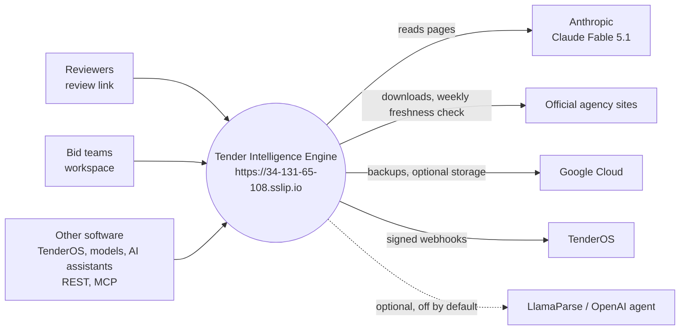
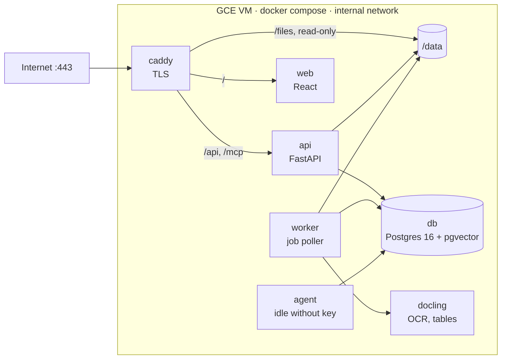
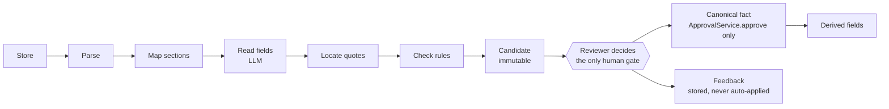

# Tender Intelligence Engine — Software Architecture

Oct 31, 2026 · Aayuda Energy

> Source: the Claude Doc at https://claude.ai/artifact/UidSACnDupA4F3GFzEFL8f. This copy is kept in git; the diagrams are redrawn in Mermaid.

## Purpose and scope

The Tender Intelligence Engine reads Indian power-sector tender documents into a structured, versioned record of 100 to 115 fields per tender. Every value carries the page and quote it came from. A model proposes the values; only a person's approval makes them facts.

It serves three kinds of user from one service:

- **Reviewers**, through a split-screen review link: PDF on one side, readings on the other.
- **Bid teams**, through the browser workspace: drop a tender, read what it requires, follow amendments, ask questions.
- **Other software**: TenderOS, financial models, optimisers and AI assistants, through REST, MCP and webhooks.

Scope today: RfS, RfP and NIT documents and their corrigenda, amendments and clarifications, for FDRE, solar, wind, hybrid, BESS, transmission, generation, EPC, RE-RTC and other power procurement. PDF (native or scanned), Word and Excel are read.

Out of scope by design:

- **Writing truth with a model.** There is no auto-approval at any confidence.
- **Training a model on corrections.** Corrections are stored to improve prompts and evaluation sets by hand.
- **Assembling a bid submission.** That is the next product, built on this one.

The code is `Ergplan/tender_engine` on GitHub, branch `main`. It runs at `https://34-131-65-108.sslip.io`. This document describes the system as of commit `ebf958d`.

## System context

Everything reaches the engine through one HTTPS address; the engine itself reaches out only to the model, to official agency sites and to Google Cloud.

The TenderOS link runs both ways: TenderOS calls the API, and the engine calls TenderOS back with signed webhooks. Documents leave the VM only to Anthropic, which reads them, and never to an embedding service.

## Principles and invariants

Eight invariants hold in every part of the code. Where a feature seems to conflict with one, the invariant wins.

| Invariant | What it means in the code | Enforced by |
| --- | --- | --- |
| The model never writes truth | Model output lands only in `candidate`; `canonical_fact` has one writer, the approval handler | `core/services/approve.py` is the only `CanonicalFact(` constructor; a database guard on the table (migration 0004) |
| Every value carries its evidence | A candidate with a value but no evidence span is rejected before a reviewer sees it; an unlocated quote is shown at capped confidence (0.3) and cannot be approved without a reviewer's page and quote | `core/services/validate.py`, `core/evidence/` |
| The tender is versioned | A corrigendum, amendment or clarification is a new `tender_version`; the current view is a projection over versions | `tender/services/tenders.py`, `current_view` |
| Candidates are immutable | An edit creates an `approval` row; the candidate is never updated; the difference is the feedback signal | Database refuses UPDATE and DELETE on `candidate` and `evidence_span` |
| Validation is deterministic | Type, range and cross-field rules in plain Python; a failure marks `needs_review` with the rule name, never hides | `core/validation/`, pack `validation/` rules |
| Everything is audited and tenant-scoped | Every table has `tenant_id`, `created_at`, `created_by`; writes to the truth tables append to `audit_log`; queries filter by tenant | `core.services.audit.record`; row-level security policies |
| Feedback is never auto-applied | Corrections are stored in `feedback`; no code path reads it to change a prompt, threshold or model | Code review and the independent review checklist |
| API first | Every operation is a versioned endpoint under `/api/v1`; the web apps call nothing else | Routes in `api/v1`; web calls only through `web/src/api/client.ts` |

Three working principles sit beside them:

- **Traceability beats speed.** When a choice trades extraction speed against evidence traceability, traceability wins.
- **One model per job, logged.** Every model call goes through `core/llm/` with a typed request, a stored prompt version and a full log row.
- **Fields come from documents.** No field exists in a schema unless a real sample tender contains it.

## Containers

One VM runs the whole system as Docker Compose services behind Caddy. Only Caddy listens on the internet; everything else talks on the internal network.

| Service | Image | Runs | Notes |
| --- | --- | --- | --- |
| `caddy` | `caddy:2` | `infra/Caddyfile` | TLS for the sslip.io name (Let's Encrypt) and the IP (internal CA); `/api` and `/mcp` to `api` with the public mark; `/files` served from `/data` after the API authorises the token |
| `api` | `Dockerfile.python` | `uvicorn api.main:create_app` | Routes, auth, rate limits, the MCP server; the only model call inside a request is `ask` |
| `worker` | same | `python -m worker.main` | Polls `job` every 2 s; parse, section map, index, extract, validate, derive, summarise, webhooks |
| `docling` | docling-serve | compose profile `parsing` | OCR and table cells for the worker, over HTTP on the internal network |
| `web` | `Dockerfile.web` | Vite | Review screen, workspace, library, admin |
| `db` | `pgvector/pgvector:pg16` | Postgres 16 | Databases `tender` (app) and `tender_ci` (tests); bound to 127.0.0.1 only |
| `agent` | same as api | `python -m agent.main` | Independent OpenAI reader; idle while no OpenAI key is set |
| `tests` | `Dockerfile.python` target `tests` | `run_checks.py` | The check runner; stopped in normal operation |

The `api` and `worker` both write to `/data`; Caddy reads it read-only. A nightly cron job outside the containers dumps the database and archives `/data` to `/work/backups`.

## Components

One monorepo, layered so the document-intelligence core knows nothing about tenders. The tender domain sits on top of it, and routes, workers and UIs sit on top of both.

| Package | Owns | Main modules |
| --- | --- | --- |
| `core/` | Domain-agnostic document intelligence: documents, pages, candidates, evidence, approval, audit, jobs, identity | `services/` ingest, inputs, parse, spreadsheet, section\_map, extract, extract\_plan, validate, approve, review\_state, audit, jobs, identity, oidc, webhooks |
| `core/llm/` | The one door to every model: typed request and response, retries, prompt registry, call log, batch API | `client.py`, `registry.py`, `prompts/<name>/vN.md` |
| `core/parsing/` | Text layers per page: pdfplumber, Docling (OCR and table cells), LlamaParse (optional, off) | `layers.py`, `docling.py`, `llamaparse.py` |
| `core/evidence/` | The quote resolver: standalone, no ORM, no settings, its own test corpus | resolver and corpus loader |
| `core/retrieval/` | Clause-aware chunks, local embeddings, hybrid search in pgvector | `chunks`, `embeddings`, `indexer`, `store`, `query` |
| `core/validation/` | Rule engine and generic rules | type, range, cross-field rules |
| `core/storage/` | Files on local disk or GCS behind one interface | `LocalStorage`, GCS |
| `tender/` | The tender domain: tenders, versions, schemas, review, amendments, publication | `services/` tenders, versioning, current\_view, review, rounds, amendment\_link, amendment\_map, amendments, classify, derive, summary, snapshot, status, submit, ask, ask\_fields, ask\_across, freshness, publication, results\_import |
| `tender/domain_packs/` | Field schemas, section prompts, validators and derivations per tender type | `core/` (common fields, prompts), `power/` (one YAML per type, released schemas v1 to v5), `result/` (award results) |
| `api/` | FastAPI app: routes only, no business logic | `main.py`, `deps.py`, `middleware/` (auth, review\_token, errors), `v1/` routers |
| `worker/` | Job poller running the chain parse, map, index, extract, validate, derive, summarise, deliver | `main.py`, `runner.py` |
| `mcpserver/` | MCP server over streamable HTTP with OAuth 2.1 or an API key | `server.py`, `tools.py`, `auth.py` |
| `agent/` | Independent second reader on another model family (OpenAI), kept but switched off | its own container |
| `web/` | React, TypeScript and Vite: review screen, workspace, library, admin | `src/review`, `src/workspace`, `src/library`, `src/admin`, `src/api/client.ts` |
| `evals/` | Gold sets, the scoring runner, reliability and question evals | `gold/`, `runner.py`, `reliability.py`, `ask_eval.py` |
| `client/` | Standard-library Python client for other products | `tender_engine_client.py` |
| `scripts/` | Management commands only | ingest\_tenders, review\_token, set\_password, blind\_check, export\_openapi, export\_contract, gen\_field\_trace, independent\_review |

Dependencies point one way: `api`, `worker` and `mcpserver` depend on `tender`, which depends on `core`. Nothing in `core` imports `tender`. The two reference repos (`tariff-oder`, `FDRE`) are never imported; code taken from them is copied with its origin noted (`docs/INHERITANCE.md`).

## The truth pipeline

A value travels from a page to a fact in nine steps, and only one of them is a person; derived fields and feedback follow from the decision. Every step before the reviewer can be re-run; nothing after the reviewer is written by a model.

| Step | Implemented by | Writes |
| --- | --- | --- |
| Store the document | `IngestService.upload`, `inputs.normalise` | `document`, file under `/data` |
| Parse | `ParseService.parse`, `core/parsing/layers.py` | `page` (text layer, boxes, render) |
| Map sections | `section_map` job, prompt `section_map/v1` | `section` |
| Read fields | `ExtractService` (`extract.select_pages`, `extract_plan.share_windows`) | `extraction_run` |
| Locate quotes | `core/evidence` resolver | `evidence_span` |
| Check rules | `ValidateService`, pack `validation/` rules | `validation_result`, candidate status |
| Candidate | `ExtractService`, database trigger blocks UPDATE | `candidate` |
| Reviewer decides | `POST /api/v1/approvals` → `ApprovalService.approve` | `approval`, `audit_log` |
| Canonical fact | `ApprovalService.approve` only; trigger `canonical_fact_guard` | `canonical_fact` |
| Derived fields | `tender_derive` job, `domain_packs/<pack>/derivations/` | derived sections (producer `DERIVED`) |
| Feedback | `ApprovalService` on an edit or rejection | `feedback` |

A candidate whose quote resolves nowhere stays visible with its reason, confidence capped at 0.3, and the reviewer cannot approve it without supplying a page and quote that resolve. A failed rule marks the candidate `needs_review` with the rule's name; it never hides it. `docs/FIELD-TRACE.md` traces each of the 218 fields through this chain: UI component, route, service, table and producer.

## Data model

One PostgreSQL 16 database with the pgvector extension, 38 tables, one Alembic history (26 migrations, head `0026`). Every table carries `tenant_id`, `created_at` and `created_by`. Candidate payloads are `jsonb`; approved facts have proper columns.

| Table | Holds | Written by |
| --- | --- | --- |
| `document`, `page`, `section` | A stored file by its SHA-256; one row per page with size, text layer and render; the section map | `IngestService`, `ParseService`, section-map job |
| `extraction_run` | One reading of one document for one tender version and field group, with prompt version and cost | `ExtractService` |
| `candidate` | A machine reading: value, confidence, rationale, prompt version, withdrawn flag; **immutable** | `ExtractService` only |
| `evidence_span` | Document, page, character range or box, quote, how it was matched; **immutable** | `ExtractService` via the resolver |
| `validation_result` | Each rule's outcome for a candidate | `ValidateService` |
| `approval` | A reviewer's decision (approve, edit, reject, not stated) with the final value and their own evidence | `ApprovalService.approve` |
| `canonical_fact` | The current approved value per field and version; **one writer** | `ApprovalService.approve` only |
| `feedback` | The difference between candidate and approval, for prompt work | `ApprovalService` |
| `audit_log` | Before and after of every write to the truth tables and identities; append-only | `core.services.audit.record` |
| `tender`, `tender_version`, `tender_version_document` | The tender, its versions (original, corrigendum, amendment, clarification) with issue dates, and which documents make each version | `TenderService` |
| `tender_field_def` | The compiled field definitions per type and schema version | `field_defs` at start-up |
| `review_token`, `tender_review_snapshot` | Review links and rounds; the record of a completed review | `TokenService`, `ReviewService` |
| `model_assumption` | Bid-model assumptions a person enters (never a candidate or fact) | `assumptions` route |
| `retrieval_chunk` | Clause-aware text chunks with a 384-dimension embedding, page, clause, version | `ChunkIndexer` |
| `job` | The work queue: kind, payload, attempts, `run_after` | `core.services.jobs` |
| `llm_call_log`, `llm_batch` | Every model call: input hash, output, model, tokens, latency, cost; batch submissions | `core/llm/` |
| `app_user`, `login_session`, `api_key`, `usage_record` | People (OIDC or password), browser sessions, API keys (hashed), metered usage | `IdentityService` |
| `oauth_client`, `oauth_code` | MCP clients registered over OAuth 2.1 | `mcpserver/auth.py` |
| `webhook_endpoint`, `webhook_delivery` | Registered receivers and each signed delivery with attempts | `core.services.webhooks` |
| `publication_hold`, `correction_case`, `watchlist_entry` | Takedowns, public corrections, a user's watched tenders | library services |
| `award` | Imported auction results (Stage 6) | `ResultsImporter` |
| `agent_run`, `agent_finding` | The independent agent's second reading (off) | `agent/` |
| `tenant` | Tenants and their plan (`enterprise`, `free`, `public`) | migrations, sign-up |

The current view of a tender is never stored. It is projected on each read from versions, candidates and approvals: each field shows its latest dated version's value and which version set it.

## Parsing and evidence

Every document is stored once, by its SHA-256, and becomes pages with a text layer and character boxes. Evidence is only as good as that layer, so each page records which layer produced it.

**Inputs** (`core/services/inputs.py`):

| Input | Becomes |
| --- | --- |
| Native PDF | Stored as is |
| PDF protected by an owner password only | Saved plain; one that needs a password to open is refused |
| Word `.docx` | Rendered to PDF, paragraphs in order, tables as one line per cell |
| Excel `.xlsx` | Rendered once, deterministically, to a text PDF: a block per row, a line per cell, so a quote resolves to the cell |
| ZIP pack | Opened member by member (at most 200 files, 600 MB unpacked); each member a document; the rest named with a reason |
| Anything else (images, old `.doc`) | Refused with the reason |

**Text layers per page** (`core/parsing/layers.py`):

| Layer | Used for | Measured on the hard set |
| --- | --- | --- |
| pdfplumber | Every native page: text and exact character boxes | 6% of scanned-page quotes, 85% of table cells |
| Docling (on the VM) | Pages without a text layer (OCR) and pages with ruled tables, whose cells are appended with their boxes | 94% of scanned-page quotes, 100% of table cells |
| LlamaParse | Optional, off; a tender's record must allow it, and documents then leave the VM | Not measured (no key) |

A page with fewer than 50 extractable characters counts as scanned. Docling runs one document at a time on the current 2-vCPU machine: about 40 seconds per scanned page. Pages are also rendered to PNG at 150 dpi with pymupdf for the review screen.

**The quote resolver** (`core/evidence/`) takes a quote, a page's text and one box per character, and returns a character range and box, or a miss. It is deterministic and imports nothing else from the system. Text is normalised for case, whitespace, quote and dash variants, ligatures, Indian thousands separators and words hyphenated across lines. Four methods are tried in order:

1. **Exact:** the normalised quote on word boundaries.
2. **Fuzzy:** rapidfuzz partial ratio of at least 85, on word boundaries, with every number in the quote present.
3. **Reordered:** the quote's words in any order over consecutive page words, numbers unchanged (wrapped table cells).
4. **Interleaved:** the quote's words in order with other words between them (side-by-side columns read line by line).

The stated page is tried first, then its neighbours, then the window. A quote that resolves nowhere is kept, shown and marked unlocated; its candidate's confidence is capped at 0.3 and it cannot be approved until the reviewer supplies a page and quote that resolve. Across the 11 gold tenders, 100% of approved evidence (634 of 634 quotes) resolved.

## Model use

All extraction, classification, summaries and answers use Claude Fable 5.1 (`claude-fable-5-1`), one model so evaluation results stay comparable. Every call goes through `core/llm/client.py`: a typed request, a Pydantic response model checked by `messages.parse`, a stored prompt version, retries, and a row in `llm_call_log` with input hash, output, tokens, latency and cost. A call refused or cut short is a failure; it is never retried on another model.

| Job | Prompt | Input | Output |
| --- | --- | --- | --- |
| Section map | `section_map/v1` | A digest of every page | Sections with page ranges and kinds |
| Type classification | `classify_type/v1` | The first eight pages, as text | A type, a state (`set`, `unsure`, `unknown`) and a calibrated confidence |
| Field extraction | `extract/v2` extended per section | Native PDF pages, at most 40: the mapped sections plus up to 12 keyword pages | Values with quotes, pages, confidence and rationale; withdrawals marked |
| Amendment mapping | `amendment_map` | The amending document | Which sections it touches, so only those are re-read |
| Summary | `summary_record` | Decided fields | A plain-English brief with markers to its evidence |
| Questions | `ask_tender/v1` | Retrieved passages only | An answer whose every claim cites a page and quote |
| Independent review | `independent_review` | A code diff, CLAUDE.md, the stage prompt | The rule-15 checklist (Claude Opus 5.5) |

Cost controls:

- **Batch API by default.** Readings nobody is waiting for go through the batch API at half price; `priority` switches a submission to direct calls.
- **Shared page windows.** Field groups whose windows overlap enough read one window once (`core/services/extract_plan.py`); the prompt cache serves repeated pages at 2.5% of the input price.
- **Re-read only what changed.** An amendment re-reads only the sections it touches.
- **No duplicate work.** An identical file returns the existing document and tender.

A 300-page RfS costs about USD 13 to read; the ledger stood at USD 503 over 1,882 calls on 28 October 2026. Questions answered from an approved or read field make no model call at all.

Prompts are versioned files (`vN.md`); a section prompt `extends` the base one. The version is stored on every candidate, so feedback can be grouped by prompt version. Changing a prompt means a new version file, never an edit in place.

## Versions and amendments

A tender is a list of versions ordered by issue date; nothing about an earlier version is ever overwritten. Amendments are the buyer's first condition, so the pipeline treats each one as a reading of its own.

**Linking** (`tender/services/amendment_link.py`). An amending document is matched to its tender by the reference it prints (for example `SECI/C&P/IPP/13/0002/26-27`, suffixes like `/Amendment-02` set aside). Without a reference, the share of the tender's title words in the document's opening decides, and links only at 0.85 or more with a 0.10 margin over the next tender. Below that the engine asks, listing candidates. A submitted amendment that names a different tender is refused unless forced.

**Ordering** (`ordered_versions`). The current version is the latest dated one, not the latest to arrive. An amendment that turns up after a later one slots in by date and every view re-projects; no reseed. The Ramagiri case, where a July clarification arrived after an October amendment, is a regression test.

**Reading** (`tender/services/amendment_map.py`). The amendment map names the sections the document touches, and only those are read. Keyword routing comes first; a section-map comparison against the base is the fallback when keywords miss. Derived sections are never routed to.

**Classifying** each change:

| Change class | Example |
| --- | --- |
| `value_changed` | PPA term 12 years to 15 years |
| `date_moved` | Bid deadline 10 Dec to 15 Jan |
| `clause_withdrawn` | Clause 40.3 tariff ceiling deleted (state `withdrawn`, distinct from `not_stated`) |
| `annexure_replaced` | Annexure G replaced by Annexure H |
| `requirement_added` | A new eligibility condition |
| `restated` | Repeated without change |

Each change carries impact notes computed from the derivation rules' inputs: "replaces a value you decided", "required field", "read by optimiser constraints / source eligibility (written again from it)", plus a numeric delta or a word-level diff.

**Review rounds** (`tender/services/rounds.py`). When a later version's reading of a reviewed tender is validated, the reviewer gets a round scoped to the fields that version changed. Earlier approvals carry forward with their provenance; nothing is reviewed twice.

**Freshness** (`tender/services/freshness.py`). Once a week the engine reads each tracked tender's source page again and reports new or changed documents (`amendment_detected`). It is report-only: nothing is ingested without a person.

## Retrieval and questions

Questions are answered from the record first and from the pages second; an answer is never written back as a fact.

**Indexing** (`core/retrieval/`). After a document's section map, the `index_document` job cuts it into clause-aware chunks, each carrying page, clause number, section, version and role. Chunks are embedded locally with `BAAI/bge-small-en-v1.5` through fastembed (384 dimensions), so no document leaves the VM to be embedded. They are stored in `retrieval_chunk` with pgvector, in the app database, under row-level security.

**Search.** Hybrid: the embedding leg and a Postgres full-text leg (every word first, then any word, at least two words) joined by reciprocal rank fusion. `EMBEDDINGS_PROVIDER=none` falls back to full text alone. Top 8 chunks by default.

**Answering** (`tender/services/ask.py`):

1. A question that names a field ("what is the EMD?") is answered from the record with no model call: the approved value if there is one, else the reading marked as machine.
2. Any other question retrieves passages, and the model answers from those passages only. Every claim cites a page and quote, and each quote is checked by the same resolver as extraction. An unresolved citation is shown as unresolved.
3. The answer is version-aware: it is given against the current version and says when an amendment changed it.

**Across tenders** (`tender/services/ask_across.py`). "Which tenders allow thermal with RECs?" is turned into a structured query over approved facts (`field_path`, `operator`, `value`), not retrieval. Unreviewed tenders are listed apart.

A 50-question evaluation set over the gold tenders exists (`evals/questions/`, `make ask-eval`); its first run is pending API credit.

## Interfaces

One API serves every caller; the web apps, the MCP server and other products are all clients of it.

| Interface | Path or place | Who uses it | Auth |
| --- | --- | --- | --- |
| REST v1 | `/api/v1/...` (OpenAPI 3.1 in `docs/contracts/openapi.v1.json`) | Everything | Review token, session cookie, API key or admin token |
| Fields snapshot, contract v1 | `GET /api/v1/tenders/{id}/fields`; JSON Schema `docs/contracts/snapshot.v1.schema.json` | TenderOS, financial model, optimiser | API key `read` |
| Webhooks | `POST /api/v1/webhooks`; events `extraction_done`, `new_version`, `review_complete`, `amendment_detected` | TenderOS and other products | API key `write`; deliveries HMAC-SHA256 signed |
| MCP | `/mcp`, streamable HTTP; OAuth 2.1 with dynamic registration and PKCE, or an API key | Claude Code; Claude.ai and ChatGPT after one fix | OAuth scopes `public:read`, `own:read`, `own:write`, or an API key |
| Python client | `client/tender_engine_client.py` (standard library) | Python products | API key |
| Function definitions | `docs/contracts/functions.v1.json` | A model given the API as tools | API key |
| Review screen | `/review/{token}` | Reviewers | The review token in the link |
| Workspace | `/workspace` | Bid teams | Password session or access key |
| Library and admin | `/tenders`, `/admin`, `/admin/reliability` | Signed-in users, administrators | Session; admin token |

MCP tools: `search_tenders`, `get_tender`, `get_field`, `get_document_page`, `find_matching_tender`, `list_changes`, `compare_tenders`, `reliability_report` (read); `ask_tender`, `get_status`, `get_changes`, `submit_tender`, `submit_amendment`, `get_review_link`, `model_tender`, `save_model_assumptions`, `my_watchlist` (paid tier, write tools need the write scope).

Contract rules:

- **Additive only.** A published property keeps its name and type and never becomes required. The `contract_drift` check fails the build on any other change.
- **Generated, not hand-written.** The OpenAPI document, the TypeScript client types (`web/src/api/schema.d.ts`) and the function definitions are exported from the running routes; `openapi_drift` fails the build when they are stale.
- **One error shape.** `{error_type, message, detail, request_id}`; clients branch on `error_type`.
- **Versioned paths.** A breaking change would be `/api/v2`, side by side with v1.

## Security and tenancy

The app is reachable from the whole internet on port 443, and scanners probed it within minutes of the HTTPS address going live. Every request is therefore resolved to a principal or refused.

**Who a request is** (`api/middleware/auth.py`), checked in this order:

| Principal | Carried as | Role and reach |
| --- | --- | --- |
| Review token | `X-Review-Token` header or cookie from the link | One tender, the reviewer's own reads and decisions; never `/admin` |
| User session | `tie_session` cookie (HttpOnly, Secure, SameSite=Lax), from a password or Google sign-in | `reviewer`, `approver` or `admin`; admin reaches everything |
| API key | `Authorization: Bearer tie_live_…`, stored hashed | Role `api_client`, a fixed list of routes, plus scopes `read`, `model`, `write`, `review:mint`; rate-limited (60 a minute, 5,000 a day by default) and metered |
| Admin token | `X-Admin-Token` | `/admin/*` only |

Requests through Caddy carry `X-Public-Request`, which a client cannot remove. A public request with no principal is refused except the health probe and the sign-in routes. A request from inside the Docker network with no identity is trusted; webhook receivers are therefore refused if they resolve to a private, loopback, link-local or in-network address, so a registered URL cannot reach back inside.

**Passwords.** scrypt with a random salt, parameters stored with the hash, at least 12 characters. One message for a wrong username or password. Five failures in 15 minutes lock that username and that address for the window.

**Tenancy.** Every table has `tenant_id`; every query filters on it; PostgreSQL row-level security binds the app's own database role (`tender_app`), which owns nothing. Migrations run as the owner role. A principal reads its own tenant plus the public library tenant. One tenant, `ergplan`, holds today's data.

**Outbound fetches.** A tender submitted by URL is fetched only from an allowlisted official domain (`infra/source-domains.yaml`), every redirect hop checked before it is requested, and the body streamed under a 200 MB cap. Bundles are capped at 600 MB unpacked before any member is read.

**Network and secrets.** Firewall: 443 open; 22 open only to Google's IAP range (`35.235.240.0/20`). Secrets live in the VM's `.env` (mode 600, gitignored) and are never committed. TLS: a Let's Encrypt certificate for `34-131-65-108.sslip.io`, renewed by Caddy; the bare IP keeps an internal-CA certificate. Documents leave the VM only to Anthropic for reading, and to LlamaParse only for a tender whose record allows it.

## Deployment and operations

The whole system runs on one Google Compute Engine VM with Docker Compose. Cloud Run manifests exist (`infra/cloudrun/`) but are not deployed.

| Item | Value |
| --- | --- |
| VM | `instance-20261004-081207`, project `tender-intelligence-510607`, zone `asia-south2-b`, e2-medium (2 vCPU, 3.9 GB, 4 GB swap, 200 GB disk) |
| Address | Static IP `34.131.65.108`; app at `https://34-131-65-108.sslip.io` |
| Code | `/work/tender_engine`, owned by `venture`; GitHub `Ergplan/tender_engine`, `main` |
| Data | Postgres volume; files under `/data` (documents by hash, page renders, the embedding model) |
| Deploy | `make deploy`: git pull, build images, migrate, `npm ci`, recreate `api worker agent web caddy`, start `docling`, health check |

**Jobs.** One Postgres-backed queue (`job`), no Redis or Celery. The worker polls every 2 seconds and claims only the kinds it has handlers for. The chain for a document: `parse` → `section_map` → `index_document` → `extract` (sync or batch, then batch collection) → validate → `tender_derive` and `tender_summary` once every run of the version is in → `webhook_deliver`. Around it: `classify_type`, `amendment_plan`, `tender_extract` (a submitted version waits for its parse and type), `source_freshness` weekly. Failed jobs retry with backoff up to their `max_attempts`.

**Backups.** Nightly at 02:30 UTC by cron (`infra/backup.sh`): `pg_dump` and a tar of `/data` kept 14 days under `/work/backups`, plus a Drive bundle with no secrets. A test restore matched live row counts. The copy to a versioned Cloud Storage bucket is written but the bucket has not been created yet, so every copy is still on the VM's own disk.

**Observability.** `/health` checks the database. Every model call is in `llm_call_log` with its cost; every API-key call in `usage_record`; every truth-table write in `audit_log`. `make logs` follows the services. There is no external alerting yet.

**Capacity.** The 2-vCPU machine reads one document at a time comfortably. Docling pushed swap to 2.1 GB under load and takes about 40 seconds a scanned page; a 400-page scanned tender would take hours. Resizing to e2-standard-4 is the documented next step when scanned volume grows.

## Quality

The last full run passed all 926 Python tests and 138 browser-unit tests. On the 11 human-reviewed tenders the engine reads 97.5% of fields correctly, but that figure is in-sample: those tenders were used while the prompts were tuned.

| Measure | Result | Scope |
| --- | --- | --- |
| Field accuracy | **97.5%** (942 fields) | 11 gold tenders, in-sample |
| Critical fields (dates, capacity, tariff, EMD, PBG, eligibility, penalties) | **98.8%** (249 fields) | Same |
| Evidence located on the cited page | **100%** (634 of 634) | Same |
| Evidence located, unseen tenders | **100%** (238 of 238 values) | 3 new tenders read under a frozen commit, not reviewed |
| Rule checks passed, unseen tenders | 99 to 100% | Same |
| Type classification, unseen | 3 of 4 right; the 4th flagged unsure, not forced | 4 new tenders |
| High-confidence misses | 10, of which 5 were one enum (`procurement_mode`), split in schema v5 | Gold set |

Only two accuracy sentences may be published, produced from the result files by `evals/reliability.py`: the in-sample figure and the evidence-location rate on unseen tenders. No other accuracy claim is made anywhere.

**Checks on every commit** (`make check`, also the pre-commit hook and GitHub Actions): ruff lint and format, mypy, pytest, vitest, `tsc`, `alembic check` (a model change without a migration fails), `openapi_drift`, `contract_drift`, and the field trace (`docs/FIELD-TRACE.md`, 218 fields, regenerated from schemas, routes and models; fails when stale). Playwright runs the review screen in a real browser; tests that call the real model are marked `slow`.

**Independent review.** Before each stage report, a reviewer in a fresh context gets only the diff, CLAUDE.md and the stage prompt, and answers a fixed checklist: invariants held, every new endpoint tested, every truth write audited, trace clean, report claims backed by code. It is rerun until it finds no new code defect. The Stage 7 review on 29 October found four defects (webhook receivers could be internal addresses, redirect hops unchecked, unbounded ZIP size, four routes untested), all fixed with tests. Since the owner chose not to use OpenAI, the reviewer is from the builder's own vendor, which is weaker than intended.

**Evaluation sets.** Gold records are completed reviews (`evals/gold/<type>/<slug>.yaml`). `make eval` scores candidates per field, per type, for critical fields and by confidence band; feedback reports group corrections by prompt version.

## Key decisions

The full log has 249 dated entries in `docs/DECISIONS.md`. These are the ones that shape the architecture, newest first.

| Date | Decision | Why |
| --- | --- | --- |
| 31 Oct 2026 | Password sign-in; app at `34-131-65-108.sslip.io` with a public certificate; the requested password "admin" not used | No identity provider is configured; the site is public, and a weak admin password would expose every tender and the model budget |
| 30 Oct 2026 | Browser workspace entered by an access key or session; API keys may read amendments and page renders | Bid teams need to drop a tender and see the analysis without the review screen |
| 29 Oct 2026 | Webhook receivers must be public addresses; every redirect hop of a submitted URL checked | Found by the independent review; requests inside the deployment are trusted |
| 28 Oct 2026 | `procurement_mode` split into stage structure and `price_discovery` (schema v5) | Half the high-confidence misses came from one enum mixing two facts |
| 27 Oct 2026 | No more human reviews; no OpenAI; blind test reported as unreviewed checks; only two accuracy sentences may be published | Owner's decision to finish fast; the claims are limited to what was measured |
| 25 Oct 2026 | Local embeddings (`bge-small`) in pgvector; Haystack-style hybrid retrieval for questions only | Documents never leave the VM to be embedded; extraction stays on section-map routing |
| 24 Oct 2026 | Docling on the VM for scanned pages and tables; LlamaParse optional and off | Measured: Docling 94% on scanned quotes vs pdfplumber 6%; LlamaParse returns no usable coordinates and sends documents away |
| 24 Oct 2026 | Versions ordered by issue date, not arrival | An amendment that arrives late must not need a reseed |
| 15 Oct 2026 | A `withdrawn` state distinct from `not_stated` | A deleted tariff ceiling and a ceiling never set mean opposite things for a bid |
| 8 Oct 2026 | Derived sections (source eligibility, optimiser constraints) computed by rules from decided fields, producer `DERIVED` | Bid tools need machine-readable constraints traceable to clauses |
| 4 Oct 2026 | One extraction model (Fable 5.1), no fallback to another model | Evaluation results stay comparable |
| 4 Oct 2026 | Section-map routing, native PDF windows of at most 40 pages, not RAG, for extraction | Tables and layout survive; accuracy measured per field |
| 4 Oct 2026 | Candidate immutability and the single canonical writer enforced in the database | The invariants hold even if application code is wrong |
| 4 Oct 2026 | Field namespace `core.<section>.<field>` and `sector.power.<type>.<field>`; one tender, one type, one pack | Stable paths are the contract other products key on |
| 4 Oct 2026 | Port 443 open to all; port 22 only to Google's IAP range | Reviewers work from changing addresses; SSH needs no open port |
| 4 Oct 2026 | Postgres-backed job queue, no Redis or Celery | One fewer moving part at this volume |
| 4 Oct 2026 | Independent review by a fresh reviewer before every stage report | The builder should not grade its own work |

## Known gaps, risks and what comes next

The largest risk is that accuracy on new tenders is unmeasured; the largest operational gap is that every backup sits on the VM's own disk.

| Gap or risk | Effect | Remedy |
| --- | --- | --- |
| Accuracy on unseen tenders not scored | 97.5% is in-sample; machine readings on a new tender are a draft until approved | Review 4 to 8 new tenders when reviews resume and score them blind |
| Backups only on the VM | A lost disk loses every decision | Create the versioned Cloud Storage bucket; the script already copies to it |
| One VM, 2 vCPU | Scanned tenders read slowly; one machine is a single point of failure | Resize to e2-standard-4; Cloud Run manifests are ready when needed |
| Independent review by the builder's vendor | Shared blind spots between builder and reviewer | Restore a different-family reviewer when an OpenAI key is available |
| Model credit runs out | Reading stops mid-tender (it did on 27 Oct) | Auto-reload on the Anthropic account; `scripts.ingest_tenders resume` recovers |
| sslip.io address | Depends on a third-party name service and shared certificate limits | Point a company domain at the IP; change `infra/Caddyfile` and `PUBLIC_BASE_URL` |
| Password sign-in without reset or second factor | A leaked password is enough | Rotate with `scripts.set_password`; add a second factor or an identity provider |
| Claude.ai and ChatGPT connectors | The OAuth consent page still sends people to Google sign-in | Point consent at the password sign-in |
| IPP tenders untested | No IPP document could be fetched | Add one IPP tender to the gold set |
| No external alerting | Failures surface only when someone looks | Uptime check on `/health`; alert on failed jobs |
| Workspace keys in browser storage | Anyone with the browser profile can use the key | One key per person, revoke on leaving; prefer password sign-in |

**Next builds**, in order:

1. **Production hardening:** the backup bucket, auto-reload of model credit, a company domain, alerting.
2. **TenderOS cross-check:** the integration in the TenderOS manual, the engine as an added check layer.
3. **Assistant connectors:** OAuth consent on the password sign-in, then Claude.ai and ChatGPT.
4. **Bid submission assembly:** the buyer's next ask, pre-filling forms from approved facts, each box citing the clause that demands it, behind a stricter sign-off than review.
5. **Benchmarking:** linking auction results from Tender Atlas to tenders, once more results are linked (34 of 623 records today).
