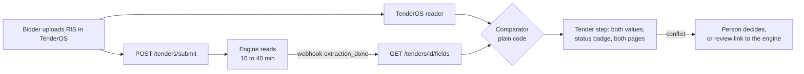

# Tender Intelligence Engine — Integration Manual for TenderOS

Oct 31, 2026 · Aayuda Energy

> Source: the Claude Doc at https://claude.ai/artifact/Ji3wZDMpvSKSBRaLJu3Dmx. This copy is kept in git; the diagrams are redrawn in Mermaid.

## What you are building

TenderOS keeps its own tender reader. The Tender Intelligence Engine reads the same tender independently, and TenderOS shows both readings side by side, flagging every field where they disagree. Nothing in TenderOS's existing extraction pipeline is removed or rewritten.

The engine is a separate service at `https://34-131-65-108.sslip.io`. TenderOS talks to it only over HTTPS with an access key. It never shares a database or imports engine code.

Three things the engine gives TenderOS that its own reader does not:

- **Human-approved values.** Where a reviewer has approved a field in the engine, that value is the reference. It outranks both machine readings.
- **Evidence that was checked.** Every value carries the page and the exact quote. The engine has confirmed the quote is actually on that page.
- **Amendment history.** Each field says which version of the tender last set it, and whether an amendment withdrew it.

The TenderOS reader and the engine share code and model ancestry, so they can make the same mistake. Agreement between the two machine readings is a signal, not proof. Only an approved value is verified.

## Access

Every call goes to `https://34-131-65-108.sslip.io/api/v1/...` with the header `Authorization: Bearer tie_live_…`. The certificate is a public Let's Encrypt one, so normal TLS verification works; never disable it.

| Item | Value |
| --- | --- |
| Base URL | `https://34-131-65-108.sslip.io/api/v1` (moves to a company domain later; keep it in config as `ENGINE_URL`) |
| Auth header | `Authorization: Bearer <key>` |
| Key for TenderOS | One key named `tenderos`, scopes `read`, `write`, `model`; add `review:mint` only if TenderOS will hand out review links |
| Rate limit | 60 calls a minute and 5,000 a day per key by default; raised per key when it is minted |
| Over the limit | HTTP 429 `rate_limited`; wait and retry with backoff |
| Where the key lives | TenderOS server environment only (`ENGINE_API_KEY`), never in the browser, never in git |

What each scope opens:

| Scope | Opens |
| --- | --- |
| `read` (always on) | Tender list, status, fields snapshot, changes, amendments, document pages, webhook list |
| `write` | Submit a tender or an amendment; register and remove webhooks |
| `model` | Questions about a tender (`ask`), which spend model credit |
| `review:mint` | A review link for a named reviewer |

The administrator mints the key on the engine VM and passes it to the team through a password manager. The secret is shown once:

```bash
cd /work/tender_engine && set -a && . ./.env && set +a
curl -s -X POST https://34-131-65-108.sslip.io/api/v1/admin/api-keys \
  -H "X-Admin-Token: $ADMIN_TOKEN" -H "Content-Type: application/json" \
  -d '{"name":"tenderos","scopes":["read","write","model"]}'
```

**Cost.** Reading a new tender spends the engine's Anthropic credit, about USD 0.045 a page (a 300-page RfS is roughly USD 13), charged once per document. Reading the fields of a tender already read costs nothing. Only submit a document once: the engine recognises an identical file by its hash and returns the existing tender instead of reading it again.

## The flow end to end

A tender is read twice, independently, and compared once both readings are in. TenderOS never waits on the engine to do its own work.



1. **Upload.** The bidder uploads the RfS in TenderOS. TenderOS reads it with its own reader, exactly as today.
2. **Submit.** In the same request handler, TenderOS sends the file to `POST /tenders/submit` and stores the returned `tender_id` on its tender record. The call returns in seconds; reading takes 10 to 40 minutes for a large RfS.
3. **Wait.** The engine sends `extraction_done` to TenderOS's webhook when every run is checked. Polling `GET /tenders/{id}/status` is the fallback.
4. **Compare.** TenderOS fetches `GET /tenders/{id}/fields`, maps each field, runs the comparator and stores both readings with a status.
5. **Show.** The Tender step shows both values, the status and both pages. Sizing and the Excel model keep running on TenderOS's values.
6. **Decide.** On a conflict, a person looks at both pages and decides in TenderOS. For a value worth fixing at the source, `POST /tenders/{id}/review-link` hands the tender to a reviewer in the engine; once approved, it comes back as `verified` everywhere.
7. **Amend.** An amendment uploaded in TenderOS goes to `POST /tenders/{id}/submit-amendment`, and the same loop runs on the changed fields.

## Endpoint reference

TenderOS needs eight calls. Paths are under `/api/v1`. The full OpenAPI 3.1 document is `docs/contracts/openapi.v1.json` in the `Ergplan/tender_engine` repo.

| Call | Method and path | Scope | Body | Returns |
| --- | --- | --- | --- | --- |
| Submit a tender | `POST /tenders/submit` | `write` | multipart: `file` **or** `source_url`; optional `tender_type`, `agency`, `title`, `external_ref`, `issued_on` (YYYY-MM-DD), `priority` | 202 `{tender_id, slug, version_no, document_id, created, status_path}` |
| Submit an amendment | `POST /tenders/{id}/submit-amendment` | `write` | multipart: `kind` (`amendment`, `corrigendum`, `clarification`), `file` **or** `source_url`; optional `issued_on`, `summary_of_change`, `force`, `priority` | 202, same shape |
| Reading status | `GET /tenders/{id}/status` | `read` | none | per version: `stage` (`submitted`, `parsing`, `mapping`, `extracting`, `validated`, `failed`); `extraction_done` |
| All fields | `GET /tenders/{id}/fields` | `read` | none | the snapshot, contract v1 (next section) |
| Amendments with impact | `GET /tenders/{id}/amendments` | `read` | none | per version: each changed field before and after, its change class and impact notes |
| Ask one tender | `POST /tenders/{id}/ask` | `model` | JSON `{"question": "…"}` | `{answer, source, answered, citations[{n, page_no, quote, resolved}]}` |
| Ask across tenders | `POST /tenders/ask` | `model` | JSON `{"question"}` or `{"field_path", "operator", "value"}` | matching tenders, approved facts only |
| Review link | `POST /tenders/{id}/review-link` | `review:mint` | JSON `{"reviewer_name": "…"}` | 201 `{url, reviewer_name, expires_at}` |

Webhooks (`POST /webhooks`, `GET /webhooks`, `DELETE /webhooks/{id}`) are in the amendments and webhooks section.

Submission rules that trip people up:

- **Send exactly one of `file` and `source_url`.** A URL must be on the agency's own site (the engine's allowlist of official domains). A news site or mirror is refused with the reason.
- **The type is optional.** Without `tender_type` the engine classifies the document first. If it is unsure, `status.type_state` says `unsure` and a person should confirm it.
- **`created: false`** means the engine already holds that exact file and returned the existing tender. Nothing is read twice.
- **An amendment that names a different tender is refused** unless `force` is true. That protects against attaching a corrigendum to the wrong tender.
- **`priority: true`** reads with direct calls instead of the batch queue: faster, about twice the cost.

Every error has the same JSON body, so handle `error_type`, never the message text:

```json
{"error_type": "validation_failed", "message": "The request did not pass validation.", "detail": "https://news.example/rfs.pdf: the host is not an official source", "request_id": "7f3c…"}
```

## The fields snapshot (contract v1)

`GET /tenders/{id}/fields` returns every field of the tender's schema, read or not, in one JSON document. The contract is additive only: a property, once published, keeps its name and type and never becomes required. Ignore properties you do not know. The JSON Schema is `docs/contracts/snapshot.v1.schema.json`.

Top level:

| Property | Meaning |
| --- | --- |
| `contract_version` | `"1"`; check it on every read |
| `tender_id`, `slug`, `title`, `issuing_agency`, `tender_type`, `external_ref` | Identity of the tender |
| `current_version` | The latest dated version (amendments arriving late slot in by date) |
| `reviewed_version` | The version a reviewer completed, or null |
| `approved`, `machine`, `not_stated` | Counts of fields by source |
| `generated_at` | When this snapshot was built |
| `fields[]` | One entry per field, below |

Each entry of `fields[]`:

| Property | Meaning |
| --- | --- |
| `path` | Stable field id, e.g. `core.guarantees.emd_per_mw_inr`. Key your mapping on this, never on `label` |
| `section`, `label` | Grouping and display name |
| `value_type` | `text`, `long_text`, `int`, `decimal`, `bool`, `date`, `enum`, `list_text`, `money_inr`, `percent`, `duration_months`, `mw`, `mwh`, `kv`, `km`, `time`, `record`, `record_list` |
| `unit` | Unit for numbers, e.g. `INR per MW`; null otherwise |
| `state` | `value` (stated), `withdrawn` (an amendment removed it), `not_stated` (the tender does not say) |
| `source` | `approved` (a reviewer decided it), `machine` (the engine's reading, not reviewed), `none` |
| `value` | The value; null when withdrawn or not stated |
| `confidence` | 0 to 1, machine readings only |
| `version_no`, `version_kind` | The version that last set this field (`original`, `amendment`, …) |
| `withdrawn_from_version` | The version that withdrew it, when `state` is `withdrawn` |
| `evidence[]` | `{document_id, filename, page_no, quote, located}` |
| `needs_review` | A validation rule flagged it |

Rules for reading it:

1. **Treat `withdrawn` and `not_stated` as different facts.** A ceiling that never existed and one an amendment deleted last week mean opposite things for a bid.
2. **Never present a `machine` value as verified.** Show its confidence; below 0.8, mark it for checking.
3. **Check `evidence[].located`.** `false` means the quote was not found on the cited page. Treat that field as unverified, whatever the confidence.
4. **Show the page.** `GET /documents/{document_id}/pages/{page_no}/render` returns the page as a PNG with the same key, so a user can see the quote in place.
5. **Do not cache a snapshot past a new version.** Re-read on the `new_version` and `extraction_done` webhooks, or when `current_version` changes.

## Field map: TenderOS to engine

Most fields need no mapping. TenderOS's reader was copied from the engine's packs, so a field with the same path in both means the same thing. Compare those directly, path to path.

The exceptions are the 22 fields TenderOS added in `engine/extraction/packs/overlay.yaml`. The engine holds most of them under another path, and some not at all. The table below is a first pass from reading both schemas. The team confirms each row against a real tender before it is used to flag conflicts.

| TenderOS field (overlay) | Engine field | Match |
| --- | --- | --- |
| `sector.power.fdre.permitted_re_sources` | `sector.power.common.source_eligibility` (derived table, one row per source) | Same meaning, different shape: build the list from rows whose eligibility is allowed |
| `sector.power.fdre.biomass_permitted` | `sector.power.common.source_eligibility`, biomass row | Same meaning |
| `sector.power.fdre.non_re_allowed` | `sector.power.common.source_eligibility`, non-RE row | Same meaning |
| `sector.power.fdre.annual_supply_min_pct` | `sector.power.re_rtc.cuf_annual_min_pct`; for FDRE `sector.power.fdre.assured_availability_percent` | Same |
| `sector.power.fdre.monthly_supply_min_pct` | `sector.power.re_rtc.cuf_monthly_min_pct` | Same |
| `sector.power.fdre.peak_supply_min_pct` | `sector.power.re_rtc.cuf_peak_min_pct` | Same |
| `sector.power.fdre.green_share_min_pct` | `sector.power.re_rtc.traceable_green_min_pct` | Same |
| `sector.power.fdre.supply_start_date` | `sector.power.re_rtc.supply_start_date` | Same |
| `sector.power.common.greenshoe_capacity_mw` | `sector.power.re_rtc.greenshoe_capacity_mw` | Same |
| `sector.power.common.greenshoe_supply_start_date` | `sector.power.re_rtc.greenshoe_ssd` | Same |
| `sector.power.common.greenshoe_offer_date` | `sector.power.re_rtc.greenshoe_exercise_deadline` | Same |
| `sector.power.fdre.peak_hours_per_day` | `sector.power.re_rtc.peak_window` or `sector.power.fdre.peak_window_definition` (text) | Partial: count the hours from the text |
| `sector.power.fdre.peak_hours_set_by` | `sector.power.re_rtc.peak_window` (text) | Partial |
| `sector.power.fdre.min_solar_capacity_multiple` | `sector.power.re_rtc.linked_capacity_obligation` (text) | Partial |
| `sector.power.common.greenshoe_same_tariff` | `sector.power.re_rtc.greenshoe_tariff_basis` (text) | Partial |
| `core.key_dates.loa_date` | `core.key_dates.loa_timeline` (text) | Partial |
| `core.key_dates.ppa_execution_date` | `sector.power.common.ppa_signing_window_days` | Partial: a window, not a date |
| `sector.power.fdre.market_sale_scope` | none | TenderOS only |
| `sector.power.fdre.ppa_priority_before_sale` | none | TenderOS only |
| `sector.power.common.part_capacity_allowed` | none | TenderOS only |
| `core.key_dates.query_response_date` | none | TenderOS only |
| `core.key_dates.document_sale_end_date` | none | TenderOS only |

How to treat each kind of row:

- **Same:** compare and flag conflicts.
- **Partial:** show the engine's text beside TenderOS's value, but do not auto-flag a conflict until a converter for that row is written and tested.
- **TenderOS only:** shown as "not cross-checked". Ask the engine owner to add the field to the engine's power pack rather than computing it in TenderOS.

Keep the map in one file in TenderOS (`engine_field_map`), versioned with the contract. The engine renamed one field in schema v5: `core.identity.procurement_mode` now means the stage and envelope structure only, and the new `core.identity.price_discovery` holds e-reverse auction or sealed bid. Map TenderOS's `procurement_mode` accordingly.

## The cross-check

For every field, TenderOS stores both readings and a status, decided by a plain comparator in code. Never use a model to compare. The first matching rule wins:

| Status | When | What the user sees |
| --- | --- | --- |
| `verified` | Engine `source` is `approved` and it equals TenderOS's value | Green; the reviewer's value with its page |
| `conflict` | Engine `approved` and it differs, **or** the two readings differ, **or** one is `withdrawn` and the other is not | Red flag; both values side by side, both pages one click away; the approved value shown as the reference when there is one |
| `agree` | Both are machine readings and they are equal | Neutral; marked as unreviewed |
| `one_sided` | One side has a value, the other has `not_stated` or no field | Amber; never passed silently |
| `not_cross_checked` | The engine is unreachable, the tender is still reading, or the field has no engine counterpart | Grey; TenderOS behaves exactly as it does today |

Normalise both values before comparing, by `value_type`:

- **Numbers and money:** to a number in the engine's unit (`INR per MW`, `percent` as 0 to 100, `mw`). Compare with a tolerance of 0.5% of the larger value, so `5,00,000` and `500000.0` agree.
- **Dates:** to ISO `YYYY-MM-DD`; drop the time unless the field is a deadline, then compare to the minute in IST.
- **Booleans and enums:** to lower-case canonical strings.
- **Lists:** lower-cased, trimmed, sorted, de-duplicated.
- **Text:** never compared for conflict. Show both; the user judges.

Store it additively. Add a new table through a new migration; alter nothing that exists:

| Column | Holds |
| --- | --- |
| `tender_id`, `field_path` | TenderOS's tender and the field, keyed on the engine path |
| `tenderos_value`, `tenderos_page`, `tenderos_quote` | TenderOS's own reading |
| `engine_value`, `engine_source`, `engine_confidence`, `engine_page`, `engine_quote`, `engine_located` | From the snapshot |
| `engine_version_no`, `engine_state` | Which version set it; value, withdrawn or not stated |
| `status`, `checked_at`, `engine_tender_id` | The comparator's result and when it ran |

Put the whole feature behind one switch, `ENGINE_CROSSCHECK=on|off`. With it off, TenderOS must behave exactly as it does today, and every existing test must still pass unchanged.

In the UI, add one column beside each requirement on the Tender step with the engine's value, its status badge and its page link. Sizing, dispatch and the Excel export keep running on TenderOS's values. The Excel model gains one column with the cross-check status of every tender input, so a reader of the model sees which inputs were verified.

## Amendments and webhooks

When a bidder uploads a corrigendum, amendment or clarification in TenderOS, send it to the engine as the next version of the same tender with `POST /tenders/{engine_tender_id}/submit-amendment`. Keep the engine's `tender_id` on TenderOS's tender record from the first submission; that is the only link between the two.

The engine then:

1. Checks the document names this tender (by reference, else title words). One that names another tender is refused unless `force` is true.
2. Slots the version in by its issue date, even if it arrives late, and re-projects the current view.
3. Reads only the sections the amendment touches, and classes each change: value changed, date moved, clause withdrawn, annexure or format replaced, new requirement, or restated.
4. Returns the changes with impact notes on `GET /tenders/{id}/amendments`, e.g. "replaces a value you decided", "required field", "read by Optimiser constraints".

Show those impact notes in TenderOS next to the changed requirement. A `clause_withdrawn` on a field the sizing uses must stop the run until a person looks at it.

### Webhooks instead of polling

Register one receiver URL on TenderOS's server for the events you want. The URL must be a public HTTPS address. Private or in-network addresses are refused unless the engine is told otherwise (`WEBHOOK_ALLOW_PRIVATE`, for a receiver on the same Docker network).

```bash
curl -s -X POST $ENGINE_URL/webhooks -H "Authorization: Bearer $ENGINE_API_KEY" \
  -H "Content-Type: application/json" \
  -d '{"url":"https://tenderos.example/hooks/engine","events":["extraction_done","new_version","review_complete"],"secret":"<32+ random characters>"}'
```

| Event | Sent when | Payload (besides `event`, `occurred_at`) |
| --- | --- | --- |
| `extraction_done` | Every run of a version has finished and been checked | `tender_id`, `slug`, `version_no` |
| `new_version` | A version was added to a tender | `tender_id`, `slug`, `version_no`, `kind`, `issued_on`, `document_id`, `filename` |
| `review_complete` | A reviewer completed a review | `tender_id`, `slug`, `snapshot_id`, `reviewer`, `round_no` |
| `amendment_detected` | The weekly check of official sites found a new document for a tender the engine tracks; nothing is read | `tender_id`, `slug`, `page_url`, `new`, `changed` |

Every delivery is a JSON `POST` with headers `X-Tender-Event`, `X-Tender-Delivery` and `X-Tender-Signature: t=<unix seconds>,v1=<hex HMAC-SHA256 of "<t>.<raw body>">` keyed with your secret. Your receiver must:

- Verify the signature over the raw body before parsing, and reject a timestamp older than 5 minutes (`verify_webhook` in `client/tender_engine_client.py` does both).
- Answer 2xx within 15 seconds, then do the work in the background. Anything else is retried six times with backoff, then marked failed.
- Be idempotent on `X-Tender-Delivery`: a retry can arrive after a slow success.
- On any event, re-read `GET /tenders/{id}/fields` rather than trusting the payload for values.

As a safety net, poll `GET /tenders/{id}/status` every 30 seconds while a TenderOS user is watching a tender that is still reading.

## Code

TenderOS has a Python engine (`engine/app.py`, FastAPI) and a Next.js web app. Put every engine call in the Python side; the browser never sees the key.

### Python: submit, wait, fetch

Copy `client/tender_engine_client.py` from the engine repo into `engine/crosscheck/`. It uses the standard library only.

```python
import os
from engine.crosscheck.tender_engine_client import TenderEngine, TenderEngineError

engine = TenderEngine(os.environ["ENGINE_URL"], os.environ["ENGINE_API_KEY"])

# 1. Submit TenderOS's uploaded RfS (path on disk) or its official URL.
made = engine.submit_tender(file="/data/uploads/rfs.pdf", tender_type="re_rtc", agency="WBSEDCL")
engine_tender_id = made["tender_id"]          # store on TenderOS's tender record

# 2. Wait: webhooks in production; this poll is for scripts and tests.
status = engine.wait_until_done(engine_tender_id, poll_s=30)

# 3. Read every field.
snapshot = engine.fields(engine_tender_id)
assert snapshot["contract_version"] == "1"
by_path = {f["path"]: f for f in snapshot["fields"]}
```

### Python: the comparator

```python
TOLERANCE = 0.005  # 0.5% of the larger value
NUMERIC = {"int", "decimal", "money_inr", "percent", "duration_months", "mw", "mwh", "kv", "km"}

def normalise(value, value_type):
    if value is None:
        return None
    if value_type in NUMERIC:
        return float(str(value).replace(",", ""))
    if value_type == "date":
        return str(value)[:10]
    if value_type in {"bool", "enum"}:
        return str(value).strip().lower()
    if value_type == "list_text":
        return sorted({str(v).strip().lower() for v in value})
    return None  # text, long_text, records: shown, never compared

def same(a, b, value_type):
    if value_type in NUMERIC:
        return abs(a - b) <= TOLERANCE * max(abs(a), abs(b), 1e-9)
    return a == b

def status(tenderos_value, engine_field):
    if engine_field is None:
        return "not_cross_checked"
    vt = engine_field["value_type"]
    ours = normalise(tenderos_value, vt)
    theirs = normalise(engine_field["value"], vt)
    if engine_field["state"] == "withdrawn":
        if ours is not None:
            return "conflict"  # TenderOS still holds a value the amendment removed
        return "verified" if engine_field["source"] == "approved" else "agree"
    if ours is None and theirs is None:
        return "not_cross_checked" if vt not in NUMERIC | {"date", "bool", "enum", "list_text"} else "agree"
    if ours is None or theirs is None:
        return "one_sided"
    match = same(ours, theirs, vt)
    if engine_field["source"] == "approved":
        return "verified" if match else "conflict"
    return "agree" if match else "conflict"
```

Test this comparator against every status before wiring it: one test per row of the status table, plus the normalisation cases (`5,00,000` against `500000.0`, a list in a different order, a withdrawn field on one side).

### Python: the webhook receiver

```python
from fastapi import BackgroundTasks, Header, HTTPException, Request
from engine.crosscheck.tender_engine_client import verify_webhook

@app.post("/hooks/engine")
async def engine_hook(request: Request, tasks: BackgroundTasks,
                      x_tender_signature: str = Header(...), x_tender_delivery: str = Header(...)):
    body = await request.body()
    if not verify_webhook(os.environ["ENGINE_WEBHOOK_SECRET"], x_tender_signature, body):
        raise HTTPException(401)
    if already_seen(x_tender_delivery):          # idempotent on the delivery id
        return {"ok": True}
    event = json.loads(body)
    tasks.add_task(refresh_crosscheck, event["tender_id"])   # re-reads /fields, re-runs the comparator
    return {"ok": True}
```

### Next.js: the page reads TenderOS, not the engine

The Tender step calls TenderOS's own API (for example `GET /api/tenders/{id}/crosscheck`), which returns the stored rows from the cross-check table. Only the page image is fetched live, through a TenderOS route that adds the key on the server:

```js
// web/app/api/tenders/[id]/engine-page/route.js
export async function GET(req) {
  const { searchParams } = new URL(req.url);
  const doc = searchParams.get("document"), page = Number(searchParams.get("page"));
  const res = await fetch(`${process.env.ENGINE_URL}/api/v1/documents/${doc}/pages/${page}/render`, {
    headers: { Authorization: `Bearer ${process.env.ENGINE_API_KEY}` },
  });
  if (!res.ok) return new Response(null, { status: res.status });
  return new Response(res.body, { headers: { "Content-Type": "image/png", "Cache-Control": "private, max-age=86400" } });
}
```

Check in that route that the document belongs to a tender the signed-in TenderOS user may see, before fetching it.

## Errors, testing and go-live

Handle these `error_type` values; everything else is logged with its `request_id` and shown as "engine unavailable":

| HTTP | `error_type` | Meaning | TenderOS does |
| --- | --- | --- | --- |
| 401 | `api_key_invalid` | Key wrong or revoked | Alert the admin; switch the cross-check to `not_cross_checked` |
| 403 | `not_allowed` | The key lacks the scope | Fix the key's scopes, not the code |
| 404 | `not_found` | Unknown tender or document | Clear the stored `engine_tender_id`; resubmit |
| 422 | `validation_failed` | Bad input; `detail` says why (non-official URL, wrong file type, amendment for another tender) | Show `detail` to the user |
| 429 | `rate_limited` | Over 60 a minute or 5,000 a day | Retry with backoff: 2, 4, 8, 16 s |
| 502 | `model_unavailable` | The model call failed, often the engine's API credit | Retry later; tell the engine owner |
| 503 | `dependency_unavailable` | A service inside the engine is down | Retry with backoff; TenderOS carries on without the check |

### Testing

- **Unit:** the comparator, one test per status and per normalisation case. No network.
- **Contract:** load `docs/contracts/snapshot.v1.schema.json` from the engine repo and validate a recorded snapshot against it in CI, so a contract change breaks TenderOS's build, not production.
- **Integration:** record real responses for one gold tender (WBSEDCL RE-RTC is reviewed in the engine and built into TenderOS) and replay them with a mock HTTP transport.
- **End to end:** once, against the live engine with a test key: submit, wait for `extraction_done`, compare, render a page. A new tender costs real model credit, so reuse an existing one by submitting the identical file (`created: false`).
- **Switch off:** with `ENGINE_CROSSCHECK=off`, the full existing TenderOS suite passes unchanged.

### Go-live checklist

- [ ] A `tenderos` key minted with `read`, `write`, `model`; stored only in the TenderOS server's environment
- [ ] `ENGINE_URL`, `ENGINE_API_KEY`, `ENGINE_WEBHOOK_SECRET`, `ENGINE_CROSSCHECK` in TenderOS's `.env.example`, documented
- [ ] Field map reviewed row by row against one real tender
- [ ] New table added by a new migration; no existing table altered
- [ ] Comparator and contract tests green in CI
- [ ] Webhook receiver on a public HTTPS URL, signature checked, idempotent
- [ ] One end-to-end run on the live engine recorded in the PR
- [ ] Excel export carries the cross-check status column
- [ ] The engine owner has confirmed the Anthropic API account has credit with auto-reload

### Rules that must not be broken

1. **Nothing in TenderOS's own extraction pipeline is deleted or rewritten.** The engine is an added layer, behind a switch.
2. **A machine reading is never shown as verified.** Only `source: approved` is.
3. **TenderOS never calls a model to compare readings.** The comparator is plain code.
4. **The key never reaches a browser, a log line or git.**
5. **A conflict is never resolved silently.** A person decides, in TenderOS or in the engine's review screen.
